# 0002 · Visual direction

Milestone: #4 (part of #2). MySous's visual direction, settled by looking at real renders of the Ingredient Pairings screen (Lime) instead of describing them. It took three prototype rounds, each in light and dark at phone (390px) and desktop (1280px) widths, with the author choosing at every round.

**Final direction: Botanical line → Garden colour → Soft serif.** Single-line Ingredient drawings, each Ingredient in its own colour, gentle motion, Nunito for text and a soft Fraunces for headings.

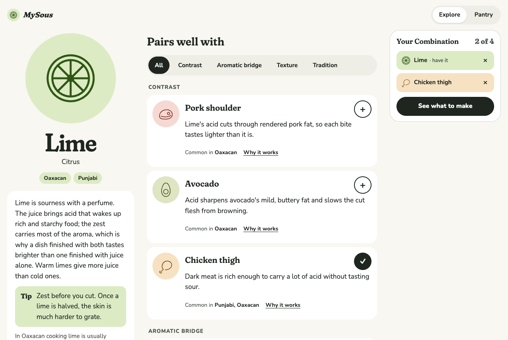
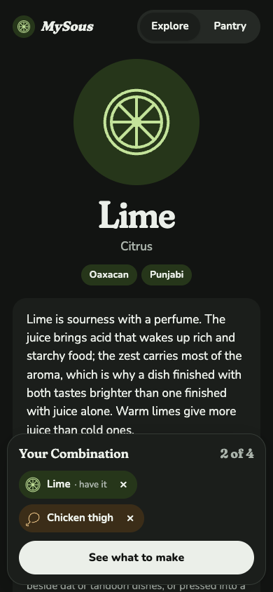

## Decisions

**Type: Fraunces for headings, Nunito for everything else.** Fraunces is set at its softest (`SOFT` 100, `WONK` 0, optical size up to 144) at weight 600 for the Ingredient name, section headings, Pairing names and the tray title, with an italic 700 for the wordmark. Nunito, a rounded humanist sans, carries body text, controls and labels. The author's reason for the serif: "the serif lends credibility and gives it an editorial authority." The rounded body keeps the calm, approachable tone the voice guide asks for.

**Colour: each Ingredient has its own colour; the interface stays neutral.** Every Ingredient carries a wash and a stroke colour, with separate values for light and dark (lime is a soft green, radish pink, dried chile red, chaat masala ochre). Its drawing always sits on its own wash: on the page's hero plate, beside each Pairing, and in the Combination tray. Buttons, filters and text use neutral ink tokens, so the colour always identifies an Ingredient and never signals a state. Dark mode swaps the token values; it isn't a separate set of styles.

**Imagery: illustration stays.** Every Ingredient has a single-line drawing on a shared 48-unit grid, with one stroke weight (1.75) and round caps and joins. Drawings appear large on the Ingredient page and small on every Pairing row and tray item. Photography stays limited to Showcase Recipes, as #2 says.

**Motion: gentle, only on first paint or on the thing that changed.** The hero drawing draws itself in (about 1.4s, ease-out), Pairing rows settle in with a 45ms stagger, and an added Ingredient grows into the tray (0.4s, with a slight overshoot). Interactions after first paint don't replay any of this. Under `prefers-reduced-motion`, all of it is turned off.

**Layout: three columns on desktop, a bottom sheet on a phone.** On desktop: a sticky Ingredient column (drawing, name, Cuisines, essay, tip), Pairings filtered by a segmented Pairing Reason control, and the Combination tray as a sticky side panel. On a phone, the same content stacks, with the tray as a floating bottom sheet.

**Contrast is checked on what renders, not only on the tokens.** Every prototype frame ran an in-page WCAG 2.2 AA audit. It walks each element with its own text, composites the backgrounds behind it, and checks the result against 4.5:1, or 3:1 for large text. All 11 variants passed in both themes at both widths, so no direction won on looks alone. The final direction's lowest ratio is 5.99:1 light and 6.00:1 dark. Non-text contrast (SC 1.4.11: drawing strokes on their washes, control borders) was not audited; it belongs in the design system (#14).

## The rounds

| Round | Variants | Winner |
| --- | --- | --- |
| 1 | A Editorial cookbook · B Botanical line · C Modern utility | B |
| 2 | B1 Garden colour · B2 Herbarium · B3 Quiet line, against B as the baseline | B1 |
| 3 | R3a Ingredient flood · R3b Soft serif · R3c Fridge first, against B1 as the baseline | R3b (final) |

## Rejected variants

The author chose each winner. Except where quoted, the reasons below were **drafted by Claude from the renders** and are waiting for the author's review.

### Round 1

**A · Editorial cookbook.** A serif long-read on warm paper, with Pairing Reasons as numbered chapters of prose and Cuisines in the margin. *Draft reason:* it had the most authority, but its prose-first structure buried the Pairings below an essay, which is the opposite of the core task: scanning Pairings and building a Combination. Its strength came back in round 3 as the soft serif headings.

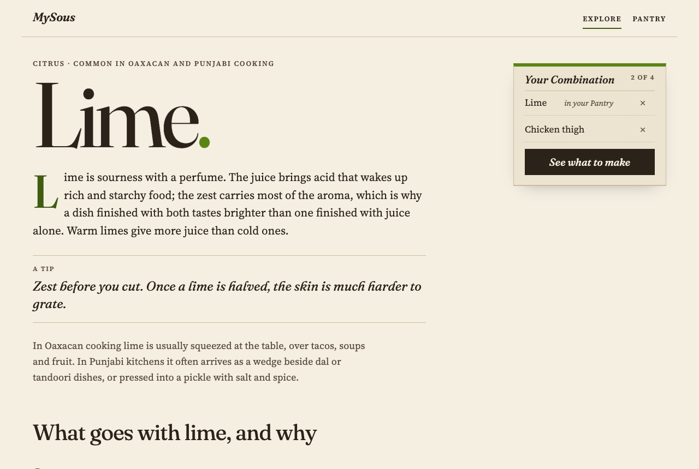 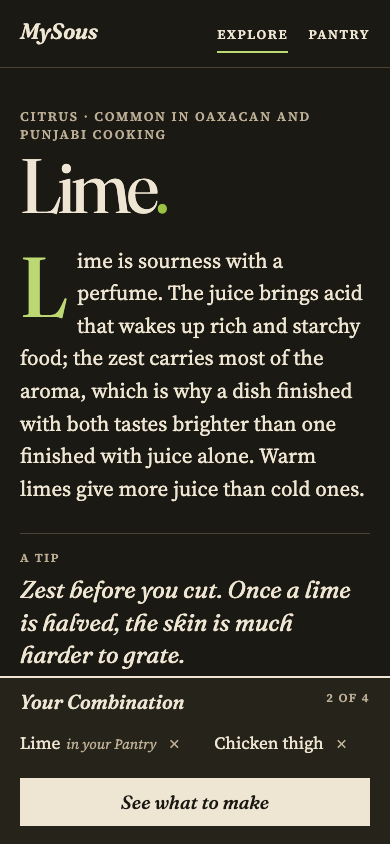

**C · Modern utility.** A dense board in a heavy grotesque, with Pairing Reasons as solid colour columns. *Draft reason:* the fastest to scan, but loud and impersonal. Four saturated blocks compete with the Ingredient for attention, and the tone is at odds with a calm, well-travelled sous chef.

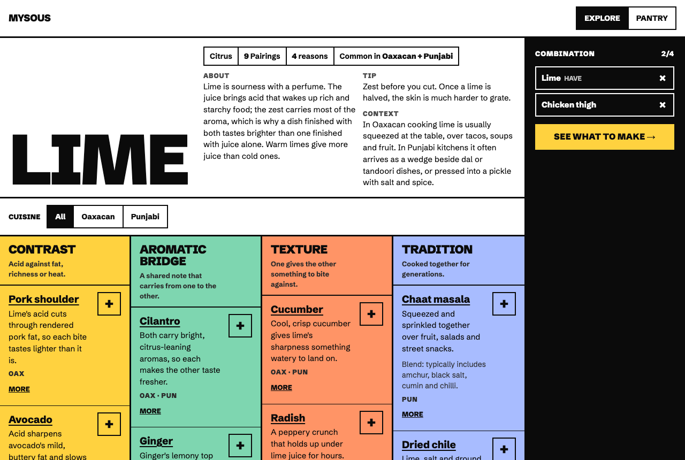 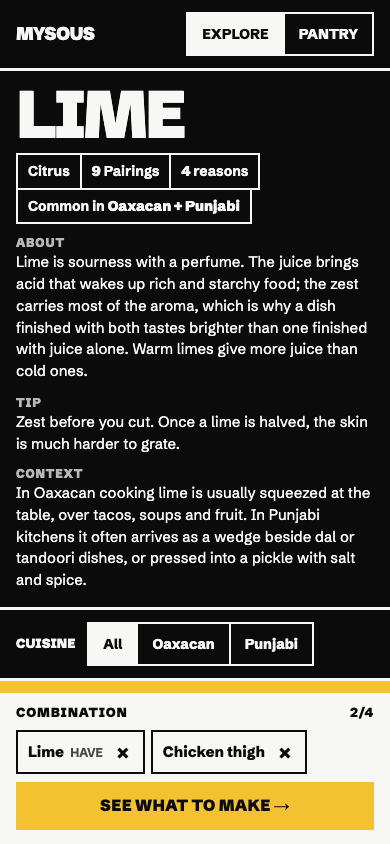

The round-1 winner, for reference:

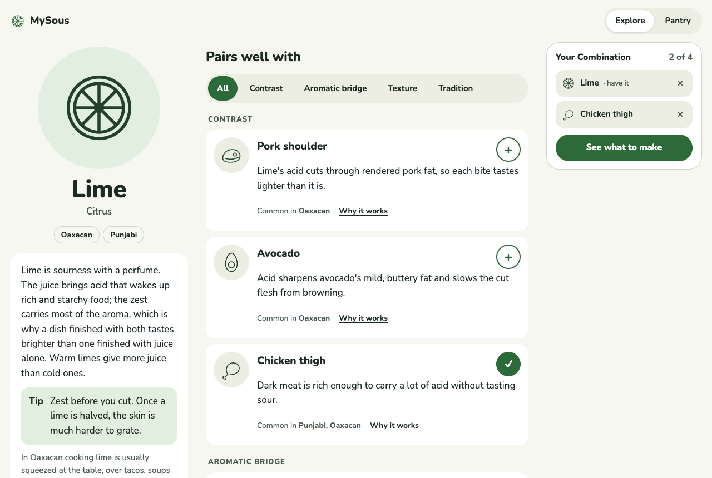 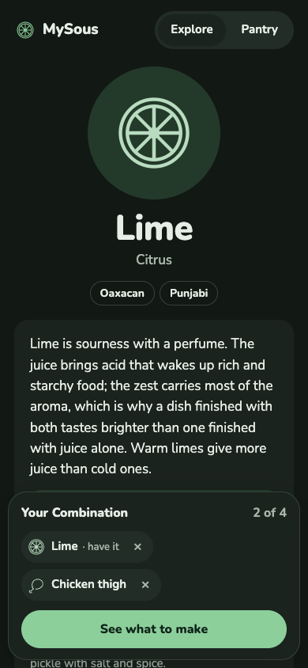

### Round 2

**B2 · Herbarium.** A large specimen tile for each Pairing, in monochrome ink on paper. *Draft reason:* charming, but the tiles cost density (about three Pairings per desktop screen), and dropping colour lost the warmth that B1 gets from its Ingredients.

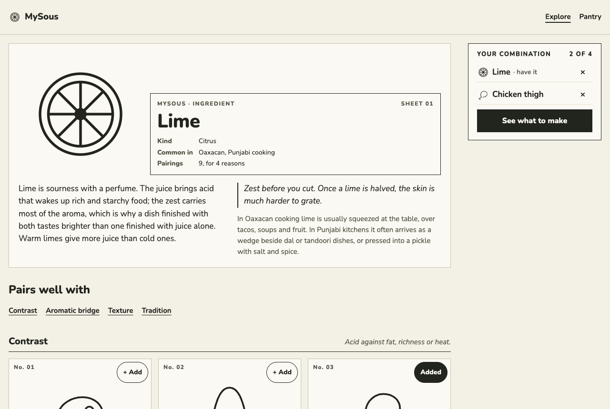 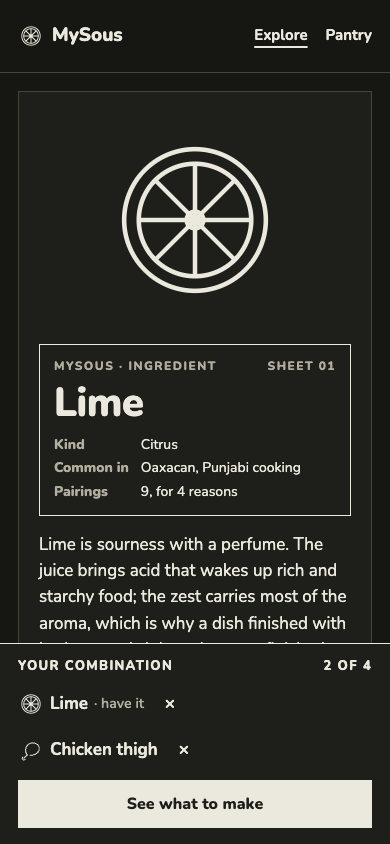

**B3 · Quiet line.** Drawings only beside the Ingredient's name and in the tray; text rows keyed by a colour per Pairing Reason, set in Figtree. *Draft reason:* taking the drawings out of the rows removed what made Botanical distinctive, and a second colour system, keyed by Pairing Reason, would compete with Ingredient colour.

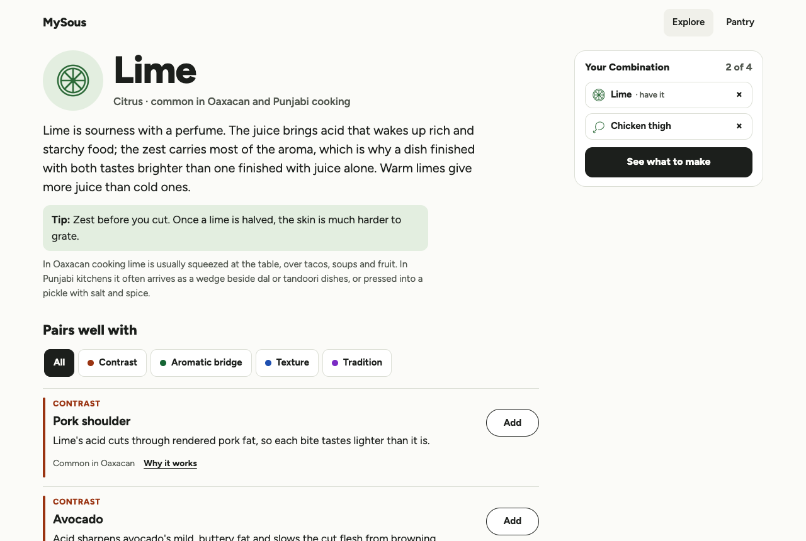 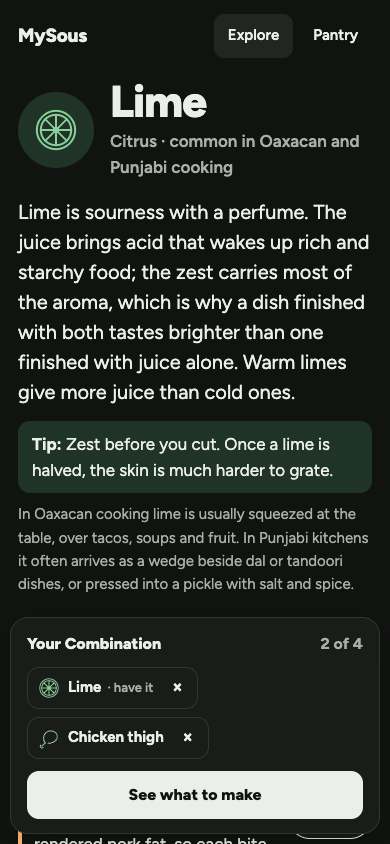

The round-2 winner, for reference:

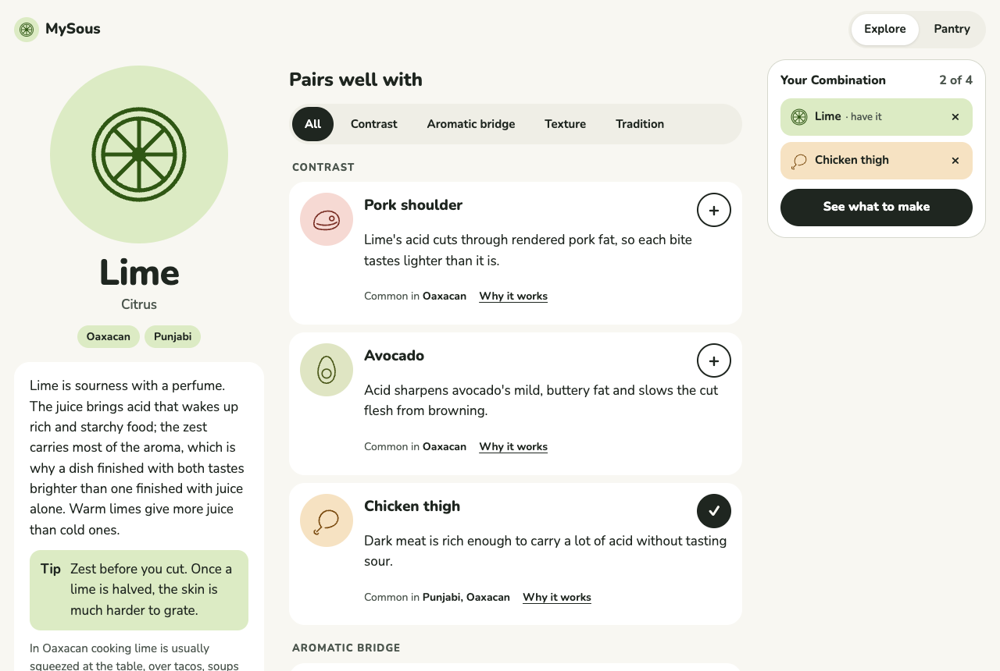 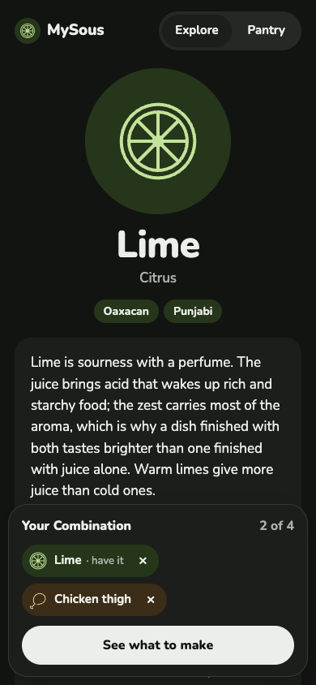

### Round 3

**R3a · Ingredient flood.** The Ingredient's colour fills a full-width header band. *Draft reason:* the strongest identity of any variant, but the band pushes the Pairings below the first desktop screen. With about 100 Ingredients, it also makes every page a different colour.

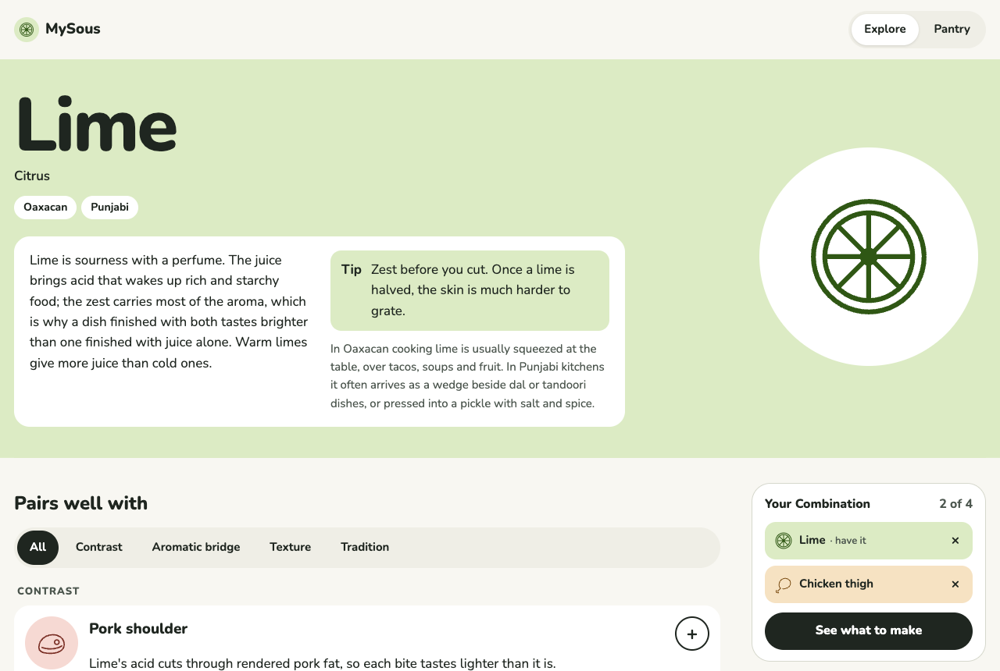 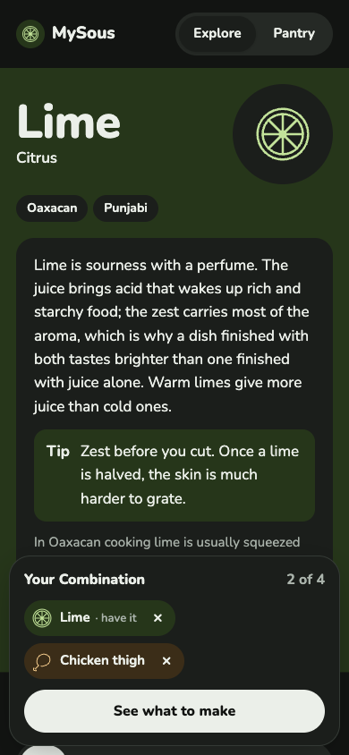

**R3c · Fridge first.** A compact header, the essay behind "About lime", a filter that stays at the top while you scroll, and a slim tray. *Draft reason:* it changes layout, not visual direction, so it answers a different question than the author was settling. Its finding still stands: on a 390px phone it puts the first Pairings on the first screen, and B1 doesn't. Polish (#15) should weigh that.

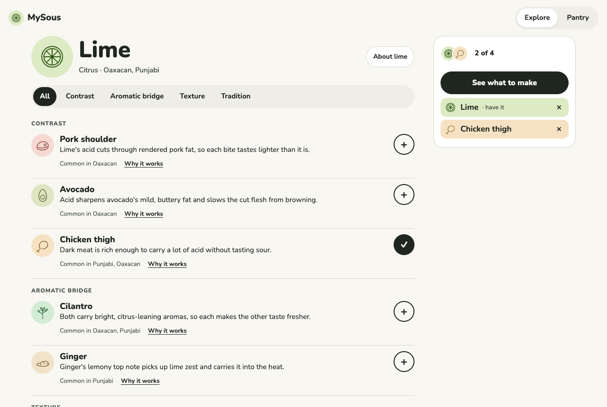 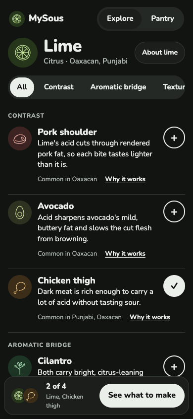

## Consequences

- **Every Ingredient needs a drawing and a colour pair.** That joins the content workload (ADR 0001): each new batch of Ingredients needs drawings on the shared grid and wash and stroke colours checked in both themes. The content format will need fields for both, or a lookup keyed by Ingredient id.
- **The design system (#14) starts from these values:** Fraunces and Nunito, the neutral ink and surface tokens, the Ingredient colour pairs, the drawing grid and stroke, and the three motion patterns. It also takes on the non-text contrast check.
- **Phone layout is still open.** R3c showed that B1's phone layout pushes the Pairings below the first screen. That's for #15 to resolve, not a reason to reopen the visual direction.

## Primary sources

The prototypes are throwaway and never merge to `main`. Each round's branch has a side-by-side board (`prototype/visual-direction/index.html`) with the live contrast audit:

- Round 1: `prototype/visual-direction`, with one branch per variant: `prototype/editorial-cookbook`, `prototype/botanical-line`, `prototype/modern-utility`.
- Round 2: `prototype/visual-direction-r2`, with `prototype/botanical-garden`, `prototype/botanical-herbarium`, `prototype/botanical-quiet`.
- Round 3: `prototype/visual-direction-r3`, with `prototype/garden-flood`, `prototype/garden-serif`, `prototype/garden-fridge`.

The sample content in the prototypes is realistic in shape but not researched; it must not be reused as real content.
