# 0008 · Design system

Milestone: #14 (part of #2). The visual direction from 0002 (Botanical line → Garden colour → Soft serif) becomes tokens and components, and every existing screen adopts them, without final polish yet (#15, #16).

## Before and after

| Screen | Before | After |
| --- | --- | --- |
| Home, desktop light | 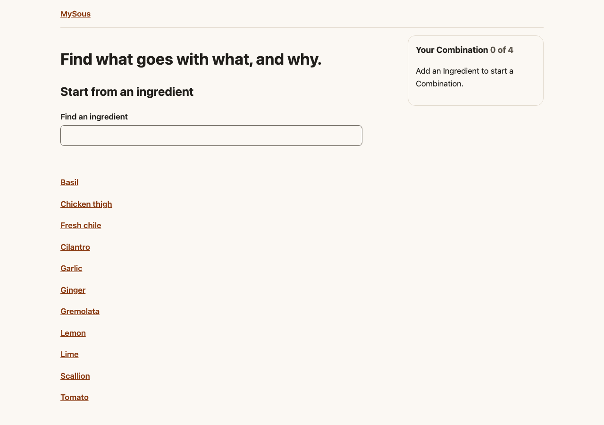 | 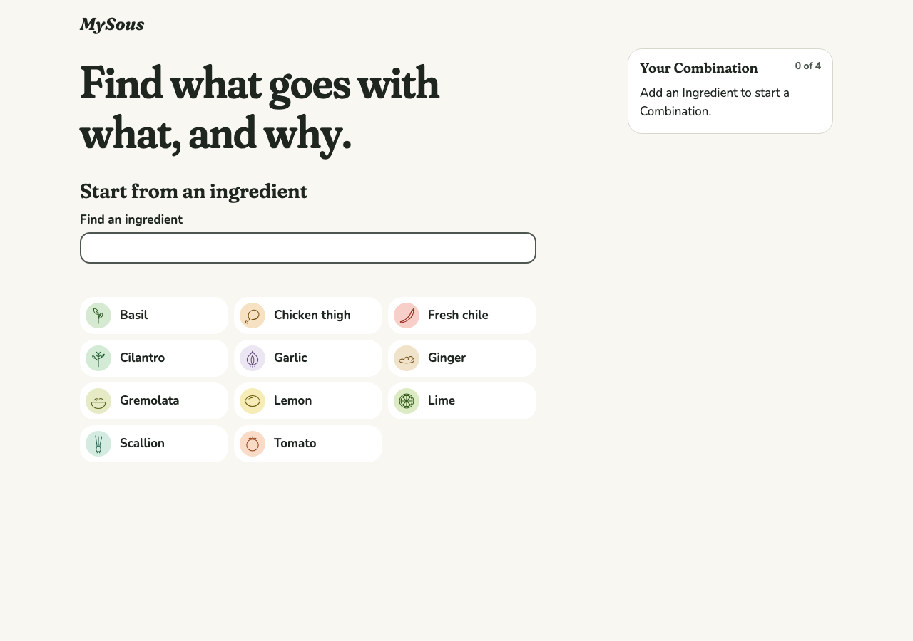 |
| Ingredient, desktop light | 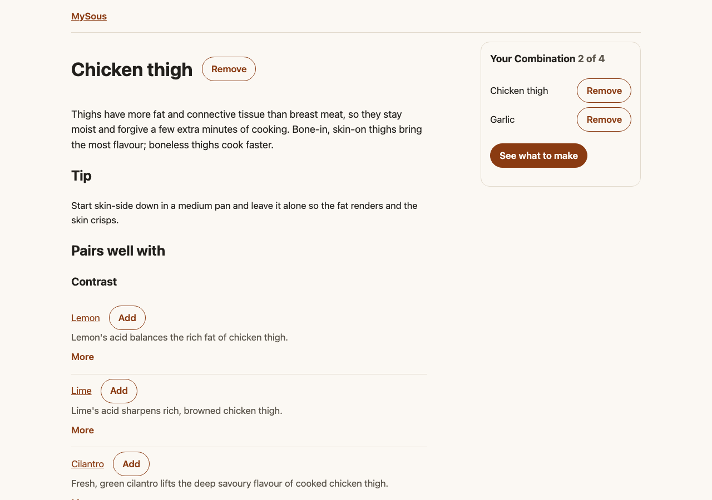 | 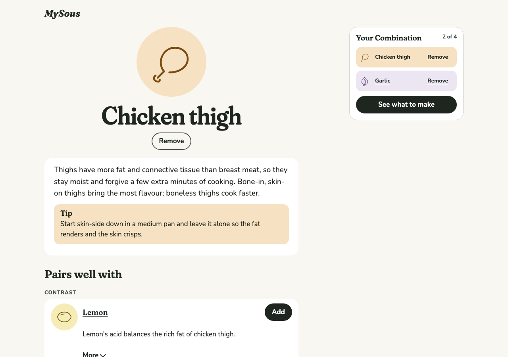 |
| Ingredient, phone dark | 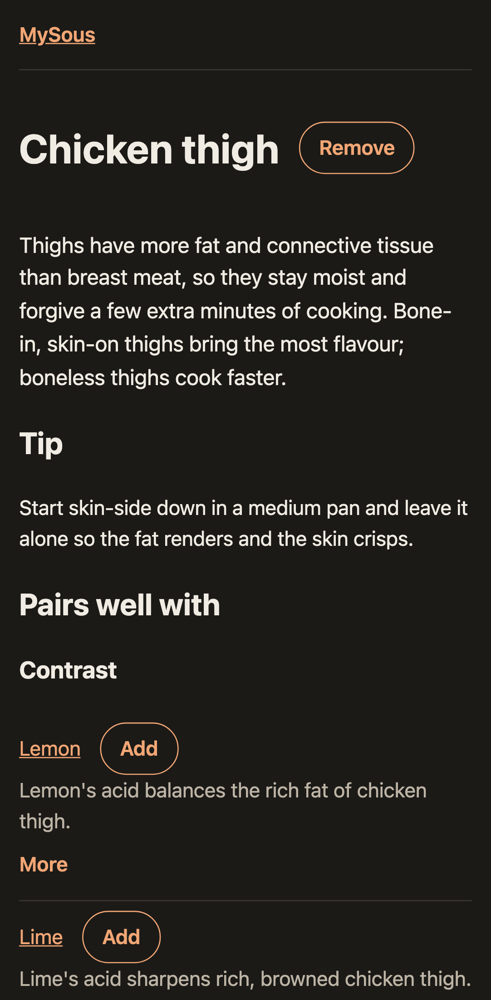 | 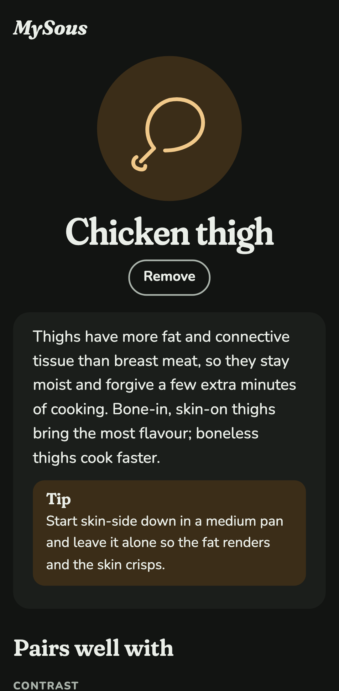 |
| Suggestions, phone dark | 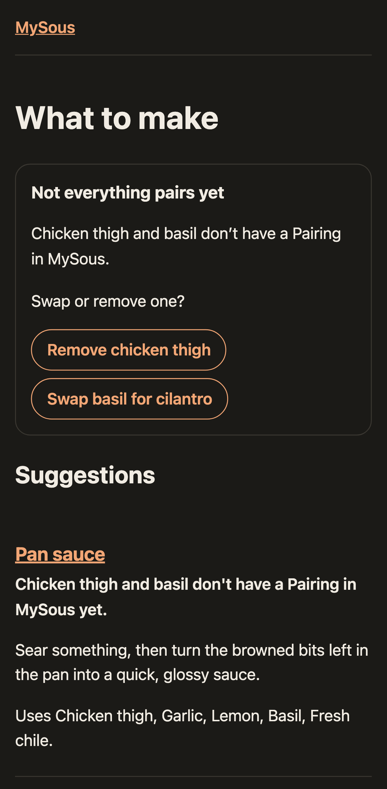 | 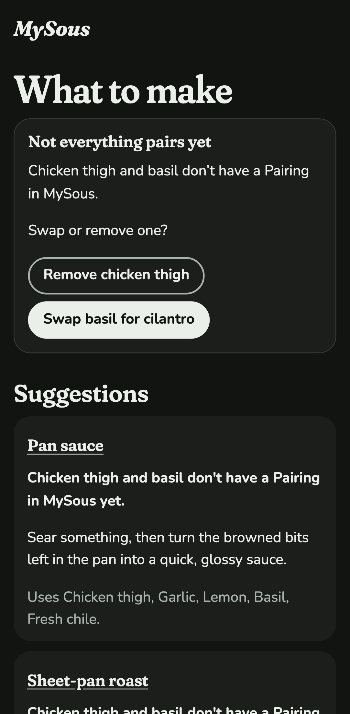 |
| Formula, desktop light | 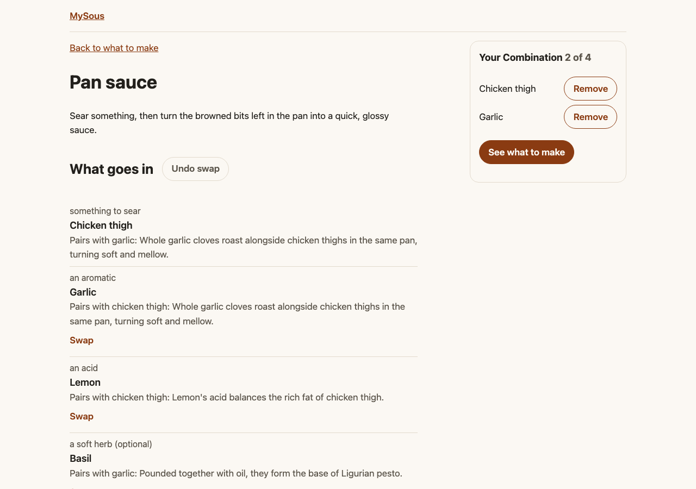 | 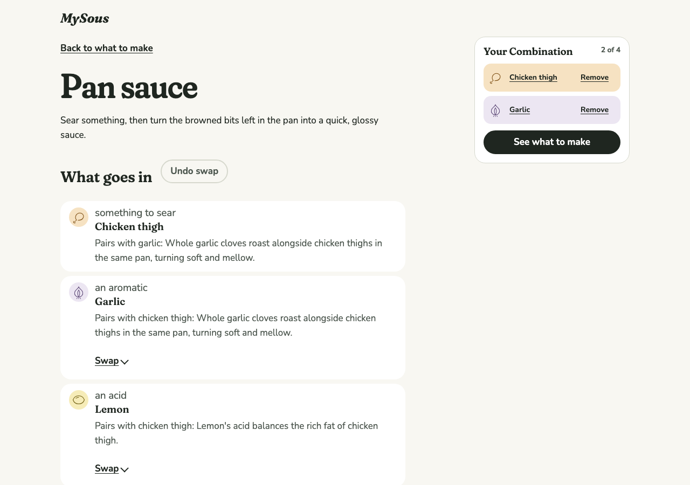 |
| Design specimen, desktop light | (new) | 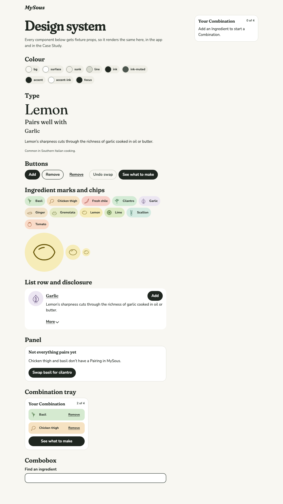 |

All shots (4 screens × desktop light and phone dark, before and after, plus the specimen in both) are in `0008-design-system/`.

## Decisions

**Tokens live in one TypeScript module, which generates the CSS.** `src/design/tokens.ts` holds every colour, type, spacing, radius, elevation, motion and focus value; the layout injects `themeCss()` into the head. Keeping them in TypeScript means the same values feed the CSS and the contrast checks, so the two can't drift. Dark is a swap of the colour tokens under `prefers-color-scheme`; nothing else changes between themes. Ingredient colours arrive per element as `--wash-light`, `--wash-dark` and so on, and one `.hue` rule in the generated CSS picks the pair for the theme, so no component has its own dark styles.

**A test keeps raw values out of the stylesheets.** Review found weights, letter-spacing, border widths and mark sizes still written out in component CSS, so "all values come from tokens" was a hope rather than a rule. Now every value is a token, and a Vitest test fails on any colour or px/rem length in any stylesheet. The one exception is media queries, which can't read custom properties.

**Contrast is checked by a test, not by eye.** Every foreground and background pairing used for text must reach 4.5:1 in both themes, and control borders, focus rings and primary buttons 3:1 (SC 1.4.11, which 0002 left to this ticket). The same test loads the real content and checks every Ingredient's colours: text on its wash at 4.5:1 and its drawing's stroke on its wash at 3:1, in both themes. A new Ingredient with a weak colour fails CI.

**Ingredient colours and drawings are content.** 0002 noted that each Ingredient needs both. Colours are frontmatter (`wash`, `washDark`, `stroke`, `strokeDark`), and each drawing is `content/ingredients/<id>.svg`: the inside of a 48-unit SVG, one stroke weight, round caps. Drawings are rendered as markup, so validation only lets in self-closing shapes (path, circle, ellipse, line, polyline, rect) with geometry attributes; scripts, event handlers, images and links fail the build. Four drawings and colours come from the prototype (lime, chicken thigh, cilantro, ginger); seven are new in the same style (tomato, basil, garlic, lemon, scallion, fresh chile, gremolata), and are first drafts for the author to review.

**Type: Fraunces at its softest for headings, Nunito for everything else.** Both load through `next/font`, so they're self-hosted in the static export with no request to Google at runtime. Headings use `SOFT` 100 and `WONK` 0, and the page title adds optical size 144; the wordmark is Fraunces italic 700, from the real italic (review caught it as a slanted roman at first). Drawings keep 0002's single stroke weight of 1.75 at every size.

**Core components take props only.** Button, Chip, Disclosure, Panel, ListRow, IngredientMark, Combobox and TrayView never read the URL or the Kitchen; containers (the tray, the search) pass them data. `/design`, a specimen page that isn't linked from the app, renders each from fixture props, and a Playwright test removes an Ingredient from its tray without the URL changing. This is what the Case Study embeds need (ADR 0002). The screen-level containers (Suggestions, Formula) still read the URL; splitting those stays deferred.

**Focus, targets and motion are rules, checked in the browser.** One focus ring everywhere (3px, `--focus`, 2px offset), checked by tabbing through every screen in both themes and comparing each focused element's ring style, width and colour against the token. The combobox's active option draws the same ring inside itself. The ring also has to reach 3:1 against every Ingredient wash, since controls sit on them. Every button, field, disclosure and option is at least 44px (`--target`) at phone width, and every standalone link at least 44px tall; links in running text are exempt, as WCAG 2.5.8 allows. That check found "Back to what to make" at 23px. Motion durations are tokens that become 0ms under `prefers-reduced-motion`. The draw-on hero, settling rows and growing tray from 0002 are #15's, built on these tokens.

## Alternatives considered

- **A CSS file of tokens, parsed by the contrast test.** Rejected: parsing CSS to test it is fragile, and TypeScript gives the components and tests typed access to the same values.
- **Drawings inline in frontmatter.** Rejected: SVG markup in YAML is hard to write and review; a separate `.svg` file opens in any editor and previews in GitHub.
- **A drawing per Ingredient as a React component.** Rejected: drawings are content that grows in batches (ADR 0001), not code.

**Screens adopt the system without changing their structure.** The Ingredient page gains its drawing on a plate and Cuisine chips, but keeps its heading outline ("Tip" and "Cultural context" stay headings), and the search field before hydration stays disabled. Restructuring is #15's and #16's, with their own review gates.

## Open

- The seven new drawings and colours are drafts. The author should review them; each needs only its `.svg` and four colour values changed.
- The phone layout still stacks the tray at the foot of the page; the bottom sheet is #15.
