# 0009 · Ingredient page and Combination tray

Milestone: #15 (part of #2). The Ingredient page and the Combination tray reach the layout and motion settled in 0002: three columns on desktop, and on a phone a bar that opens the tray as a sheet.

## Before and after

The first two "before" shots are 0008's "after" shots, which are what `main` showed when this work began; the 320px and zoomed ones were taken from `main` for this entry. Each shows Chicken thigh with chicken thigh and garlic in the Combination (and lemon and basil too at 320px). Before, a phone showed the Combination only at the very end of the page.

| Screen | Before | After |
| --- | --- | --- |
| Ingredient, desktop light | 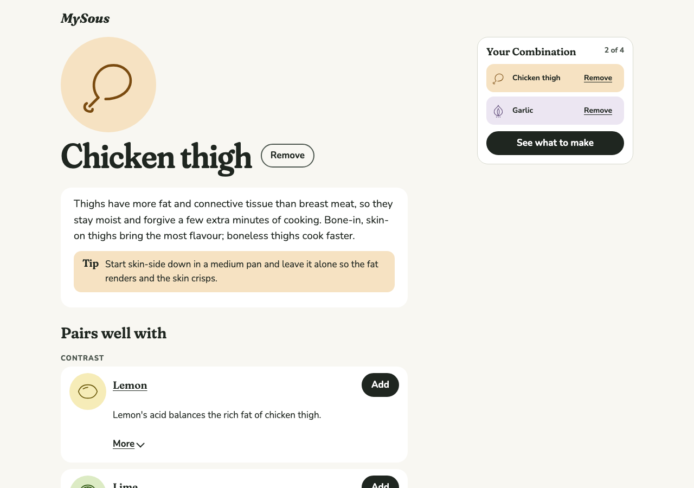 | 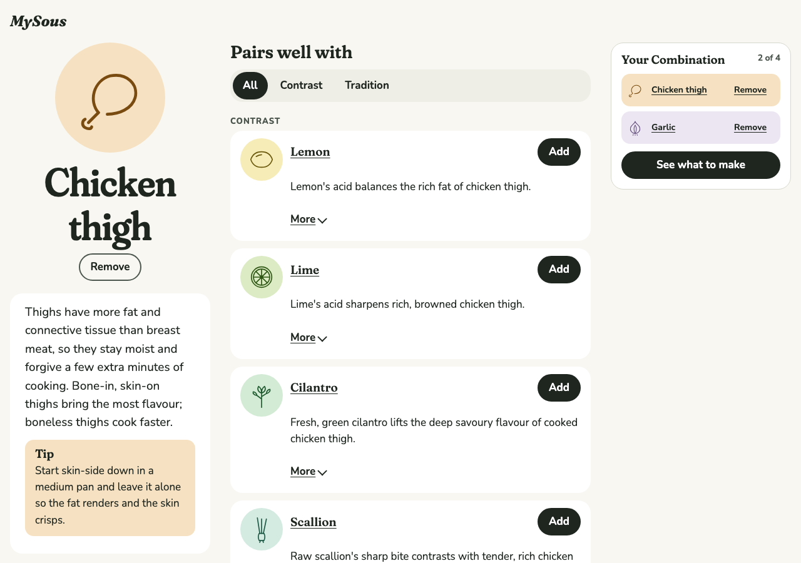 |
| Ingredient, phone dark | 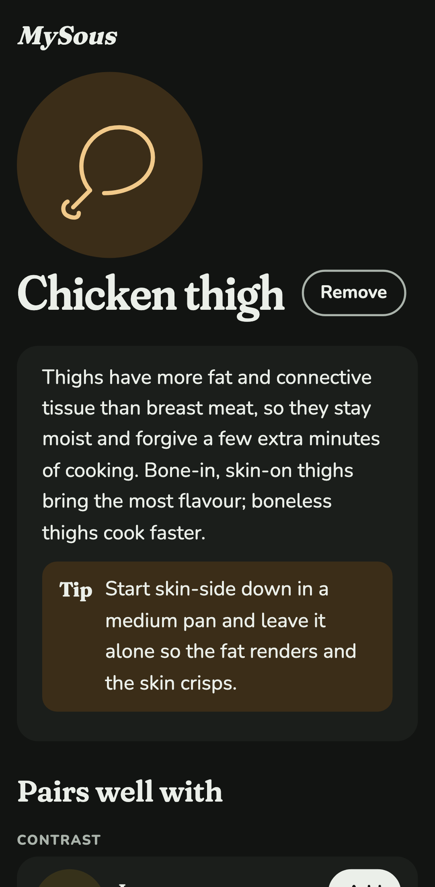 | 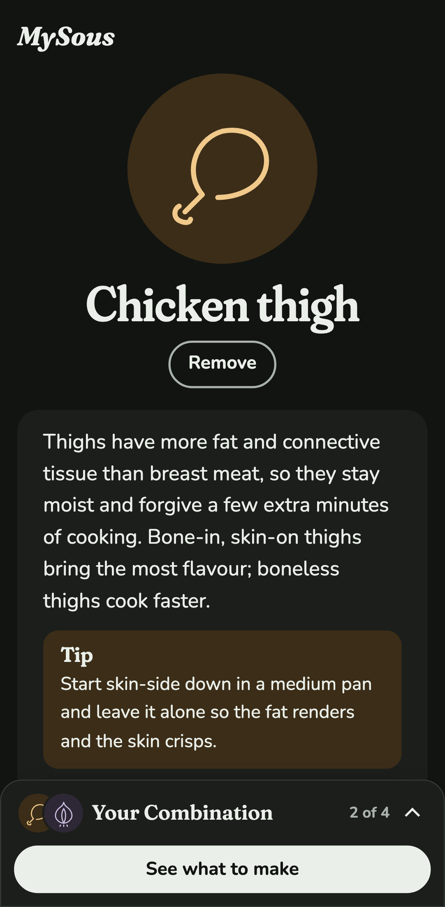 |
| Tray sheet open, phone dark | (new) | 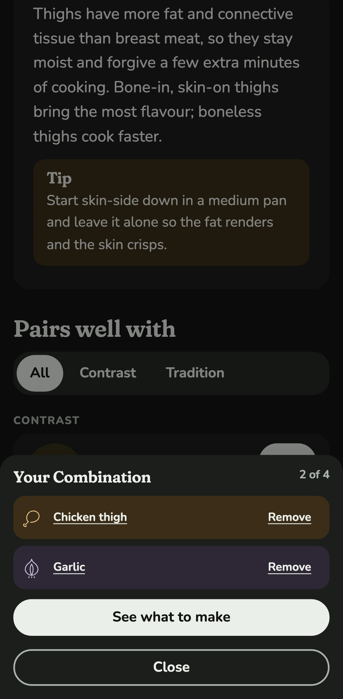 |
| Pairings filtered to Tradition, desktop light | (new) | 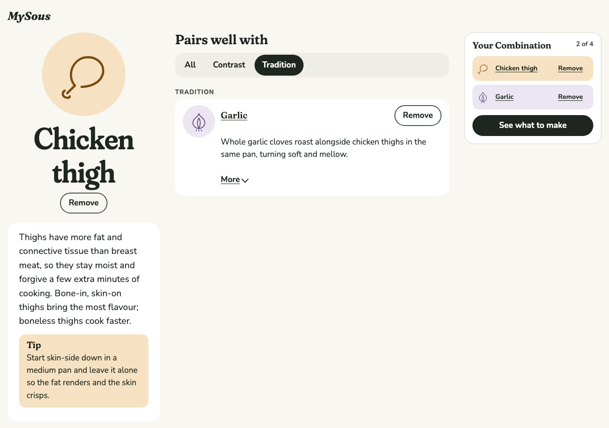 |
| 320px, four Ingredients in the Combination | 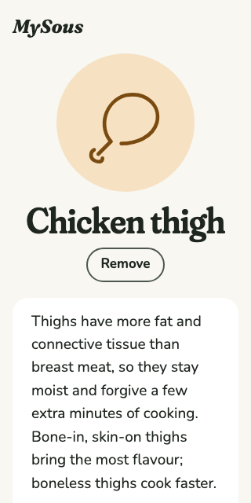 | 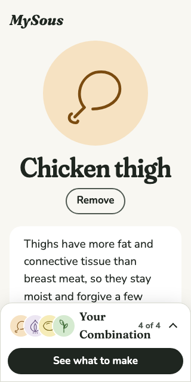 |
| 1280×720 at 200% zoom (640×360) | 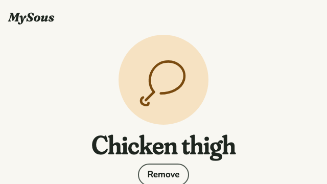 | 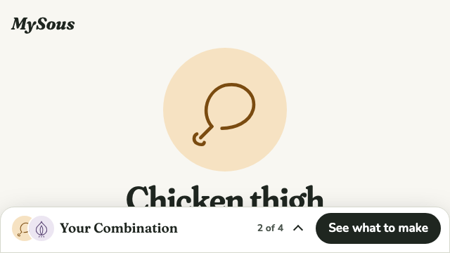 |
| 1000px, between phone and three columns | (new) | 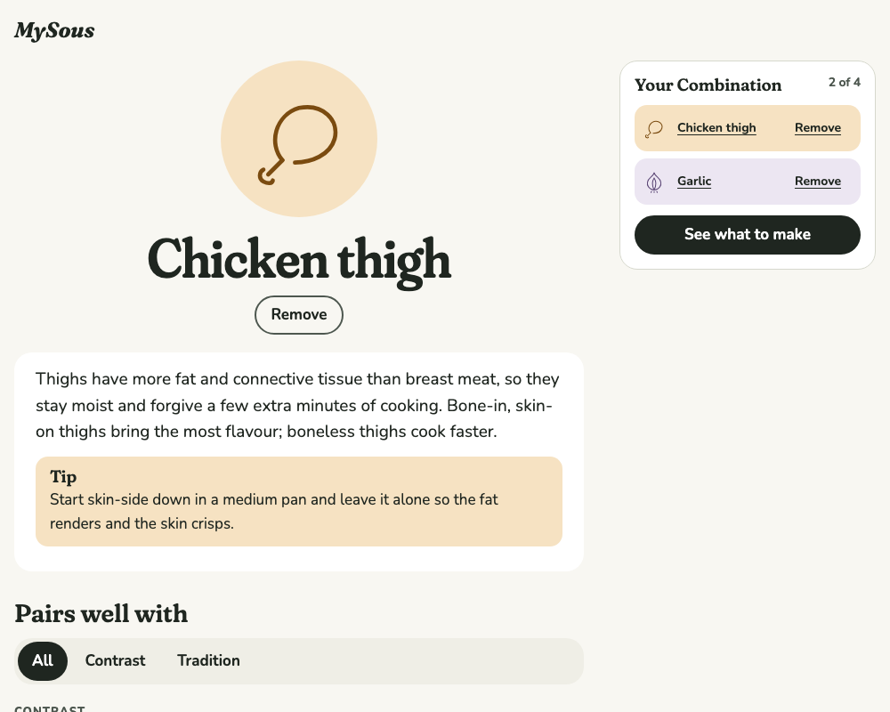 |

All twelve shots, including desktop dark and the sheet and phone page in light, are in `0009-ingredient-and-tray/`.

## Decisions

**Three columns on desktop, as 0002 set out.** From 72rem the Ingredient (drawing, name, Cuisines, essay and Tip) sits in its own column beside its Pairings, and the tray stays on the right, so the first Pairings are on the first screen at 1280×720. The Ingredient column keeps the centred stack the author asked for during #14, with the essay and Tip left-aligned inside their card. Between 56rem and 72rem the Ingredient stacks above its Pairings, beside the tray. The author chose this over keeping two columns.

**The Ingredient column doesn't stick.** 0002 drew it as sticky, but at 1280×720 the column is taller than the screen, so a sticky column would hide its own Tip until the Pairings ran out. Only the tray sticks. This departs from 0002, so it waits for the author's approval (see Open).

**Pairings can be narrowed to one Pairing Reason.** A segmented control (All, then each reason the Ingredient has) shows above the Pairings when there's more than one reason. It's made of native radios, so arrow keys move the choice and assistive technology announces "radio, 2 of 3". An Ingredient with one reason has nothing to filter, so it shows no control.

**On a phone, the essay and Tip stay open.** R3c (0002) found that the stacked layout puts the first Pairing below the first screen on a 390px phone. The author weighed that and kept the essay open, as asked for in #14.

**On a phone, the tray is a bar that opens a sheet.** A bar docked at the foot of the screen shows the chosen Ingredients' drawings, "2 of 4" and "See what to make". Tapping it opens the full tray as a modal sheet. On a phone, "See what to make" comes first, at the top of the bar, as the author asked; then "Your Combination" with its count, and the drawings on their own line below, since four of them beside the title pushed it onto two lines (the author caught this). From 40rem everything fits on one row, "See what to make" still first, with the drawings overlapping to leave the title room; a test checks the title stays whole with four Ingredients. "See what to make" comes first in the markup too, so Tab meets it in the order it's seen. Each slot still free shows as a dashed empty circle beside the drawings, as the author asked, so "2 of 4" reads at a glance; the circles are decorative, since the bar's name gives the count. The author chose this over 0002's always-open floating sheet, which would cover much of a small screen once three or four Ingredients are in.

- **Focus.** Opening the sheet moves focus to its heading. Tab and Shift+Tab cycle within it; a native modal alone lets Tab escape to the browser's controls. Escape, Close or a tap on the dimmed page closes it, and focus returns to the bar. Following a link from the sheet closes it too. If the screen widens into the side panel while the sheet is open (a rotated tablet, a resized window), the sheet closes and focus moves to the panel's heading, since the bar is gone.
- **The bar's name.** It reads "Your Combination 2 of 4: Chicken thigh, Garlic", so a Cook using a screen reader hears the Combination without opening it. The name starts with the bar's visible text, so a Cook using voice control can say what they see. axe caught the first version, whose visible text ran together as "Your Combination0 of 4".
- **The bar looks like it floats.** The author found the first bar easy to mistake for part of the page. It now casts its shadow upward (`shadow-docked`), has a sheet's grabber, and in dark uses a new, lighter `floating` colour, since a shadow barely shows on a dark page. `floating` joins the contrast checks.
- **One tray at a time.** The side panel, and the bar and sheet, are both in the page; CSS shows one for the screen size, so assistive technology meets one tray.

**Every Combination change is announced, wherever it happens.** "Garlic added to Combination, 2 of 4." comes from a live region outside the tray, so it's heard on desktop and with the sheet closed. A modal makes the rest of the page inert, live region included, so the open sheet has its own, and a change made inside the sheet is heard from there. The limit message ("Your Combination already holds 4 Ingredients…") follows the same path. Each message also shows as a toast, above the bar on a phone and near the foot of the screen on desktop, and fades after 5 seconds (it waits while pointed at). That matters most for the limit: without it, pressing Add with four Ingredients in would visibly do nothing. The author asked for the toast in place of a first version's fixed line above the bar. The toast is hidden from assistive technology, because the live region already announces the message, and a live region that remounts with each message isn't reliably heard. Under reduced motion it doesn't fade; it goes after the same 5 seconds. The open sheet sits in the browser's top layer, above everything else on the page, so the page's toast would show behind it; the sheet has its own, just above it in the dimmed space, so a toast always sits just above the bar or the sheet. Behind the sheet the page is blurred as well as dimmed, as the author asked.

**What to make shows the Combination under its heading, with no tray.** The author asked for this: on that screen the Combination is what the Suggestions come from, so it belongs in the page, and the bar's "See what to make" would lead nowhere. The Combination there can still be edited, and changes are announced and shown as a toast like anywhere else.

**Nothing scrolls sideways from 320px to wide desktop, or at 200% zoom.** Playwright checks five screens at six sizes, from 320×640 to 1600×900, including 640×360, which is a 1280×720 screen at 200% zoom. At 320px with four Ingredients, the bar's content first pushed it 5px too wide.

**The bar never covers the page's end or the focused control.** The bar is sticky inside the page rather than fixed over it, so the page's last Pairing scrolls clear of it. The page sets `scroll-padding-bottom` to the bar's measured height, so a control reached by Tab is scrolled above the bar (WCAG 2.4.11, Focus Not Obscured). A Playwright test tabs through the page at three phone and zoomed sizes and checks each control against the bar. On a phone the page has no padding at its foot, so at the end of the page the bar still meets the screen's foot rather than resting above a strip of page (the author caught the gap on the preview; a test now checks it). When there's room, the bar fits on one row, so at 200% zoom it takes about 65px of a 360px screen rather than a third of it.

**Motion: the three patterns from 0002, each only once.**

- **The hero drawing draws itself in** (1.4s, ease-out) on first paint. Each shape gets `pathLength="1"`, so one dash animates every line whatever its length.
- **Pairing rows settle in** with a 45ms stagger. Past the eighth row, the rest arrive together, so a long list doesn't keep the Cook waiting. Choosing a filter turns this off, so filtering never replays it.
- **An added Ingredient grows into the tray** (0.4s, slight overshoot): in the side panel on desktop, in the bar's drawings on a phone. What was in the tray at first paint doesn't grow, and an Ingredient removed and added back grows again.
- Every duration is a token that becomes 0ms under reduced motion. Playwright checks all three both ways.

axe now waits for running animations to finish, because it had caught rows halfway through fading in and reported their contrast.

**New components take props only.** TrayBar and SegmentedControl join the `/design` specimen, ready for the Case Study.

## VoiceOver pass

**Status: waiting for the author.** It needs a real iPhone and a Mac, which an automated run can't stand in for. The flow to check, with what each step should say:

1. Open an Ingredient page (`/ingredients/lemon`). The heading "Lemon" is read. The Pairings filter, if shown, is read as a radio group, "Show Pairings by reason".
2. Activate "Add Lemon to Combination". Expect "Lemon added to Combination, 1 of 4." Focus stays on the button, now "Remove Lemon from Combination".
3. Add a Pairing from the list. Expect "Garlic added to Combination, 2 of 4."
4. **Phone:** find the bar, "Your Combination 2 of 4: Lemon, Garlic, button". Open it. Focus moves to "Your Combination 2 of 4, heading", and swiping stays inside the sheet. Remove Garlic. Expect "Garlic removed from Combination, 1 of 4." Close it, with the two-finger scrub gesture as well as the Close button. Focus returns to the bar.
5. **Mac:** with VO+arrows and with Tab, the tray is a complementary landmark, "Your Combination", and the rotor lists it.
6. Activate "See what to make". The Suggestions heading is read.

Record anything that differs here, with the device and OS version.

## Open

- **Author review gate:** the before/after shots above and the preview deploy.
- **Author approval:** the Ingredient column not sticking, a departure from 0002.
- The VoiceOver pass above. #15 shouldn't close until its notes are recorded here.
