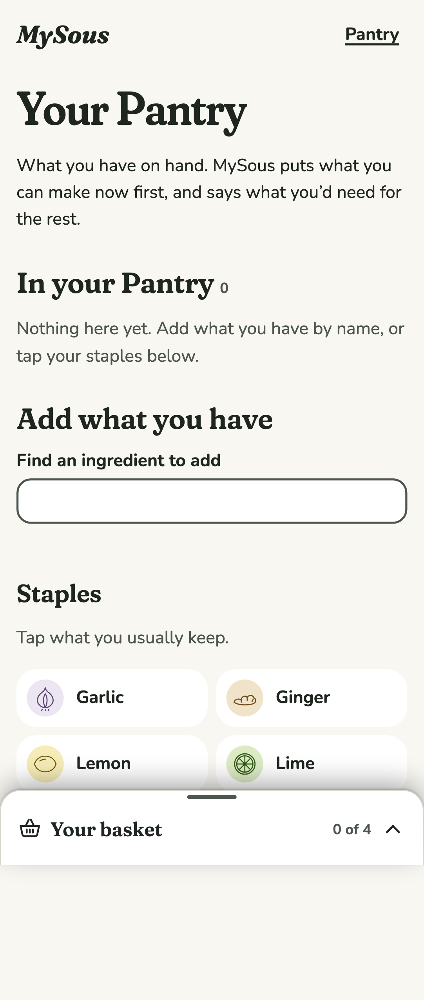
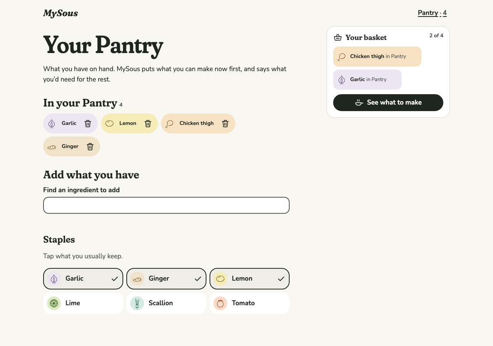
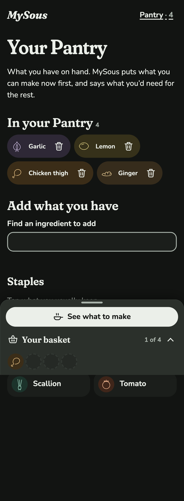
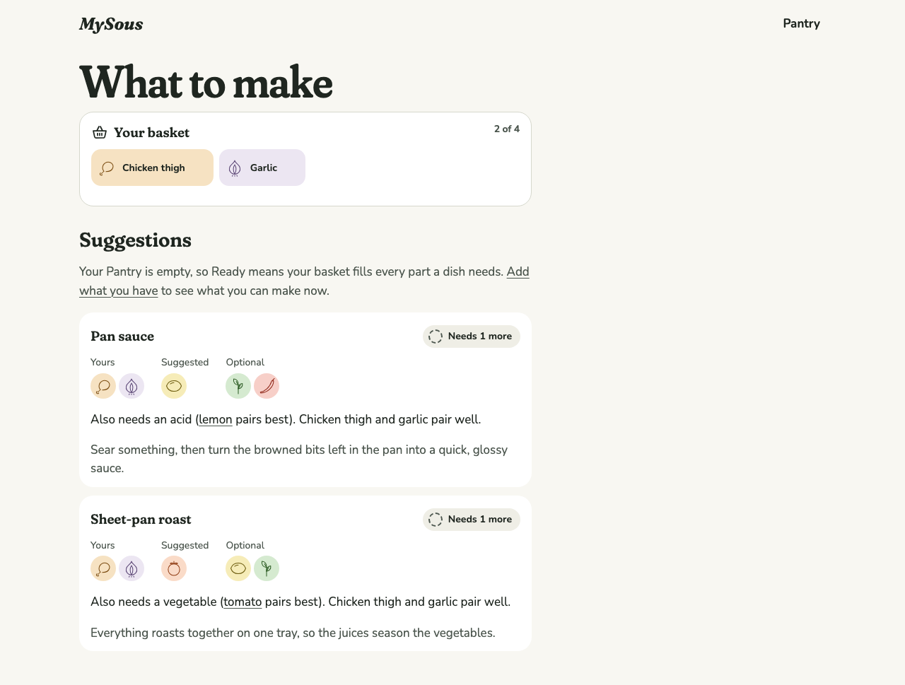
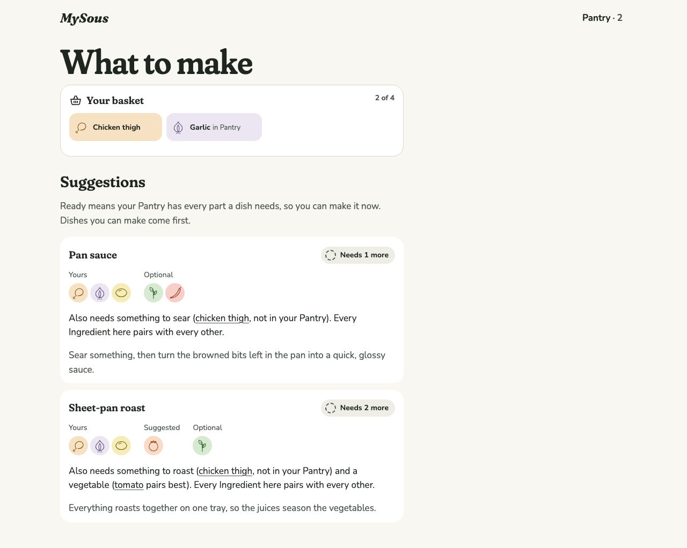
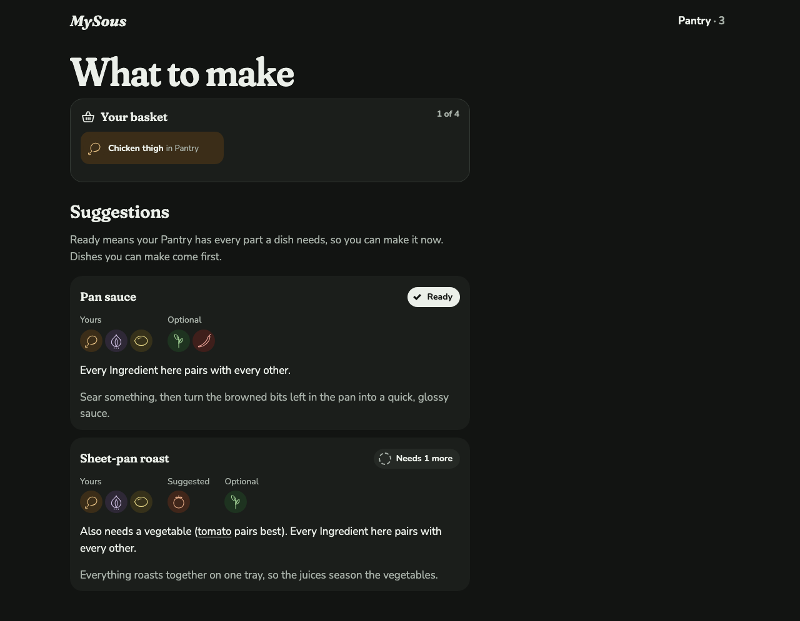
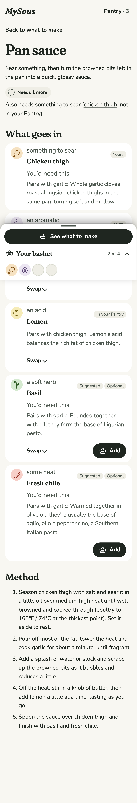
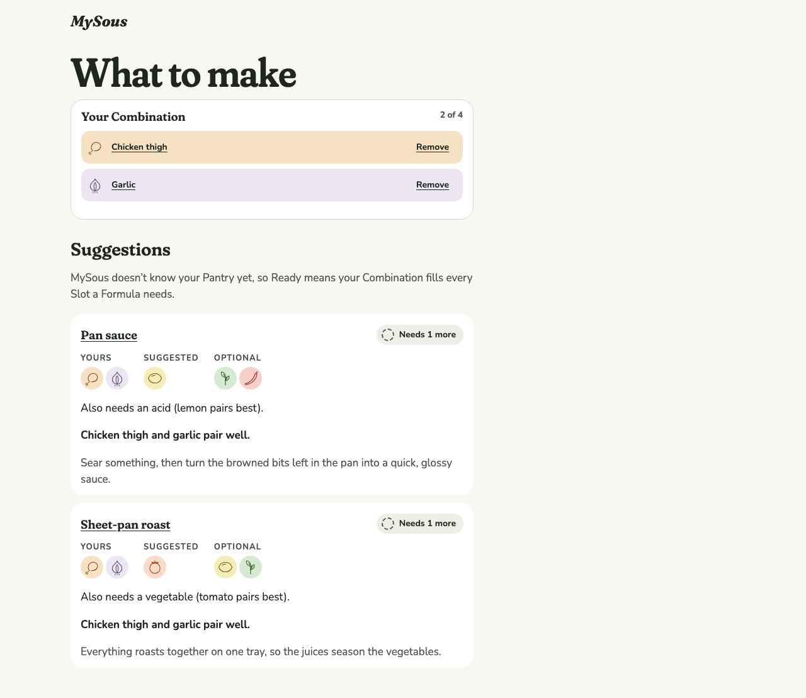
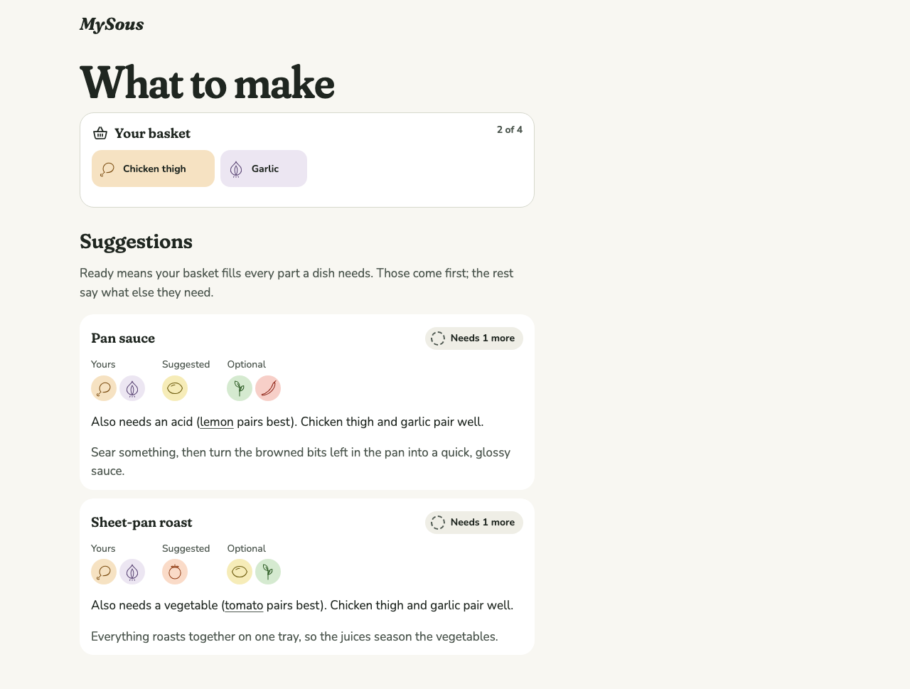
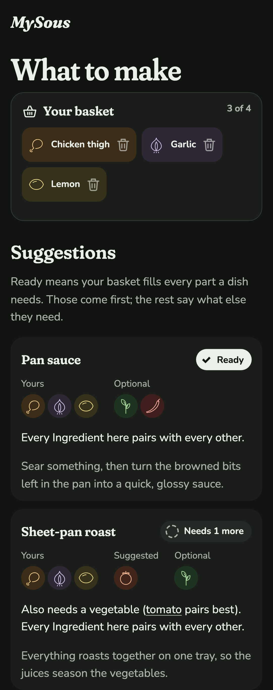

# 0011 · Cutting the Pantry

Milestone: #33 (part of #2), in place of #10. A product vision call: MySous has one way in and one concept to learn, the basket. The Pantry was specified, built, previewed and cut before release (ADR 0004). This entry is the source for the Case Study's featured chapter "One room: cutting the Pantry" (#21).

## The decision

The spec began with two equal doors: "Start from an ingredient" and "Start from what you have", where what you have was a Pantry the Cook kept on the device. It was meant to make "Ready" mean "you can cook this tonight", rank those dishes first, fill parts from the Cook's staples, and mark what they'd need to buy.

After building it fully and using the preview, the author cut it. In the author's words: it "greatly complicates the product, and the value added seems minimal". Cutting it "reduces the learning curve for adoption and distills the true purpose of the app".

## Why

**For the Cook (the UX side):**

- **One concept, not two.** The basket and the Pantry were both "Ingredients I care about", told apart only by intent: one for what to cook tonight, one for what's in the house. Every screen had to explain both: "in Pantry" on basket chips, "Yours" next to "In your Pantry" or "You'd need this" on each part, and two meanings of "Ready" depending on whether the Pantry was empty. Without it, there's one thing to learn: put what you want to cook around in the basket.
- **Help comes first, not chores.** A Pantry asks for work before it pays back: entering what you own, then keeping it current as you cook. A stale Pantry makes "Ready" wrong, which is worse than not claiming to know. Apps that track what's in the kitchen are often abandoned for this reason.
- **The purpose comes into focus.** MySous is about understanding what goes with what, and why. The Pantry pulled it toward inventory tracking, which is a different and well-served kind of app.
- **The opening problem is still served.** The Cook at the open fridge puts what's in front of them in the basket. The basket already means "what you want to cook around, in the fridge or not".

**For the build (the engineering side):**

- **All state in the URL.** The Pantry was the only thing MySous stored in the browser. It brought every hard edge case in the ticket. Storage could be blocked or full. The first render couldn't know the Pantry. Other tabs could change it. And it lived on one device only. Without it, every screen's state is in its address, so every state can be linked, shared, bookmarked and deep-linked from the Case Study. The "State you can link to" decision becomes complete.
- **A smaller Kitchen.** `suggest` takes a Combination only. There's no on-hand rule and no staples list, so there's one meaning of makeable and one ranking order to test.

## Alternatives weighed

The author weighed these before building, then again after using the preview:

| Option | What it gives | What it costs |
| --- | --- | --- |
| Full Pantry (built) | A second way in, a true "Ready", staples filling parts, a shopping answer | Upkeep, a second concept, browser storage, one device only |
| Staples only | Most of the auto-fill benefit, rarely changes | Still stored, still a second concept |
| "I have this" on basket Ingredients, for the visit | An honest "Ready" and a shopping answer, nothing stored | Another control on every basket Ingredient |
| **No Pantry (chosen)** | One concept, one way in, all state in the URL | Staples don't fill parts; no "you'd need this" |

If a "you can make this tonight" answer is missed later, the lightest step back is the "I have this" mark, not a stored inventory.

## What the prototype looked like

The full Pantry is kept on the `prototype/pantry` branch (three commits, reviewed and tested: 119 Vitest and 269 Playwright tests). These are its screens.

| Screen | Prototype (cut) |
| --- | --- |
| Pantry, empty, phone light |  |
| Pantry with staples, desktop light |  |
| Pantry, phone dark |  |
| What to make, empty Pantry: Ready explained twice over |  |
| What to make with a Pantry: "in Pantry" on basket chips, "not in your Pantry" in the needs |  |
| Ready from the Pantry, desktop dark |  |
| A dish with a Pantry: a tag and an on-hand line on every part |  |

## Before and after on main

| Screen | Before | After |
| --- | --- | --- |
| What to make, desktop light |  |  |
| Ready (chicken thigh, garlic, lemon), phone dark | (new) |  |

**What changed on main:**

- **Ready is explained once, in the basket's terms.** The "MySous doesn't know your Pantry yet" note becomes "Ready means your basket fills every part a dish needs. Those come first; the rest say what else they need."
- **Ranking.** Dishes the basket fills come first, then those needing fewest parts, then coherence. Before, ranking was by coherence alone, so a Ready dish could sit below one that needed more. Each card now says why it ranks where it does: "Ready with your basket." or "Also needs…", then how well its Ingredients pair.
- **The Kitchen.** `suggest(combination)` replaces `suggest(combination, pantry)`, and "pantry" is gone from the fill sources.
- **The spec and the glossary.** Spec #2 has one way in. Its Pantry stories are struck but keep their numbers, the ranking and state sections are updated, and "A Pantry" is added to out of scope. The glossary drops Pantry and lists "pantry" and "inventory" among the words to avoid for the Combination. #10 is closed as not planned, and #11 is now Home alone.

## For the Case Study

The chapter pairs the two sides:

- **The UX decision:** one door, one concept, help before chores.
- **The engineering decision:** state in the URL, with nothing stored in the browser.

The evidence is the prototype screens above against today's What to make, the spec's struck stories, and ADR 0004. It shows the judgement to build something properly, look at it honestly, and remove it, not only to add.

## Open

- **Author review gate:** ADR 0004 and this entry.
