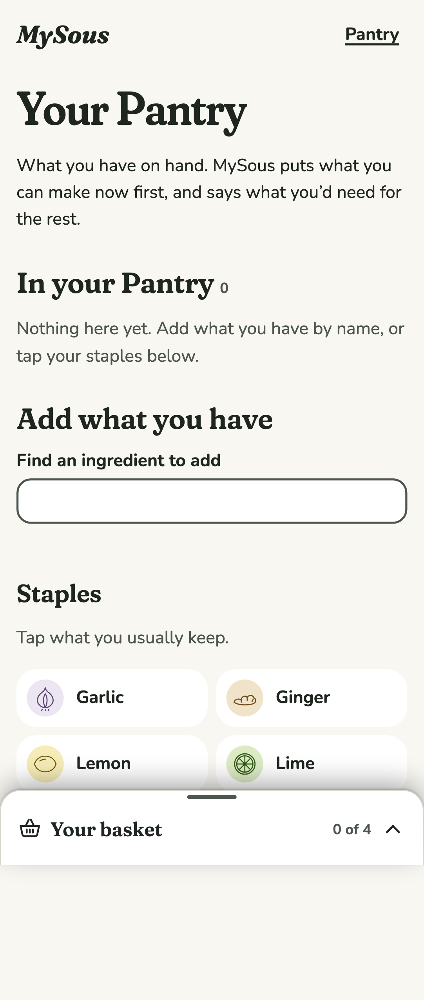
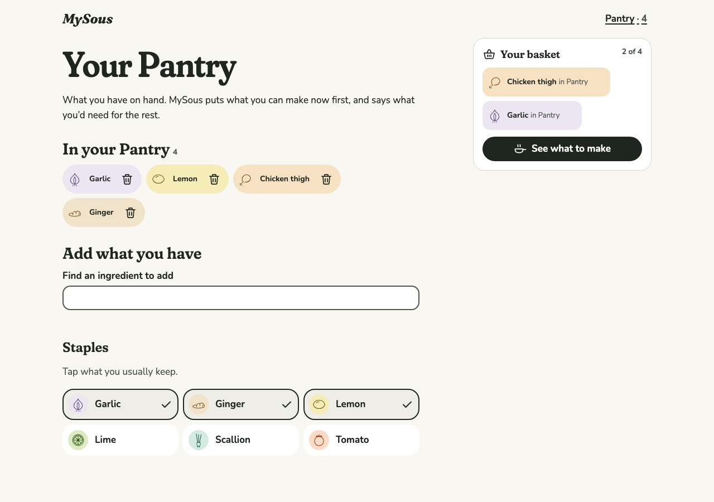
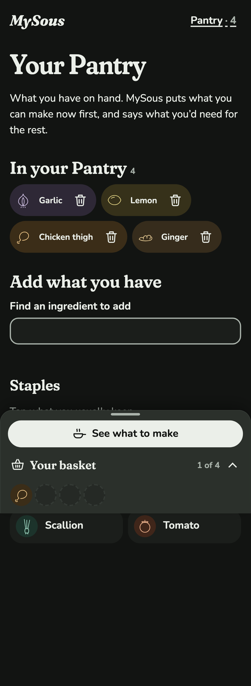
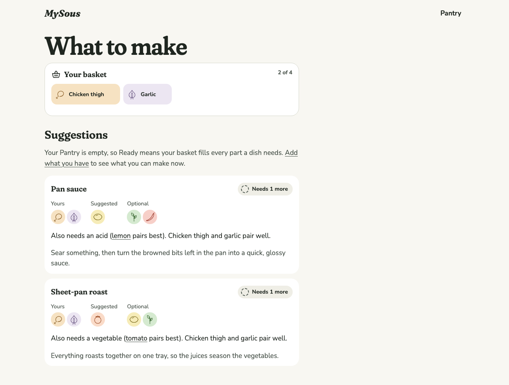
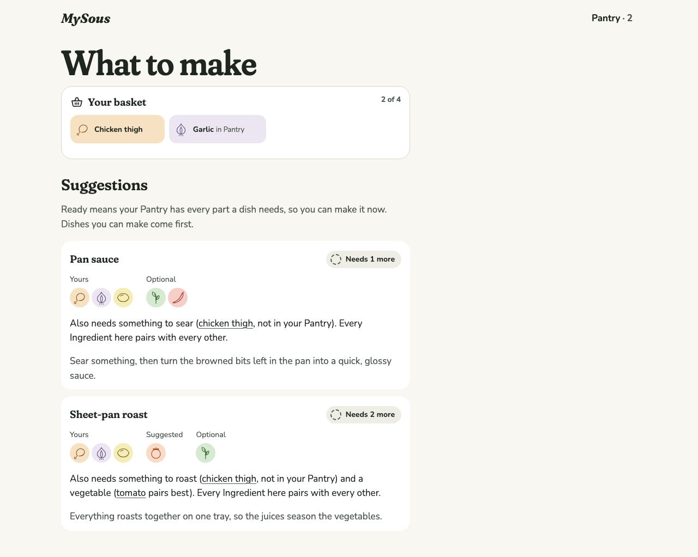
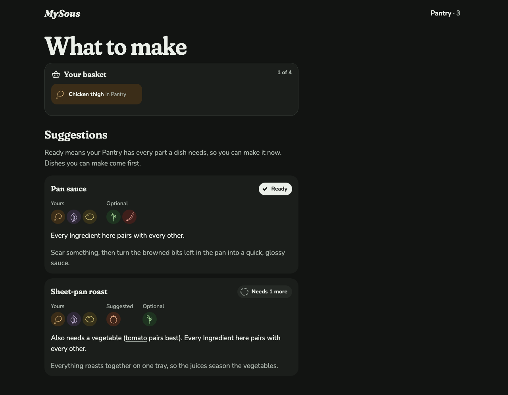
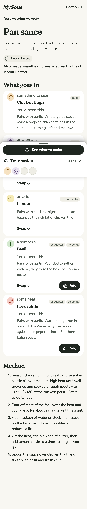

# 0011 · Pantry

Milestone: #10 (part of #2). The Cook can record what they have, and MySous uses it: what can be made now comes first, and every dish says what's on hand and what the Cook would need.

## Before and after

There was no Pantry before. What to make said so in a note: "MySous doesn't know your Pantry yet, so Ready means your Combination fills every Slot a Formula needs" (see 0010).

| Screen | After |
| --- | --- |
| Pantry, empty, phone light |  |
| Pantry with four Ingredients, desktop light |  |
| Pantry, phone dark |  |
| What to make, empty Pantry, desktop light |  |
| What to make with a Pantry of garlic and lemon, desktop light |  |
| What to make, Pan sauce ready from the Pantry, desktop dark |  |
| Pan sauce with a Pantry, phone light |  |

## Decisions

**Keeping the Pantry, knowing its cost.** Before building, the author weighed the Pantry against lighter options: remembered staples only, an "I have this" mark on basket Ingredients for the visit, or both together. A full Pantry best serves the problem the spec opens with (the Cook at the open fridge), but it's the option most likely to go stale. The author kept the full Pantry. The staples grid lowers the cost of keeping it current.

**What's on hand.** With a Pantry, only the Pantry is on hand. A basket Ingredient the Pantry doesn't have is something the Cook would need ("Also needs something to sear (chicken thigh, not in your Pantry)"), and Ready means the dish can be made now. With an empty Pantry, MySous knows nothing about what's on hand, so the basket counts, as in 0010. What to make says which is in force, and links to the Pantry when it's empty. In the Kitchen, each Suggestion carries `onHand`, so a swap to something in the Pantry counts as had.

**Ranking.** With a Pantry: fewest required parts missing (so Ready first), then coherence. With an empty Pantry: coherence alone, so a Cook planning a shop starts from what goes together (story 41).

**Adding.** By name, through the same search as Home, with the field clearing after each choice so several can go in quickly. Or by tapping a staple: Ingredients the author marks `common` in their frontmatter, at most 24, so the grid stays a quick tap rather than a catalogue. Each staple is a toggle (`aria-pressed`) that shows a tick once it's in, so the state never rests on colour. The six launch staples (garlic, ginger, lemon, lime, scallion, tomato) are a first pass for the author to change.

**Where the Pantry shows.**

- A Pantry link with its count in the header, on every screen.
- "in Pantry" beside a basket Ingredient's name, in the tray and on What to make.
- On a dish, the corner tag says where an Ingredient came from ("Yours", "Suggested", "Swapped", "In your Pantry"). Once there's a Pantry, a quiet line under the name says "In your Pantry" or "You'd need this". The line sits under the name rather than in the corner, because three tags in the corner squeezed the part's name on a phone.
- Swap choices the Cook has say "in Pantry".

**Remembering, and when it can't.** The Pantry is kept in this browser's localStorage, and every read and write is guarded. When storage is blocked or full, the Pantry works for the visit, in memory, and the Pantry screen says "This browser isn't letting MySous save, so your Pantry lasts until you close this page." Another tab's changes arrive through the `storage` event. Before the page is live in the browser, the Pantry reads as empty, so the static HTML and the first render agree.

**Tests.**

- Vitest, through `loadKitchen`: what's on hand with and without a Pantry, filling from the Pantry, a swap to a Pantry Ingredient, both ranking orders, the staples list, and the 24-staple limit.
- Playwright:
  - adding by name and by staple, removing, the header count, a reload keeping the Pantry, and a Ready dish ranked first;
  - the on-hand marks on a dish, a Swap choice and the basket;
  - storage blocked;
  - axe on the Pantry and on Pantry states in both themes;
  - no sideways scroll on the Pantry from 320px to 1600px and at 200% zoom;
  - touch targets on a phone.

## VoiceOver pass

**Status: waiting for the author.** On an iPhone and a Mac:

1. Open the Pantry from the header link. Expect "Pantry", then the heading "Your Pantry" and "In your Pantry 0".
2. Type "chi" in "Find an ingredient to add" and choose Chicken thigh. Expect "Chicken thigh added to your Pantry, 1 Ingredient", and the field empties.
3. Activate the Garlic staple. Expect "Garlic, toggle button, not pressed", then "pressed" and the announcement.
4. Remove Chicken thigh from the list. Focus moves to the heading "In your Pantry".
5. Open What to make with chicken thigh in the basket. Expect "Chicken thigh, in Pantry" in the basket only if it's in the Pantry, and the sentence saying what Ready means.
6. On Pan sauce, each part reads its role, its Ingredient, and "In your Pantry" or "You'd need this".

## Open

- **Author review gate:** the shots above and the preview deploy.
- **Author choice:** the staples (currently garlic, ginger, lemon, lime, scallion, tomato).
- The VoiceOver pass above.
- #11 adds the Pantry door on Home. Story 49's "you'd need this" on Swap choices is shown only as the absence of "in Pantry".
