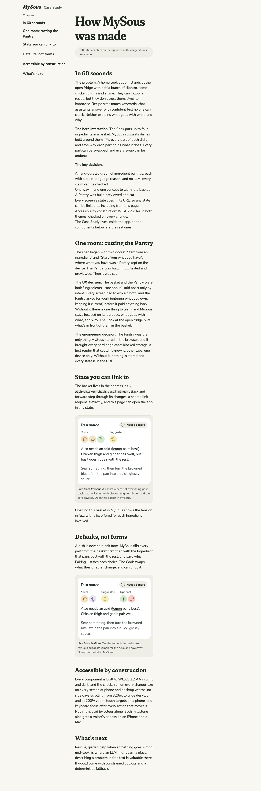
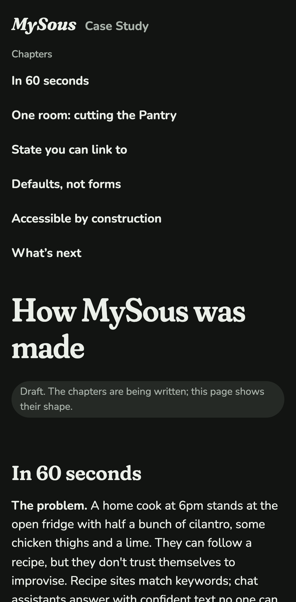
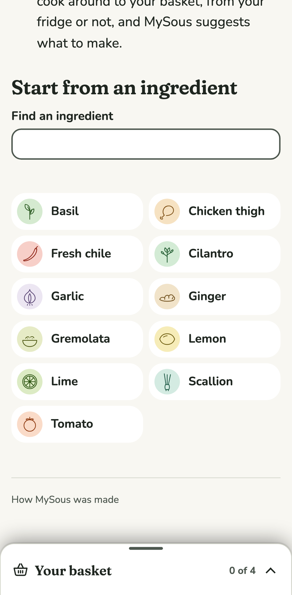
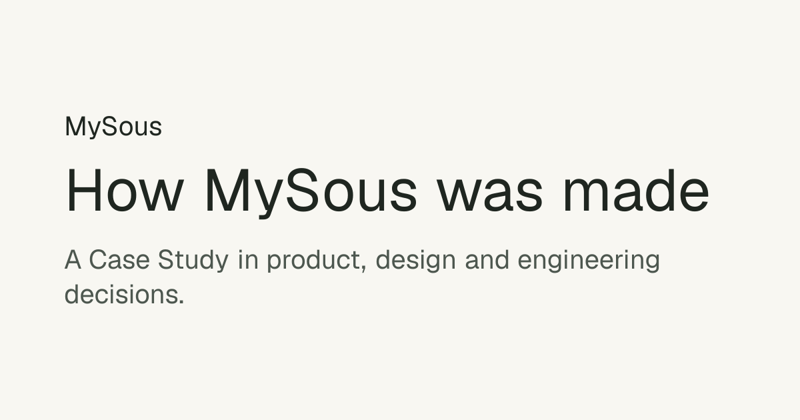

# 0012 · Case Study shell

Milestone: #20 (part of #2). The Case Study has a home inside the app (ADR 0002): a reading layout with chapters, real components in fixed states, deep links into the app, and a link preview. Its content is a draft; #21 writes it.

## After

| Screen | After |
| --- | --- |
| The Case Study, desktop light |  |
| The Case Study, phone dark |  |
| The app's footer, phone light |  |
| The link preview image |  |

## Decisions

The author chose each of these from options.

**A document, not an app screen.** The Case Study keeps MySous's type and colours but drops the basket tray. "Case Study" sits beside the wordmark. Chapters are listed alongside the text on wide screens and above it on a phone, and the text keeps to a reading measure. Two skip links come first on the page: "Skip to the Case Study" and "Skip to chapters".

**Written in MDX, with the real components.** `/case-study` is an MDX page (`@next/mdx`). Chapters come from one list, so the navigation and the sections can't drift apart. A live embed renders the app's own Suggestion card for a fixed basket. A small provider, `FixedCombination`, lets `useCombination` read that basket instead of the URL, so links inside the card carry it. Each embed is captioned "Live from MySous" and links to "Open this basket in MySous".

**Deep links.** `AppLink` opens the app with a given basket, as `/suggestions?with=…`. Because all state is in the URL (ADR 0004), any state is one link away.

**Link preview.** The page sets Open Graph and Twitter metadata with absolute URLs, from a `metadataBase` of the production site, overridable with `NEXT_PUBLIC_SITE_URL`. The preview image is made once at build time from the page colours. Its file has no extension, so `vercel.json` serves it as `image/png`. It uses the image renderer's default font, not MySous's; that's left for #21.

**One quiet way in from the app.** A footer link, "How MySous was made", sits on every app screen and nowhere else. It's placed before the tray in the page, so on a phone the docked bar still meets the foot of the screen. On wide screens it stays under the page while the tray sits alongside both.

**Draft content, live now.** The 60-second summary and short chapter drafts come from the journal and ADRs, marked "Draft". The chapters are "One room", "State you can link to", "Defaults, not forms", "Accessible by construction" and "What's next".

**Tests.** Playwright covers:

- the footer as the only in-app link, with no tray on the Case Study;
- the skip links by keyboard;
- every chapter link opening its section;
- the live tension card and the basket carried by its links;
- a deep link opening the exact basket;
- the built page's Open Graph and Twitter tags and the 1200×630 PNG.

axe, reflow from 320px and at 200% zoom, touch targets and focus rings now include `/case-study`.

**Honest claims.** The review checked the draft against the journal. Three claims overstated and are corrected:

- A part no pairing justifies stays open; MySous doesn't fill every part.
- The basket lives in the URL, but swaps on a dish don't yet. ADR 0004's "every screen's state" now reads "every screen's basket".
- VoiceOver is a hand check of the core journey, not of every milestone.

## VoiceOver pass

**Status: waiting for the author.** On an iPhone and a Mac:

1. From any app screen, find the footer link "How MySous was made" at the end of the page, and open it.
2. On the Case Study, the first Tab (or the first swipe) reaches "Skip to the Case Study", then "Skip to chapters". Each moves focus to its target.
3. The "Chapters" navigation lists six links. Each moves to its chapter, whose heading is read.
4. In "State you can link to", the live card reads as the app's card: "Pan sauce", "Needs 1 more", the groups of drawings, and the sentence. The caption reads "Live from MySous…" and ends with the link "Open this basket in MySous".
5. That link opens What to make with chicken thigh, basil and ginger in the basket, and "Not everything pairs yet".

## Open

- **Author review gate:** the layout, the draft summary and the preview deploy.
- The VoiceOver pass above.
- **The preview image's font** (for #21).
