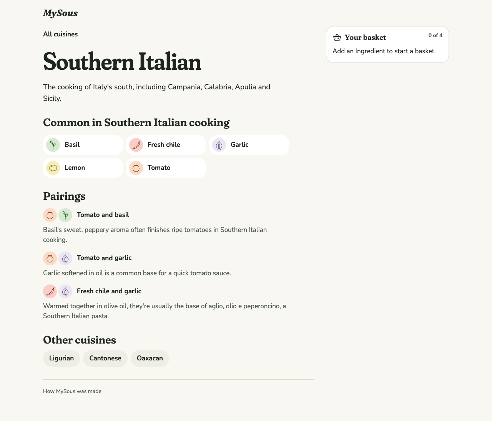
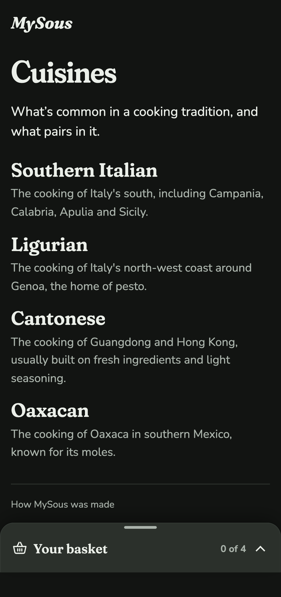
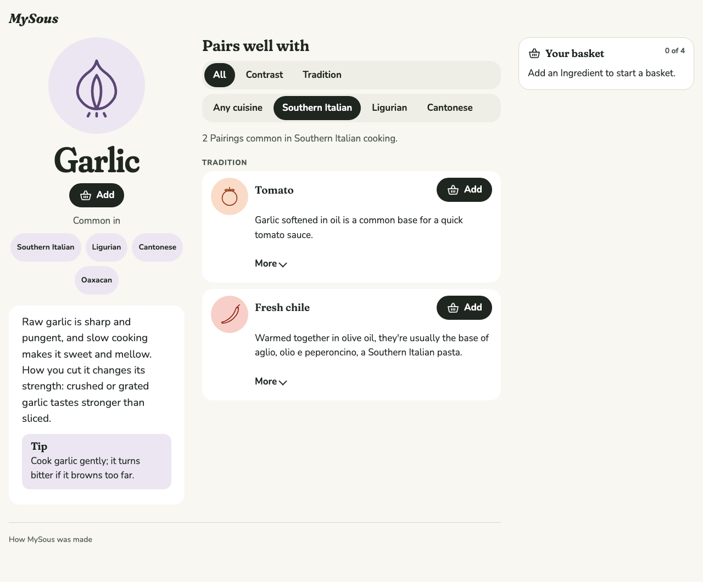
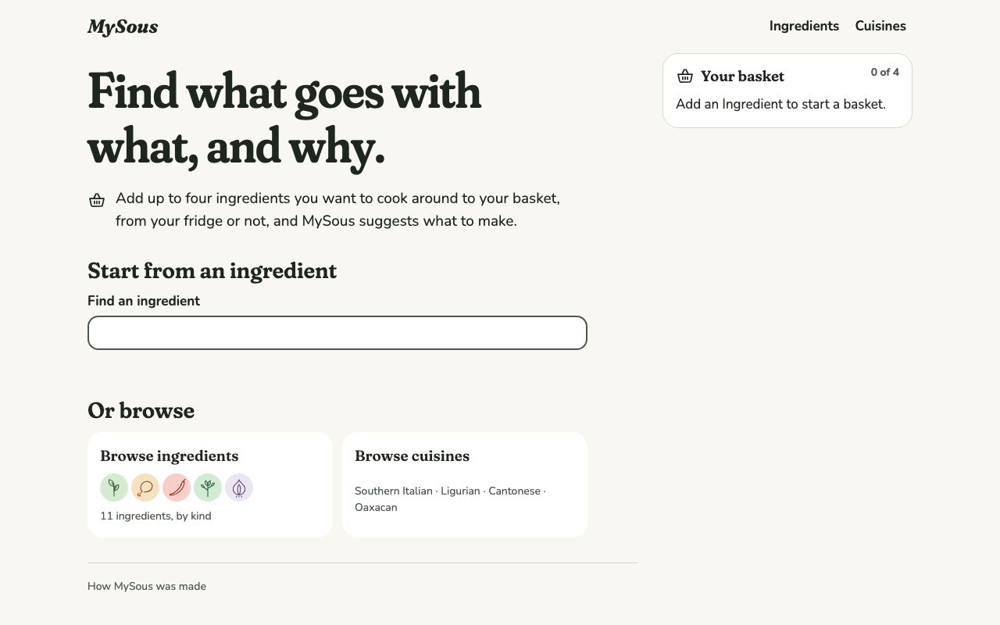
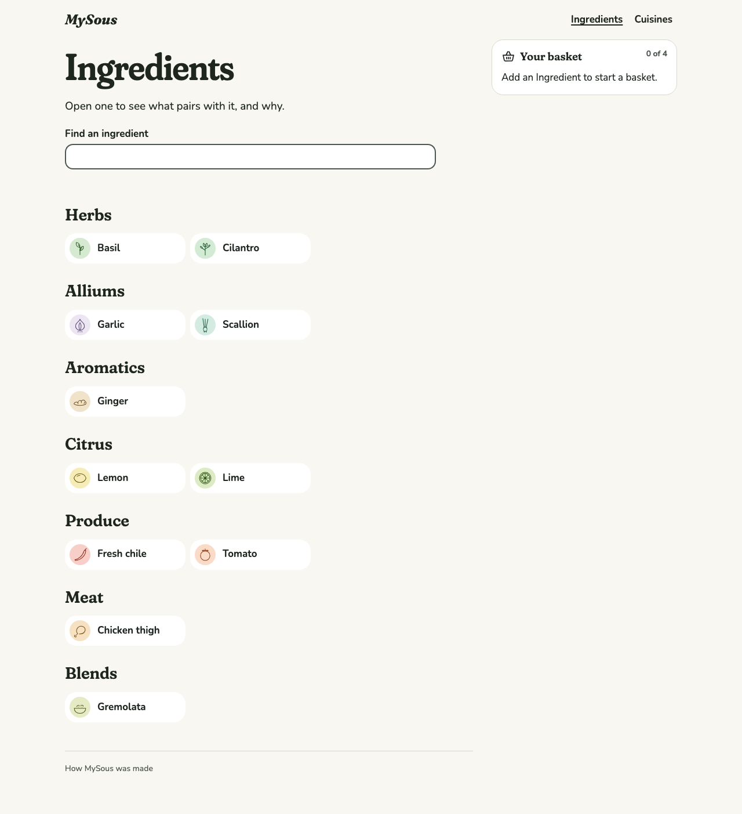

# 0013 · Cuisines

Milestone: #12 (part of #2). Cuisines become a way to browse the graph: a page for each, a list of all of them, a filter on an Ingredient's Pairings, and a tie-breaker in ranking.

## After

| Screen | After |
| --- | --- |
| Southern Italian, desktop light |  |
| Cuisines, phone dark |  |
| Garlic, filtered to Southern Italian, desktop light |  |
| Home, with the top nav and two ways to browse |  |
| Ingredients by kind, desktop light |  |

## Decisions

The author chose each of these from options.

**The filter lives in the URL.** An Ingredient's Pairings have a second control under the reason filter: "Any cuisine", then the Cuisines its Pairings are common in. The choice is a query parameter beside the basket (`?with=lemon&cuisine=cantonese`). So a filtered view can be linked, Back clears it, and the basket survives the change. A line says what the filter shows ("2 Pairings common in Southern Italian cooking."). It's a polite live region that stays in the page while empty, so screen readers hear it fill. It's not a second status, so the page keeps one status, for the basket. The control appears once the page is live in the browser; before then, every Pairing shows.

**A Cuisine bonus that breaks ties, not Pairings.** When every Ingredient the Cook chose (not those MySous suggested, which pair by construction, as with Pairings) shares a Cuisine, coherence gains half a Pairing. It decides between dishes that pair equally well, but never outweighs a real Pairing. The rank reason says why: "Lamb and mint pair well. Both are common in Levantine cooking."

**Cuisines up front: a top nav, an Ingredients page, and Home's two ways to browse.** After seeing the first build, the author asked for more emphasis on Cuisines:

- A top nav, "Ingredients" and "Cuisines", sits in the header on every app screen. The Case Study keeps its quieter header, the wordmark and "Case Study", at the author's request. It marks the current section with `aria-current` and an underline. It began at the header's end, where the author found it easy to miss: small, and blending into the basket panel below it. It now sits beside the wordmark, both larger, where the eye lands first.
- `/ingredients` lists every Ingredient by kind, in a fixed order: Herbs, Alliums, Aromatics, Citrus, Produce, Meat, Blends. The categories are now a fixed list that validation checks, as Pairing Reasons are.
- Home keeps the premise, the basket line and the search, then "Or browse" with two cards: "Browse ingredients" (a glimpse of drawings) and "Browse cuisines". The full grid moved to `/ingredients`.

Browsing either way leads to the same Ingredients and the same basket, so there's still one concept to learn (ADR 0004). Each Cuisine page lists the Ingredients common in it, the Pairings attested in it (both drawings and both names lead onward), and the other Cuisines. An Ingredient's "Common in" chips now link to their Cuisines.

**Named regionally, never "authentic".** Validation rejects a Cuisine named at continental or broad-regional level ("Asian", "European", "Middle Eastern", "Mediterranean", …). A copy check fails if "authentic" appears in content or app copy. Both run against the real content in Vitest.

**Tests.**

- Vitest through `loadKitchen`: Pairings filtered by Cuisine, a Cuisine's Ingredients and Pairings, the list of Cuisines, the bonus deciding an order and its rank reason, and continental names rejected.
- Vitest content checks on the real content and copy.
- Playwright: Home → Cuisines → Southern Italian → Garlic → filtered Pairings, then cleared by "Any cuisine" and restored by Back. Also a filtered link that keeps the basket, and an Ingredient's Cuisines leading to their pages.
- axe, reflow and touch targets on the Cuisine pages and a filtered Ingredient.

## VoiceOver pass

**Status: waiting for the author.** On an iPhone and a Mac:

1. The header's "Main" navigation lists "Ingredients" and "Cuisines", and the current one is read as "current page". On Home, "Or browse" leads to two links, "Browse ingredients…" and "Browse cuisines…".
2. On Southern Italian, the headings are "Southern Italian", "Common in Southern Italian cooking", "Pairings" and "Other cuisines". The Ingredient list is named "Ingredients common in Southern Italian cooking".
3. On Garlic, "Show Pairings common in" reads as a radio group. Choosing "Southern Italian" announces "2 Pairings common in Southern Italian cooking."
4. "Any cuisine" clears it, and Back brings it back.

## Open

- **Author review gate:** the screens above and the preview deploy.
- The VoiceOver pass above.
- Few Pairings carry Cuisines yet (6 of 17). The research batches (#17, #18) fill this out.
