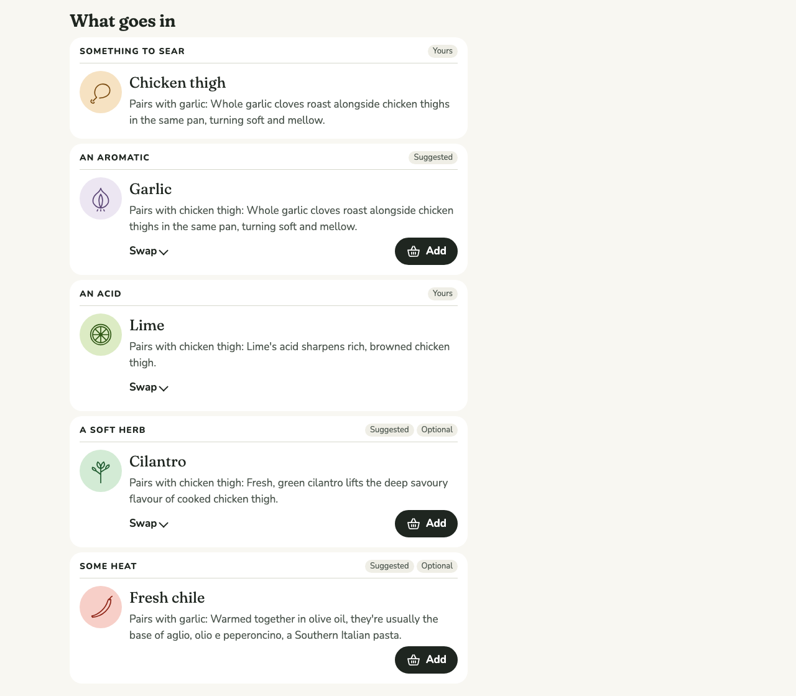
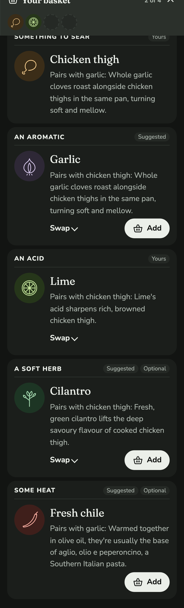
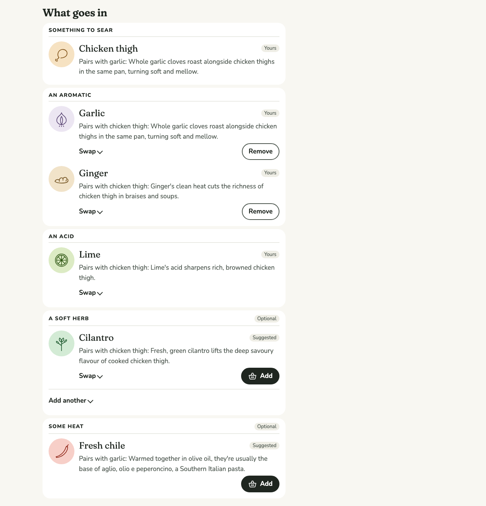
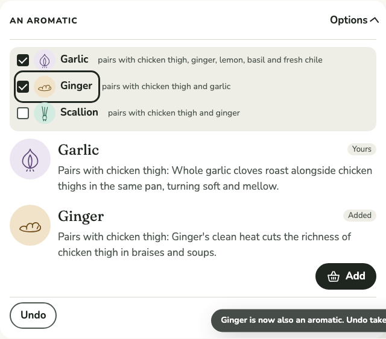
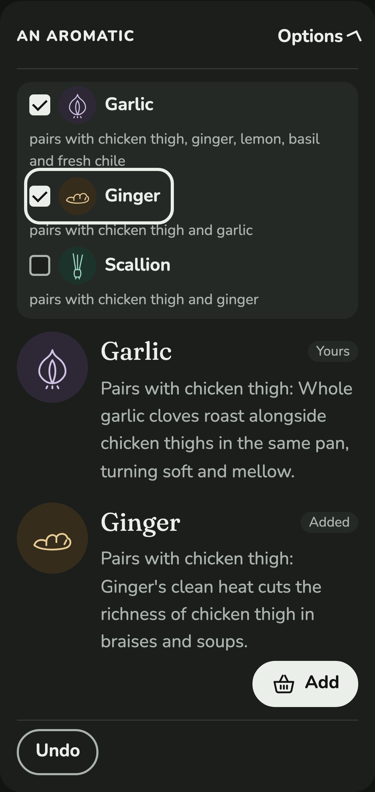
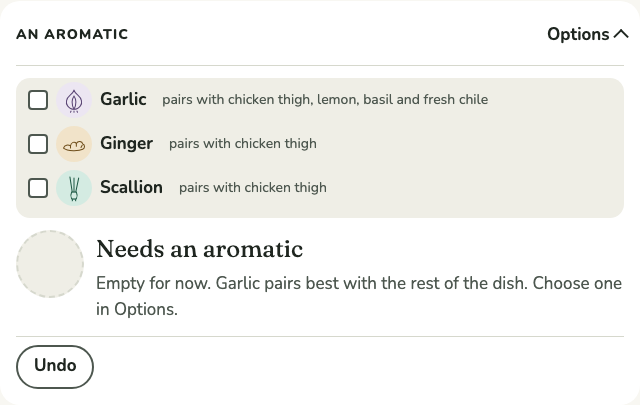
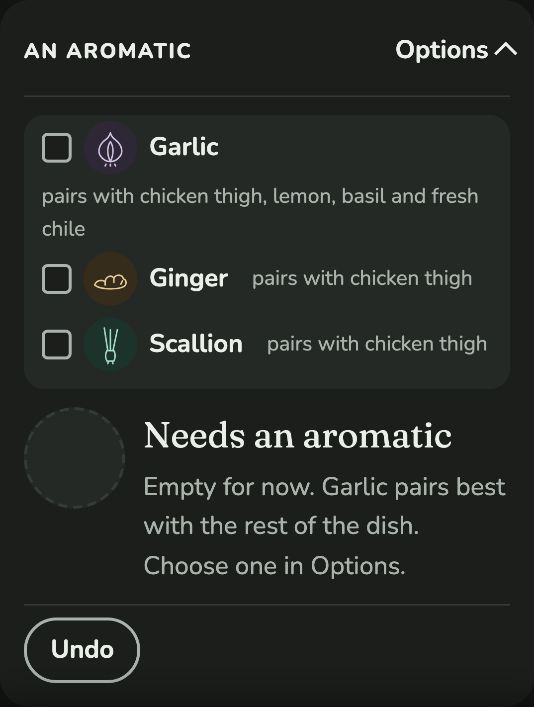

# 0014 · Recipes

Milestone: #13 (part of #2). A dish can have a recipe: quantities, timings and a full method, with cited guidance on every step where food safety is at stake. The recipe follows whatever is in the dish, whether it came from the basket, a Pairing or a swap.

## After

| Screen | After |
| --- | --- |
| Pan sauce, empty basket: the recipe as written, desktop light |  |
| Pan sauce, basket of chicken thigh and lime, phone dark |  |

## How it got here

The ticket asked for a "Showcase Recipe": a fixed, worked example on its own page. That was built first, at `/formulas/<id>/recipe`, linked as "See a worked recipe". Seeing it running, the author changed course:

- **Call them recipes.** "Worked recipe" and "Showcase Recipe" were names for an idea the Cook doesn't need to learn.
- **A recipe should swap and should start from the basket.** A fixed recipe for chicken, garlic and lemon says nothing to a Cook holding lime.

Swapping on a second page would have repeated the dish page, with two places to swap that could drift apart. So the recipe moved onto the dish page. The author chose this from options, along with the two decisions below.

## Decisions

**One page.** A dish with a recipe shows, in order:

1. its image frame;
2. serves and timings;
3. the swappable parts;
4. "Ingredients", with amounts;
5. "Method": the full recipe steps in place of the dish's short method.

A dish without a recipe is unchanged. The separate route and its link are gone.

**The recipe fills what the basket doesn't.** Parts fill in this order:

1. from the basket;
2. from Pairings;
3. any part still empty takes the recipe's own Ingredient;
4. Pairings again, since the recipe's Ingredients can give other parts a Pairing.

So an empty basket shows the recipe as written, plus anything that pairs into its optional parts (chile, which pairs with garlic), and a basket shows the Cook's own dish. Recipe fills read "Suggested" like Pairing fills. They don't count towards rank, which stays about what the Cook chose.

**Amounts follow the Ingredient (the author's choice).** Every part has an ingredient line. Its `amount` and `note` cover whatever fills the part, and `for` gives particular Ingredients their own amount, note, and the name as it reads after that amount: "3 cloves garlic, thinly sliced"; "a thumb-sized piece ginger, cut into matchsticks"; "2 limes" against "1 lemon". An Ingredient with no entry of its own takes the part's amount and note ("3 tbsp lime, juice"), so a line is never blank, though it reads less well; that's a prompt to write the entry. An optional part with nothing in it has no line. The Spec review caught the first version printing "2 lime" and "4 chicken thigh".

**Safety lives on the Ingredient (the author's choice).** A Recipe step marks the part its safety depends on and the topic, handling or cooking. The page shows the cited guidance of whatever Ingredient fills that part. Chicken thigh carries both topics:

- **Handling:** don't rinse it; wash hands and what it touched.
- **Cooking:** 165°F / 74°C on a thermometer, then rest it on a clean plate.

The sources are USDA Food Safety and Inspection Service pages. Swaps can bring in any Ingredient that fits, so the guarantee holds whatever is swapped in, as content grows. That replaces the first build's citation on each recipe step.

**Validation.** `loadKitchen` fails the build when:

- a Recipe is for an unknown Formula;
- a required part has no Ingredient as written;
- a fill names an unknown part or Ingredient, or one that doesn't fit;
- a part has no ingredient line, or two, or a line names an unknown part;
- an ingredient line or amount has a key it doesn't know (an unquoted comma in a YAML `{ … }` line once split a note this way, silently);
- an amount is given for an unknown Ingredient, or one that can't fill its part;
- a step refers to an unknown part;
- an Ingredient that could fill a safety step's part has no guidance on that topic;
- safety guidance has no citation.

**Read as a recipe.** These carry over from the first build:

- the facts are a description list;
- times are written as "minutes" (a screen reader can read "min" as "minimum");
- the lists are labelled "Ingredients" and "Method";
- amount and name sit in two columns with a space between, for reading aloud and copying;
- each linked name is a full-size tap target.

The image frame keeps its space and shows the drawings of what's in the dish, which now update with every swap, until #32 brings images.

## Then: two more changes from the author

**"Not everything pairs yet" is gone.** What to make used to open with a box naming each pair in the basket that has no Pairing, offering a swap or a removal for each Ingredient involved. The author cut it: it isn't something the Cook needs to know. Each Suggestion's rank reason still says plainly which Ingredients don't pair, such as "Chicken thigh and basil don't have a Pairing in MySous yet.", and the closest dishes still show, so nothing is a dead end. These went with the box, since nothing else used them:

- the Kitchen's tensions and fixes, so `suggest` now returns the Suggestions alone;
- the basket's "replace";
- the glossary's "Tension";
- their tests.

The Case Study's linked basket now promises every dish for it, each saying what pairs and what doesn't. Spec stories 42 and 43 no longer hold.

**Part cards lead with the role.** The author asked for a better layout, with more weight on the part's role ("an aromatic"), and chose this one from three:

- The role is a bold, upper-case label across the top of the card, with its tags at the other end, and a rule beneath.
- Below it, a larger drawing sits beside the Ingredient's name.
- Then comes the reason, with Swap (and Undo) and Add along the foot.

The role stays the part's heading, so screen readers and focus after a swap work as before.

| Part cards, desktop light | Part cards, phone dark |
| --- | --- |
|  |  |

**A part can hold more than one Ingredient.** The author asked for garlic and ginger together as aromatics. They chose each of these from options:

- **No limit.** A part holds any number of Ingredients. The first build let each part set a limit in content (two aromatics, one acid); the author dropped it.
- **From the basket.** Every basket Ingredient that fits goes in, in basket order. Each part takes one first, in part order, before any takes a second, so an Ingredient that fits two parts (scallion is an aromatic and a garnish) fills an empty part before doubling up in another. That rule wasn't asked for; it keeps a dish from leaving a part empty that the basket could fill. What's left goes into the first part it fits. Pairings and the recipe only fill empty parts.
- **Ready.** A required part counts as covered only when everything in it is from the basket. Adding ginger beside the basket's garlic makes the dish need ginger, and the readiness line names it.
- **On the dish page.** Each Ingredient in a part has its own row: name and tag, why it's there, and Add to the basket. Changing what's in the part is one control, below (see the next section). Undo covers every change and says what it undoes.
- **Amounts.** Each Ingredient keeps the full amount the recipe gives it, as a cook would: 3 cloves of garlic and a thumb of ginger, not half of each.
- **Elsewhere.** The method names them all ("add garlic and ginger"). A safety step shows the guidance of every Ingredient in its part.

| A part holding two | |
| --- | --- |
| Garlic and ginger as aromatics, desktop light |  |

**Swap and Add another became one checklist, "Options".** The author saw that the two did much the same thing. They chose a checklist from three options; the others were "add, then remove" and one list with a button for each:

- **Options.** Each part has one "Options", empty or not; it was "Change" (and "Choose" while empty) until the author renamed it. It opens every Ingredient that could be in the part, ticked while it's in it. Ticking one adds it; unticking takes it out. A swap is one of each. Remove and the separate Swap went with it.
- **Where it sits.** The author then moved Options to the end of the part's top row, level with its role, with the list opening between that row and the Ingredients. A native disclosure opens right under its toggle, so this is a toggle button (`DisclosureToggle`, sharing the disclosure's look) with `aria-expanded`, controlling a panel placed below the row. Undo stays at the foot of the part.
- **The last one can go.** At first the last Ingredient in a part couldn't be unticked, with a note saying to choose another first. The author found that confusing, so now unticking it empties the part. A required part then reads "Needs an aromatic", and says what pairs best ("Empty for now. Garlic pairs best with the rest of the dish. Choose one in Options."). An empty part where nothing pairs still says "No Pairing here points to …". The readiness line names it too: "an aromatic (garlic pairs best)". Nothing refills the part until the Cook ticks one, and Undo puts back what was there.
- **Order holds.** The list ranks by pairing with what's outside the part, so ticking moves nothing, and focus stays on the checkbox for the next change. Each choice says what in the dish it pairs with, such as "pairs with chicken thigh and garlic". That hint includes the part's own Ingredients, so a choice that goes with garlic says so, though the rank leaves them out to keep the order still.
- **Yours stays yours.** Untick a basket Ingredient and tick it again, and it's back as "Yours", so the dish is Ready again and there's no Add to the basket for something already in it. The Spec review caught it reading "Added".
- **The tag.** Whatever the Cook ticks reads "Added", so "Swapped" is gone, along with the Kitchen's `swap`.
- **Tap targets.** A bare checkbox is 20px. The whole row is the checkbox instead, with the box drawn beside the name, the way the segmented control already works, so the 44px phone check passes.

| The Options list, desktop light | The Options list, phone dark |
| --- | --- |
|  |  |
| A part emptied by the Cook, desktop light | The same, phone dark |
|  |  |

## Tests

- **Vitest, through `loadKitchen`:**
  - recipe fills come after the basket and Pairings;
  - amounts follow each fill, including the fallback;
  - steps fill in, and follow a swap;
  - a safety step carries its Ingredient's cited guidance;
  - a dish without a recipe fills from the basket and Pairings alone;
  - each validation rule fails with its own message.
- **Vitest, parts that hold any number:**
  - every basket Ingredient that fits goes in, and the method names them all;
  - each part takes one before any takes two;
  - add and remove keep the rest, and refuse to empty a part or repeat an Ingredient;
  - a part lists every Ingredient that could be in it, in an order ticking doesn't change, with what each pairs with;
  - a part needs whatever in it isn't from the basket;
  - a part's choices keep their order as the Cook ticks;
  - a basket Ingredient taken out and put back is the Cook's own again;
  - a recipe gives each its full amount.
- **Playwright:**
  - an empty basket shows the recipe as written, with timings, amounts and the cited cooking guidance;
  - the recipe follows the basket and a swap, amounts and method included;
  - a dish without a recipe keeps its short method;
  - two aromatics from the basket, each with its full amount, and removing one then undoing;
  - ticking aromatics until all are in;
  - a swap as a tick and an untick, then two undos, with focus staying on the checkbox.
  - unticking a part's only Ingredient leaves it saying what it needs, and ticking another fills it;
  - Options sits at the end of the top row and opens above what's in the part.
- **axe** covers the dish page with a recipe (both themes, phone and desktop), and so does the **reflow** check. The **phone tap-target** check passes.

## VoiceOver pass (for the author)

On `/formulas/pan-sauce?with=chicken-thigh,lime` in Safari, with VoiceOver on:

1. Rotor → Headings: Pan sauce (level 1), then What goes in, Ingredients and Method (level 2), with the parts at level 3.
2. Rotor → Lists: "Ingredients" and "Method".
3. The acid line reads "2 limes, juiced, about 3 tbsp". Open "Options for an acid": the group reads "Ingredients for an acid", Lime reads ticked, and Lemon reads "pairs with chicken thigh". Tick Lemon, then untick Lime: each change is announced, focus stays on the checkbox, and the line now reads "1 lemon, juiced, about 3 tbsp". The announcements name the change, not the new amount.
4. Method steps 1 and 3 read their text, then "Food safety", the guidance, and the linked USDA sources.
5. The drawings frame isn't announced.

## Content note

The pan sauce recipe is a placeholder for the tracer dish. The launch recipes, their per-Ingredient amounts, and their images arrive with #19.
