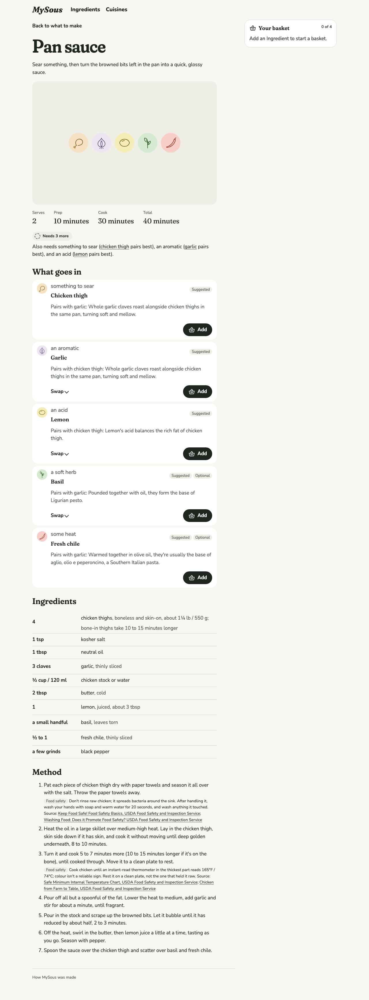

# 0014 · Recipes

Milestone: #13 (part of #2). A dish can have a recipe: quantities, timings and a full method, with cited guidance on every step where food safety is at stake. The recipe follows whatever is in the dish, whether it came from the basket, a Pairing or a swap.

## After

| Screen | After |
| --- | --- |
| Pan sauce, empty basket: the recipe as written, desktop light |  |
| Pan sauce, basket of chicken thigh and lime, phone dark |  |

## How it got here

The ticket asked for a "Showcase Recipe": a fixed, worked example on its own page. That was built first, at `/formulas/<id>/recipe`, linked as "See a worked recipe". Seeing it running, the author changed course:

- **Call them recipes.** "Worked recipe" and "Showcase Recipe" were names for an idea the Cook doesn't need to learn.
- **A recipe should swap and should start from the basket.** A fixed recipe for chicken, garlic and lemon says nothing to a Cook holding lime.

Swapping on a second page would have repeated the dish page, with two places to swap that could drift apart. So the recipe moved onto the dish page. The author chose this from options, along with the two decisions below.

## Decisions

**One page.** A dish with a recipe shows, in order:

1. its image frame;
2. serves and timings;
3. the swappable parts;
4. "Ingredients", with amounts;
5. "Method": the full recipe steps in place of the dish's short method.

A dish without a recipe is unchanged. The separate route and its link are gone.

**The recipe fills what the basket doesn't.** Parts fill in this order:

1. from the basket;
2. from Pairings;
3. any part still empty takes the recipe's own Ingredient;
4. Pairings again, since the recipe's Ingredients can give other parts a Pairing.

So an empty basket shows the recipe as written, plus anything that pairs into its optional parts (chile, which pairs with garlic), and a basket shows the Cook's own dish. Recipe fills read "Suggested" like Pairing fills. They don't count towards rank, which stays about what the Cook chose.

**Amounts follow the Ingredient (the author's choice).** Every part has an ingredient line. Its `amount` and `note` cover whatever fills the part, and `for` gives particular Ingredients their own amount, note, and the name as it reads after that amount: "3 cloves garlic, thinly sliced"; "a thumb-sized piece ginger, cut into matchsticks"; "2 limes" against "1 lemon". An Ingredient with no entry of its own takes the part's amount and note ("3 tbsp lime, juice"), so a line is never blank, though it reads less well; that's a prompt to write the entry. An optional part with nothing in it has no line. The Spec review caught the first version printing "2 lime" and "4 chicken thigh".

**Safety lives on the Ingredient (the author's choice).** A Recipe step marks the part its safety depends on and the topic, handling or cooking. The page shows the cited guidance of whatever Ingredient fills that part. Chicken thigh carries both topics:

- **Handling:** don't rinse it; wash hands and what it touched.
- **Cooking:** 165°F / 74°C on a thermometer, then rest it on a clean plate.

The sources are USDA Food Safety and Inspection Service pages. Swaps can bring in any Ingredient that fits, so the guarantee holds whatever is swapped in, as content grows. That replaces the first build's citation on each recipe step.

**Validation.** `loadKitchen` fails the build when:

- a Recipe is for an unknown Formula;
- a required part has no Ingredient as written;
- a fill names an unknown part or Ingredient, or one that doesn't fit;
- a part has no ingredient line, or two, or a line names an unknown part;
- an ingredient line or amount has a key it doesn't know (an unquoted comma in a YAML `{ … }` line once split a note this way, silently);
- an amount is given for an unknown Ingredient, or one that can't fill its part;
- a step refers to an unknown part;
- an Ingredient that could fill a safety step's part has no guidance on that topic;
- safety guidance has no citation.

**Read as a recipe.** These carry over from the first build:

- the facts are a description list;
- times are written as "minutes" (a screen reader can read "min" as "minimum");
- the lists are labelled "Ingredients" and "Method";
- amount and name sit in two columns with a space between, for reading aloud and copying;
- each linked name is a full-size tap target.

The image frame keeps its space and shows the drawings of what's in the dish, which now update with every swap, until #32 brings images.

## Tests

- **Vitest, through `loadKitchen`:**
  - recipe fills come after the basket and Pairings;
  - amounts follow each fill, including the fallback;
  - steps fill in, and follow a swap;
  - a safety step carries its Ingredient's cited guidance;
  - a dish without a recipe fills from the basket and Pairings alone;
  - each validation rule fails with its own message.
- **Playwright:**
  - an empty basket shows the recipe as written, with timings, amounts and the cited cooking guidance;
  - the recipe follows the basket and a swap, amounts and method included;
  - a dish without a recipe keeps its short method.
- **axe** covers the dish page with a recipe (both themes, phone and desktop), and so does the **reflow** check. The **phone tap-target** check passes.

## VoiceOver pass (for the author)

On `/formulas/pan-sauce?with=chicken-thigh,lime` in Safari, with VoiceOver on:

1. Rotor → Headings: Pan sauce (level 1), then What goes in, Ingredients and Method (level 2), with the parts at level 3.
2. Rotor → Lists: "Ingredients" and "Method".
3. The acid line reads "2 limes, juiced, about 3 tbsp". Swap the acid to lemon: the announcement says so, and the line now reads "1 lemon, juiced, about 3 tbsp". The announcement names the swap, not the new amount.
4. Method steps 1 and 3 read their text, then "Food safety", the guidance, and the linked USDA sources.
5. The drawings frame isn't announced.

## Content note

The pan sauce recipe is a placeholder for the tracer dish. The launch recipes, their per-Ingredient amounts, and their images arrive with #19.
