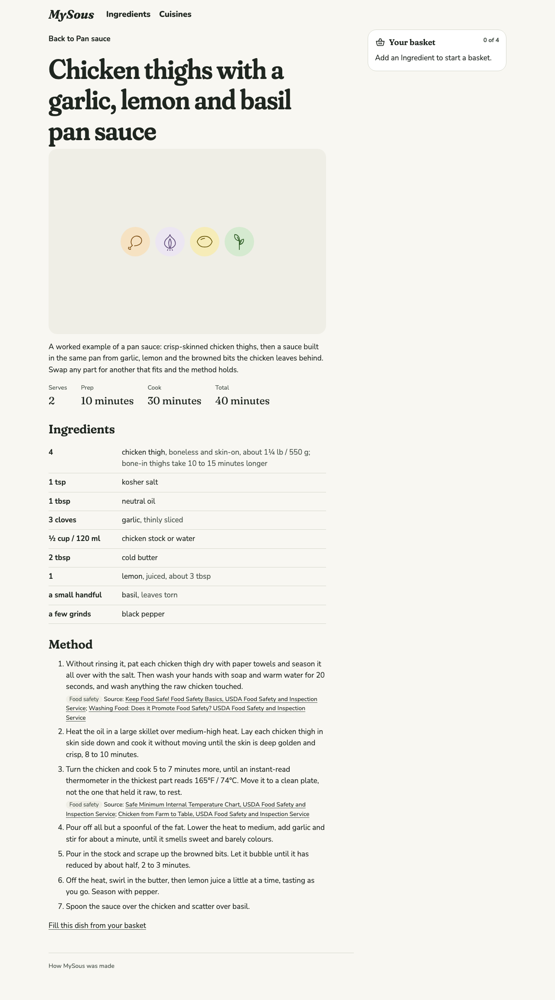
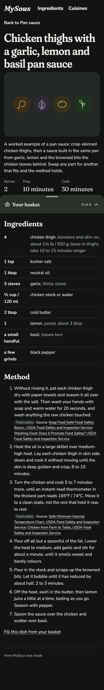
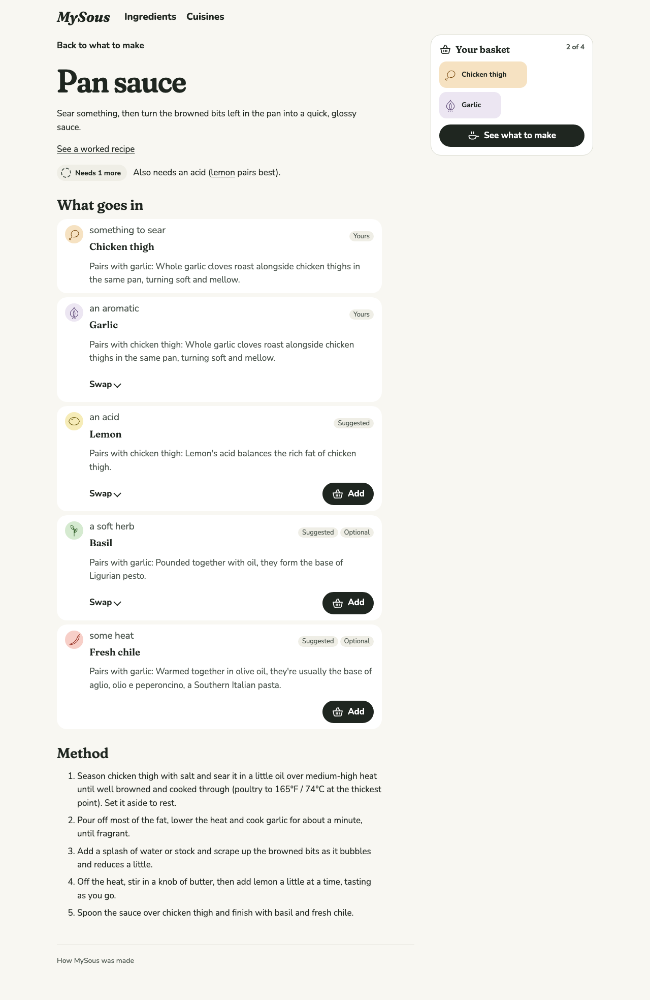

# 0014 · Showcase Recipe

Milestone: #13 (part of #2). A dish can now lead to a worked recipe: one fixed, complete way to make it, with quantities, timings, ordered steps and a cited source for every step where food safety is at stake.

## After

| Screen | After |
| --- | --- |
| Pan sauce, worked recipe, desktop light |  |
| Pan sauce, worked recipe, phone dark |  |
| Pan sauce, with the link to its worked recipe |  |

## Decisions

The author chose each of these from options.

**One Markdown file per recipe, named for its dish.** `content/recipes/pan-sauce.md` is the Showcase Recipe for the Pan sauce Formula, written as Ingredients are: frontmatter, then a short intro. The frontmatter has these fields:

- `fills`: each part's Ingredient.
- `ingredients`: each line either names a part or, for anything outside the dish (salt, butter, stock), gives a plain name.
- `steps`: each step refers to parts as `{slotId}`, as a Formula's method does.
- `serves` and `time`: prep and cook, in minutes.

Naming the file for its Formula makes one recipe per dish a fact of the file system, not a rule to check.

**Validation keeps a recipe honest to its dish.** `loadKitchen` fails the build when a recipe:

- is for a Formula that doesn't exist;
- leaves a required part unfilled;
- fills a part that doesn't exist, or uses an unknown Ingredient;
- fills a part with an Ingredient that doesn't fit it (lemon isn't an aromatic);
- fills a part without saying how much of it to use;
- lists or refers to a part it doesn't fill;
- marks a step `safety: true` without a citation.

The last is the rule the ticket asked for. Poultry and pork temperatures, cooked rice and quick pickles get conservative, cited guidance, never a confident sentence alone. The pan sauce marks two steps safety-sensitive, each citing USDA Food Safety and Inspection Service pages:

- handling the raw chicken: don't rinse it, and wash your hands and what it touched;
- cooking it to 165°F / 74°C, then resting it on a clean plate, not the one that held it raw.

The Spec review raised the hand-washing and the clean plate.

**At `/formulas/<id>/recipe`, called a "worked recipe".** The recipe lives under its dish. The dish page offers "See a worked recipe" only when one exists. The recipe links back with "Back to Pan sauce" and, at its foot, "Fill this dish from your basket". Both links keep the basket. "Worked recipe" says what it is to the Cook: one example, where the dish is the adaptable idea. "Showcase Recipe" stays in code and docs.

**No fake image.** The finished-dish image arrives with #32, which owns the format, the provenance and the "AI-generated image" note. Until then, the frame shows the drawings of what's in the dish, which is the fallback #32 already requires. The frame's space is reserved with an aspect ratio, so an image dropping in later won't shift the page. The drawings repeat the ingredient list, so the frame is hidden from screen readers rather than given alt text.

**Read as a recipe, by eye and by ear.**

- The facts (serves, prep, cook, total) are a description list.
- Times are written as "minutes", since a screen reader can read "min" as "minimum".
- The ingredients are a list labelled "Ingredients", in two columns, amount then name, so names line up down the page.
  - Names are lower-case, like "kosher salt" beside them; the ones that fill a part link to their Ingredient.
  - A space between the columns keeps "4 chicken thigh" from being read or copied as "4chicken thigh".
- The method is an ordered list labelled "Method". A safety step carries a "Food safety" tag and its source, linked.

## Tests

- Vitest through `loadKitchen`:
  - `showcase()` resolves the fills and the ingredient lines, fills `{slotId}` in steps and totals the time;
  - a dish without a recipe has none;
  - each validation rule above fails with its own message.
- Playwright:
  - dish → worked recipe → back, with the basket kept;
  - quantities, timings, ordered steps and the safety citation;
  - no link from a dish without a recipe.
- The recipe page joins the axe sweep (both themes, phone and desktop) and the reflow check (320px to wide, and 200% zoom).

## VoiceOver pass (for the author)

On `/formulas/pan-sauce/recipe` in Safari, with VoiceOver on:

1. Rotor → Headings: the recipe name (level 1), then Ingredients and Method (level 2).
2. Rotor → Lists: "Ingredients, 9 items" and "Method, 7 items".
3. In the ingredient list, each item reads amount then name, such as "4 chicken thigh, boneless and skin-on…", and the part names are links.
4. In the method, steps 1 and 3 read their text, then "Food safety", "Source:" and the linked USDA pages.
5. The drawings frame isn't announced.
6. "Back to Pan sauce" and "Fill this dish from your basket" lead to the dish with the basket kept.

## Content note

The pan sauce recipe is a placeholder for the tracer dish. The launch recipes, and their images, arrive with #19.
