# 0016 · Imagery

Milestone: #32 (part of #2). Ingredients, dishes and Recipes can have an image, shown where there's room. Each is labelled with how it was made, and the line drawings stay the mark everywhere else. The format, its validation, the build that serves images, and the three places they show are done. Two placeholders stand in until the real images arrive with the content tickets (#17, #18, #19).

## Before and after

| Screen | Before | After |
| --- | --- | --- |
| Lemon, desktop light | 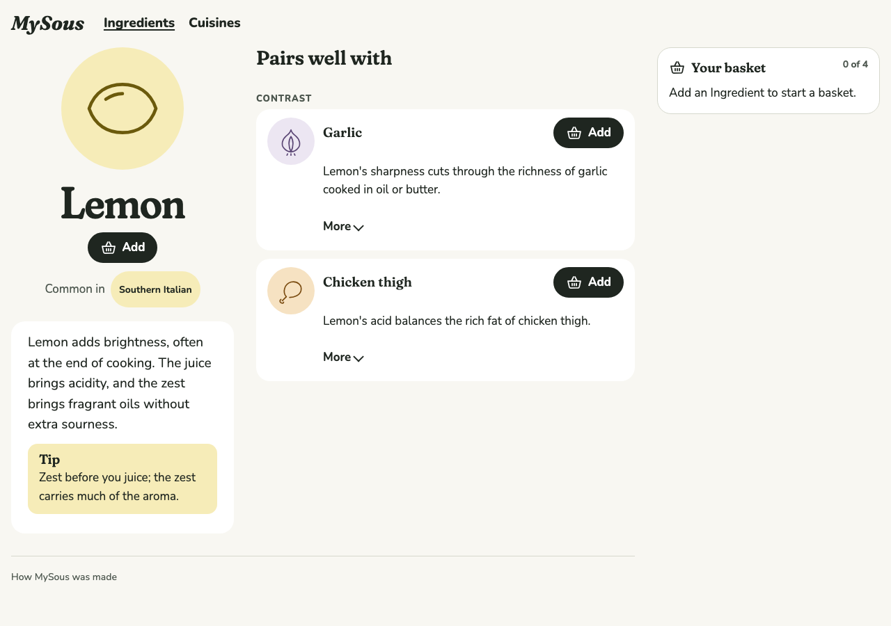 | 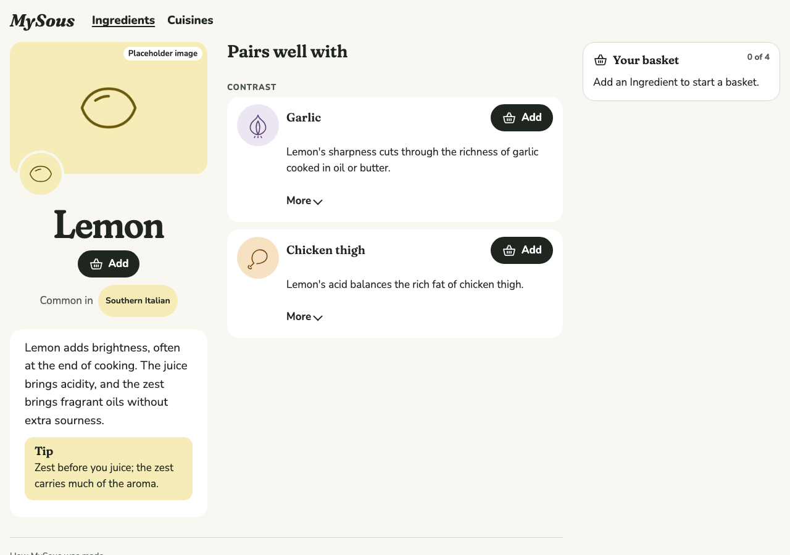 |
| Lemon, phone dark | 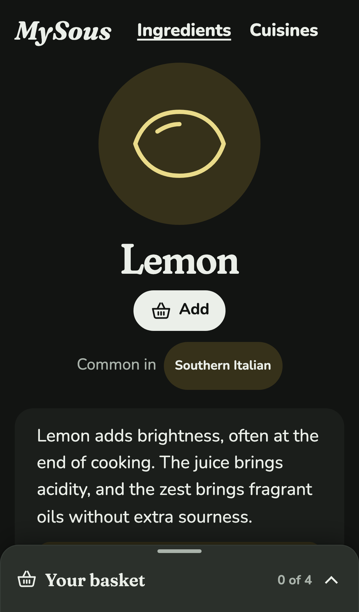 | 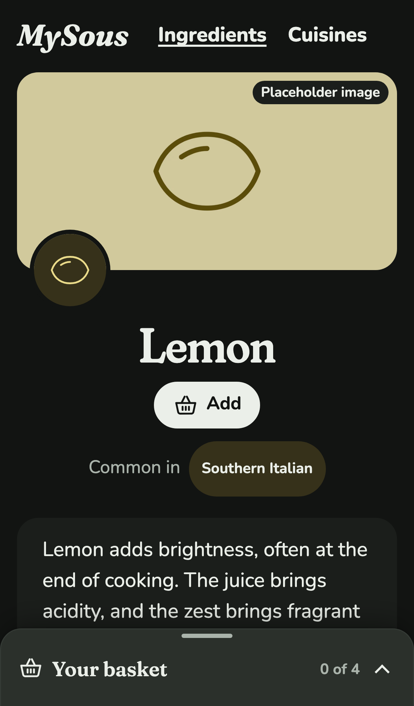 |
| Pan sauce, basket of chicken thigh and lime, desktop light | 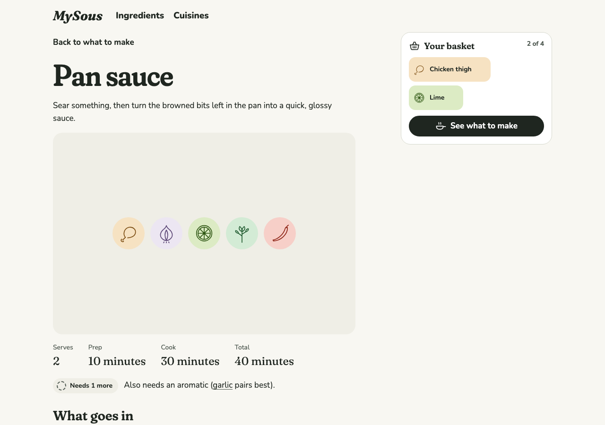 | 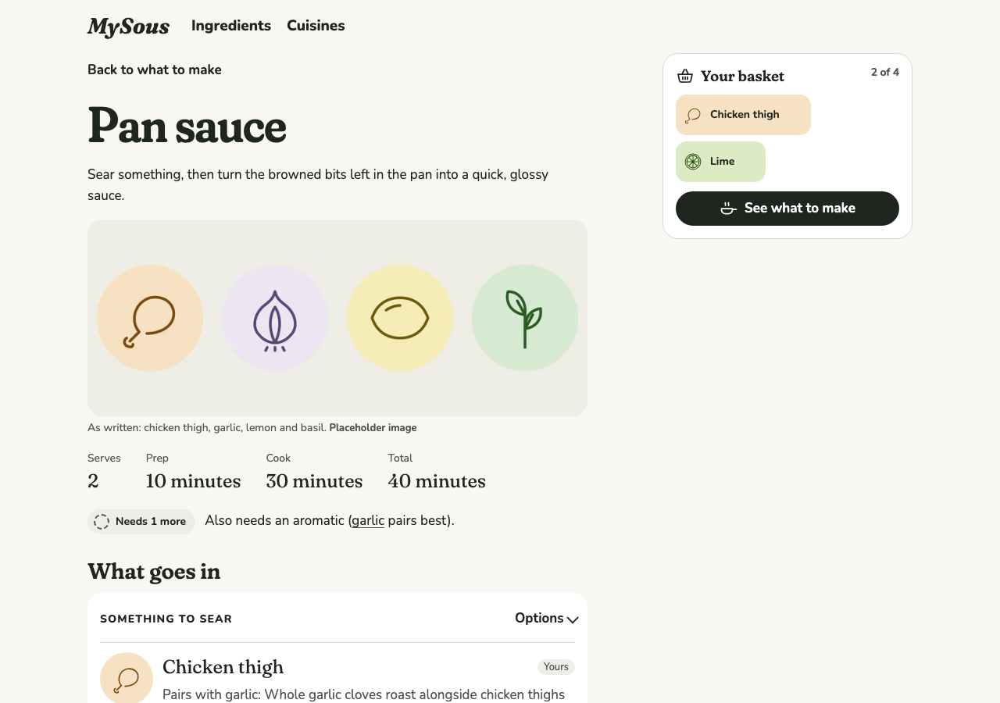 |
| Pan sauce, phone dark | 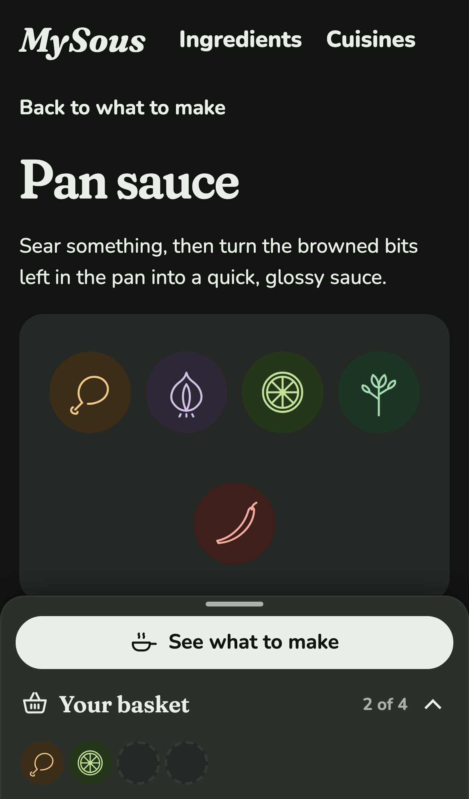 | 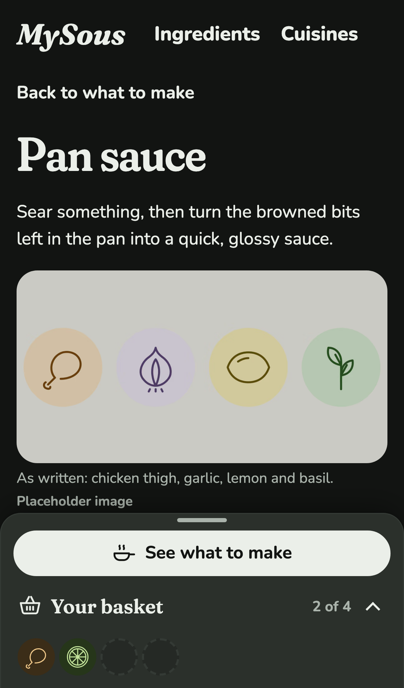 |
| What to make, desktop light | 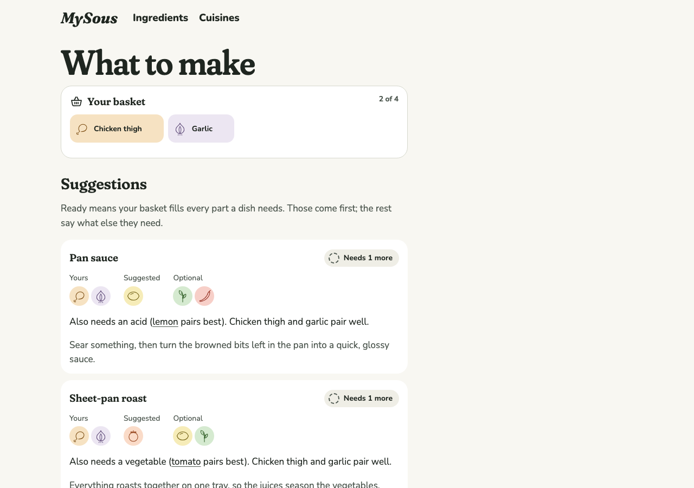 | 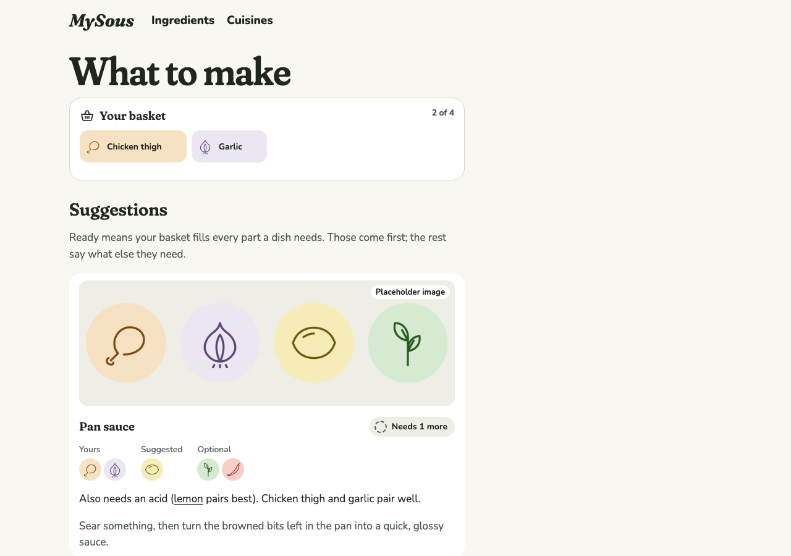 |
| What to make, phone dark | 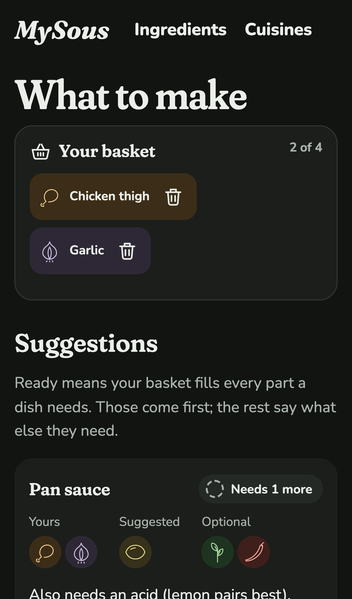 | 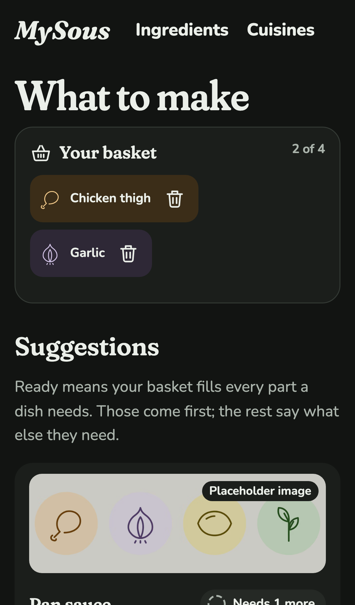 |

## Decisions

The author chose each of these from options.

**Placeholders are rendered from the drawings, and say so.** No image model is available while building, and the ticket wanted placeholders so the layouts could be built and tested now. `npm run placeholder` renders one from Ingredients' drawings, on their washes: one Ingredient fills the frame, or a dish's Ingredients sit in a row. Its provenance says `made: placeholder`, and the page labels it "Placeholder image", not "AI-generated image". The build refuses a placeholder marked as reviewed, so a stand-in can't pass as the real thing. There are two: lemon, for an Ingredient page, and the pan sauce's Recipe, for a dish.

**A Recipe's image shows the dish as written, and says so.** The dish page follows the Cook's basket and changes, so its fill often isn't the recipe as written. A photo of chicken, garlic, lemon and basil above a dish of chicken and lime would mislead. The image always shows, captioned "As written: chicken thigh, garlic, lemon and basil." Without a Recipe image, a Formula's own image shows a typical result, captioned "A typical pan sauce.". Without either, a dish with a Recipe keeps the frame of drawings from #13, and a dish without a Recipe has no frame. The Kitchen's `dishImage` makes that choice, so the dish page and the Suggestion card can't disagree.

**Images are made by a sharp script before the build.** The site is a static export, so `next/image` can't resize at request time. `npm run images` runs before `next build` and `next dev`. It makes AVIF and WebP files at 480, 800, 1200 and 1600 pixels wide, capped at the image's own width, into a git-ignored `public/images/`. It remakes an image only when its file is newer than what was made from it. `ContentImage` builds the matching `<picture>` from the same list of widths, so there's no manifest to keep in step.

## The format and its validation

An image is a file under `content/images/`, named in an Ingredient's, a Formula's or a Recipe's `image`, with alt text and provenance: how it was made, the model, the prompt, the date and the author's review. `loadKitchen` measures each image with sharp and fails the build when:

- its file is missing;
- it has no alt text or no provenance, or an AI-generated image doesn't name its model or prompt;
- it's AI-generated and unreviewed, or its review found it doesn't match;
- it's a placeholder marked as reviewed;
- it's under 1024 pixels on its shorter side, or over 5 MB.

Each message names the owner, such as "Recipe pan-sauce's image is 800×600; it needs at least 1024 pixels on its shorter side."

## Where images show

- **An Ingredient's page.** A banner across the top of the hero. On a phone it's capped at 28% of the screen's height, so the name and Add stay above the docked basket. The drawing stays, smaller, on the banner's lower corner, ringed in the page's colour, so it doesn't cover what the image shows. The note sits on the image's top corner, on the surface colour, which keeps its contrast whatever the image is. The alt text is the content's own.
- **A dish's header.** In place of the drawings frame, captioned as above, with the note after the caption. It's capped on a phone like the banner.
- **A Suggestion card.** A low strip across the top of the card, with the note on it. It's hidden from screen readers, since the card's heading names the dish, and it loads lazily.

Every image has its width and height in the page, so its space is kept before it arrives. In the dark theme, images are dimmed slightly so a light one doesn't glare.

## Found along the way

On a phone, the dish page's readiness line was already below the docked basket bar before this change. The drawings frame from #13 put it there, at 3:2 across the full width. The capped image leaves it about where it was (725 against 730 pixels down, on a 664-pixel screen), so this change doesn't fix it. That's for a follow-up: perhaps a lower header on phones, or the readiness line above the image.

## Coverage, honestly

The ticket asked for a placeholder on one Formula. The dish placeholder went on the pan sauce's Recipe instead, since a Recipe's image is what a dish page shows first. Content has only two dishes, so the built site can't show every case:

- **In Playwright:** a Recipe's image (pan sauce), and a dish with neither image nor Recipe (sheet-pan roast).
- **In Vitest only:** a Formula's typical image, and a Recipe without an image falling back to the drawings. The choice between them is the Kitchen's `dishImage`, tested for all three outcomes. On the page, the two differ only in the caption, or are the frame from #13.

The first real Formula image, with #19, will show the "A typical …" caption on a page; a Playwright check belongs with it.

The dish header and the Suggestion cards are drawn in the browser, like the rest of those pages: the static page sends no dish parts or cards until the page is live. Their images keep their space once drawn, and the Suggestion card's test checks that the card below doesn't move as the image arrives. But the dish image's fetch starts only once the page is live, not while the page loads.

## Tests

- **Vitest, through `loadKitchen`:**
  - an Ingredient, a Formula and a Recipe get their image, measured;
  - a dish's image is its Recipe's (with what it shows as written), else its Formula's, else none;
  - content can go without images;
  - a placeholder is accepted unreviewed;
  - each validation rule fails with its own message;
  - a Formula's and a Recipe's errors are named as theirs.

  The fixture helpers moved to `src/kitchen/test-content.ts`, shared by both test files.
- **Vitest, the image build:**
  - every width up to the image's own, in both formats, sized right;
  - only changed images are remade;
  - nothing is made when content has no images.
- **Playwright:**
  - each place with an image (alt text or hidden, the note, the drawing kept, eager or lazy loading, the `srcset`) and without one;
  - no layout shift on all three, measured with every image file held back until the page is measured;
  - on a phone, Add stays above the docked basket, and the dish image stays low.

  The lemon page joins the reflow check. axe already covered the lemon page, the pan sauce and What to make, in both themes, at phone and desktop widths.

## Review

The Standards and Spec reviews led to:
- `dishImage` in the Kitchen, so the page and the card pick the same image;
- clear messages for a missing alt key, model or prompt;
- the card's layout-shift test;
- sharp moving to `dependencies` (the build needs it, like `gray-matter`);
- a shared `sizes` value for banners and a shared test helper;
- "image" not "photo" in a test, as the glossary asks.

## Still to do

- **The VoiceOver pass (for the author).** On `/ingredients/lemon`, the banner reads its alt text ("A placeholder, the drawing of a lemon on its pale yellow.") and the note "Placeholder image". On `/suggestions?with=chicken-thigh,garlic`, the Pan sauce card's image isn't announced, but its note is.
- **The author review gate.** The style guide (`docs/image-style-guide.md`), the placeholders, and the three layouts.
- **No voice guide exists yet**, so the style guide sits in `docs/` on its own rather than beside one.
