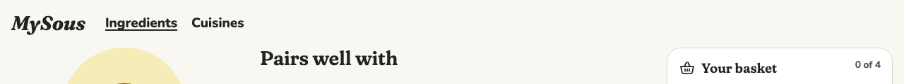
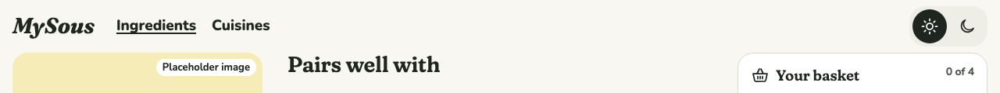
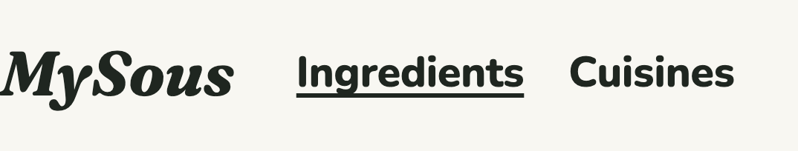
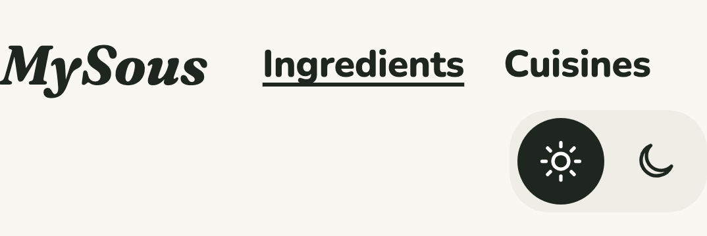
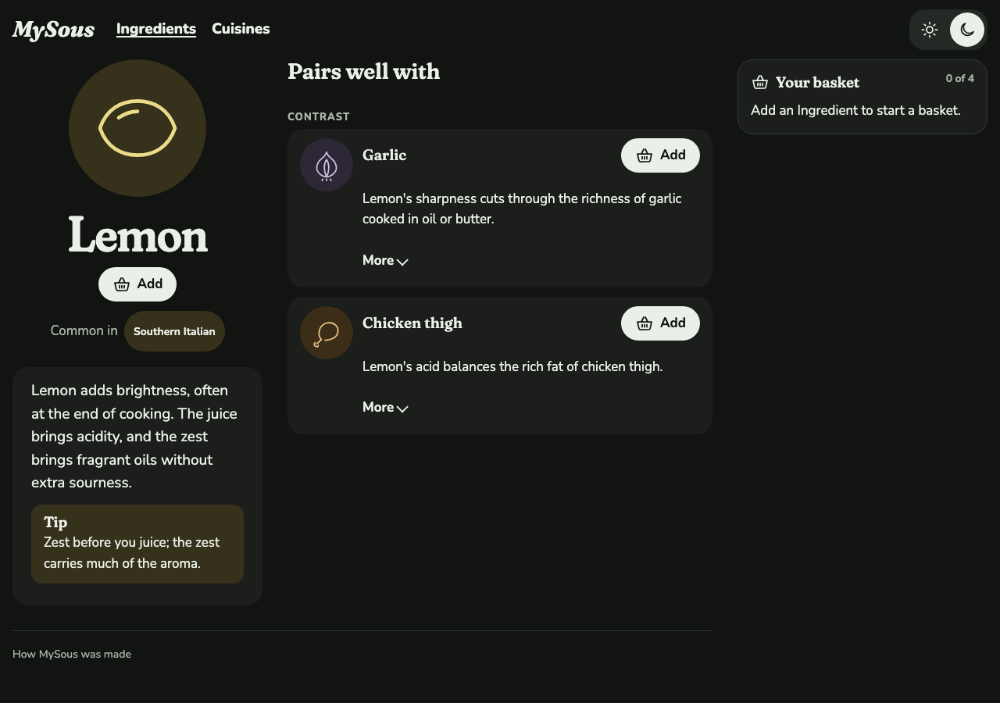
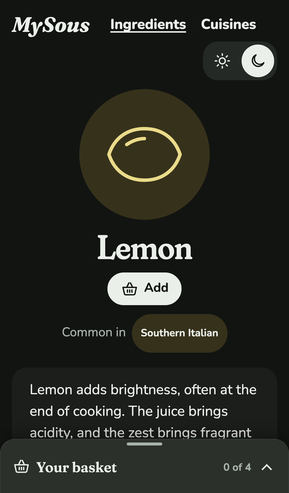

# 0017 · Theme switcher

Milestone: #42 (part of #2). MySous has always followed the device's light or dark setting. Now a sun and a moon in the window's top-right corner let the Cook choose, and the choice is remembered.

## Before and after

| | Before | After |
| --- | --- | --- |
| Header, desktop |  |  |
| Header, phone |  |  |
| Dark chosen on a light device, desktop | |  |
| Dark chosen on a light device, phone | |  |

## Decisions

The author chose each of these from options.

**Light and Dark, no System.** Two icons, starting from whatever the device uses, which shows as chosen. Once the Cook picks one, it holds; there's no way back to following the device, short of clearing the site's data. A System choice was offered and declined, to keep the control to two icons.

**Remembered, with ADR 0004 amended.** The choice is stored in `localStorage` as `theme`. It's the one thing MySous keeps in the browser: a display preference, not app state, so the basket still lives only in the URL. ADR 0004 now says so.

**Its own ticket.** It's on its own branch and PR, separate from imagery (#32), so each can be reviewed and reverted alone.

**In the window's corner, not the page's.** The author asked for it at the far right of the window, not the right of the centred layout. Wider than a phone, it's placed against the window, in the body's 16px gutter, level with the header's first row. On a phone, the window's corner is where the nav is, so it keeps a row of its own at the right.

## How it works

- **No flash.** A one-line script in the page's head reads the stored choice and sets `data-theme` on the page before it paints, before the app's scripts load. If storage is unavailable (a private window, say), it does nothing and the device's setting applies.
- **Still one source of tokens.** `themeCss()` writes the dark palette, Ingredient colours included, twice: under the device's dark setting unless Light is chosen, and whenever Dark is chosen. Each sets `color-scheme` to match, so form controls and scrollbars follow.
- **The control.** The issue said two buttons with `aria-pressed`; a radio group fits a choice of one better and brings arrow keys. `SegmentedControl` gains icons and an icons-only mode, shown on `/design`, with each label still there for screen readers. The theme is a radio group named "Theme" with "Light" and "Dark", so arrow keys move the choice, and screen readers say which is on. Each segment is a full 44 px target. `ThemeSwitch` (in `src/app`) keeps the state: it reads the page's theme once it's live, follows the device while nothing's chosen, and stores a choice.

## Noticed

- **On a phone, the switch wraps to its own row.** The wordmark, the nav and the switch don't fit across 390 pixels. The switch sits at the right of a second header row, which costs about 50 pixels at the top of every page. Add to basket still clears the docked basket on an Ingredient's page (checked by #32's tests, once merged).
- **Imagery (#32) merged first.** It dimmed images under the device's dark setting only. The dim is now a theme variable, `--image-filter`, set wherever the dark palette applies, so a chosen Dark dims images too (tested).

## Tests

- **Playwright:**
  - with nothing chosen, the page follows the device, light or dark, and the matching radio is on;
  - choosing Dark switches the page and an Ingredient's colours, and holds across a link and a reload;
  - choosing Light wins over a dark device, across a reload;
  - with the app's scripts blocked, a stored choice still applies on load, so there's no flash;
  - arrow keys move the choice;
  - a chosen Dark dims images;
  - wider than a phone, the switch sits 16px from the window's right edge, level with the header.
- **axe** runs on every screen with Dark chosen on a light device and Light chosen on a dark one, as well as in both device themes. So does the **focus-ring check**. The tap-target check covers the header's new control.
- **Vitest:** `themeCss()` gives the dark palette, Ingredient colours included, under the device's dark setting unless Light is chosen, and whenever Dark is.

## Review

The Standards and Spec reviews led to:
- the theme's key, type and head script moving out of the tokens into `src/design/theme.ts`, with one list of themes for the script and the switch;
- `themeCss()` getting back the doc comment the new code had pushed off it;
- the icons-only control on `/design`;
- the focus-ring check and a Vitest check with a chosen theme;
- a README line.

Before the page is live, neither option shows as chosen, since the static page can't know the device or the choice. That's a moment at load, and the page itself is already in the right theme.

## VoiceOver pass

**Status: passed.** The author ran this pass on 2026-11-07, and everything behaved as expected.

In Safari, with VoiceOver on: Tab into the header after the nav. It reads "Light, radio button, 1 of 2, Theme" (or Dark, if that's what's on). Press Right Arrow: the page turns dark, and VoiceOver reads "Dark, selected".
