# 0018 · Voice guide and Pairing research, batch 1

Milestone: #17 (part of #2). MySous has a voice guide, and the build enforces the parts of it a machine can check. The content grows from 11 Ingredients and 17 uncited Pairings to 30 Ingredients and 125 Pairings, every one citing a source with a link. The six launch Cuisines are in, with Ligurian and Cantonese kept alongside.

## Before and after

| Screen | Before | After |
| --- | --- | --- |
| Ingredients, desktop light | 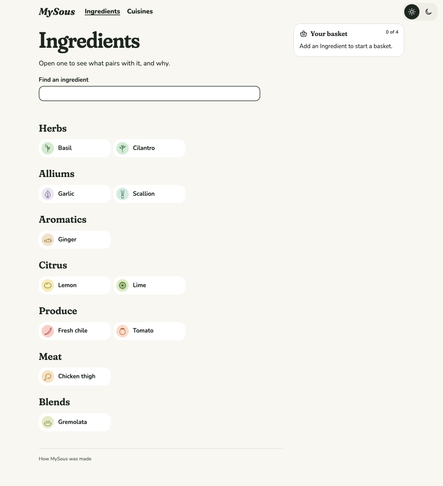 | 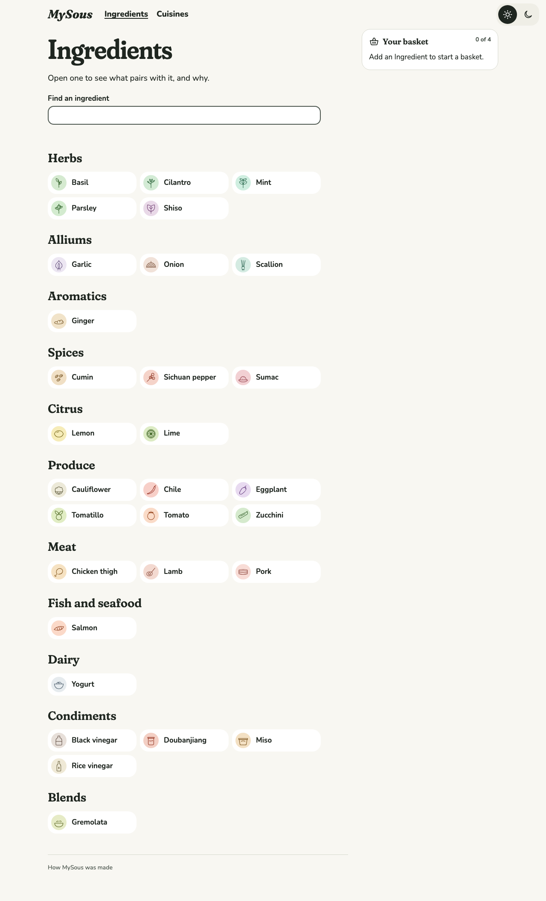 |
| Cuisines, phone dark | 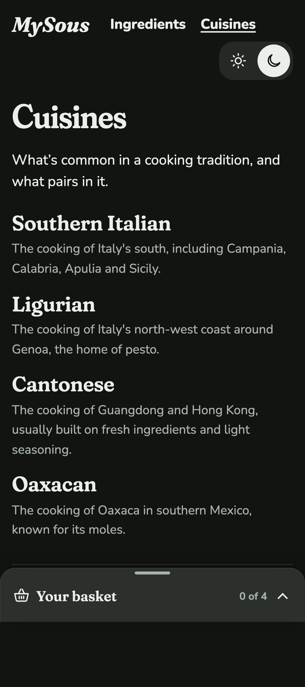 | 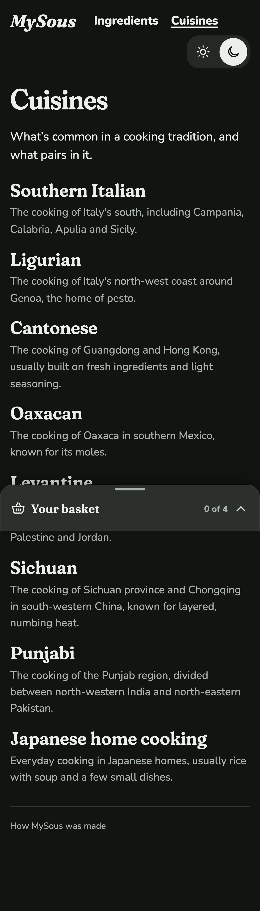 |
| Lemon, desktop light | 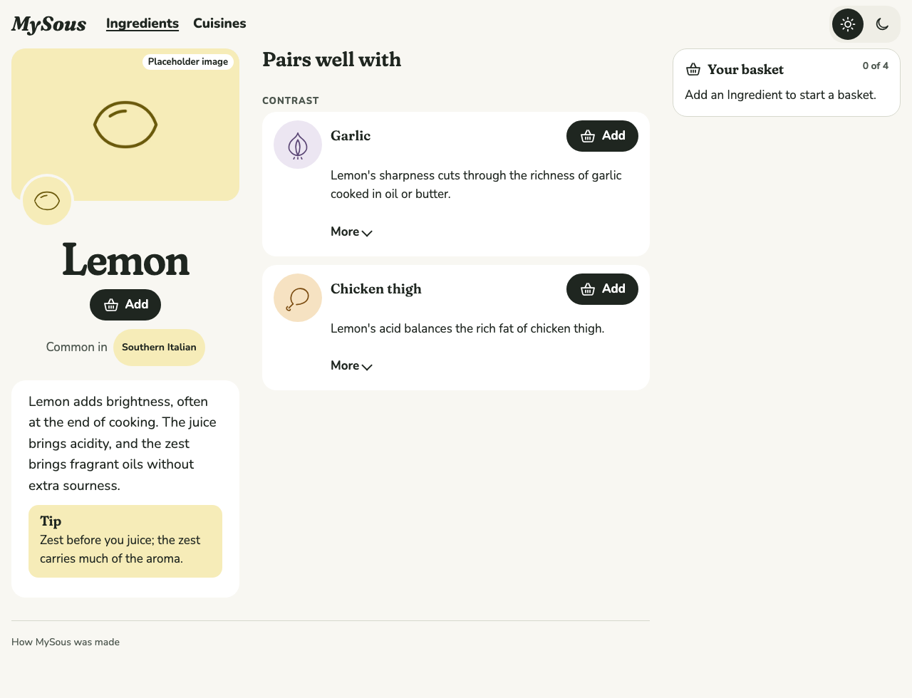 | 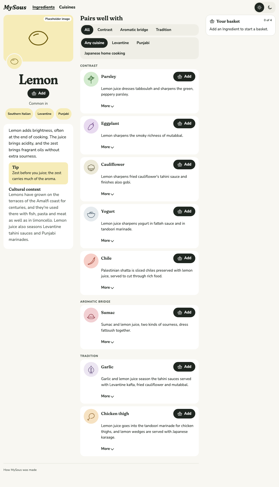 |
| Chicken thigh, phone dark | 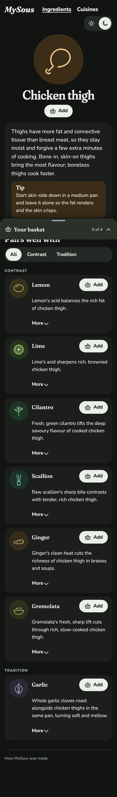 |  |

New pages:

| Screen | After |
| --- | --- |
| Sumac, desktop light | 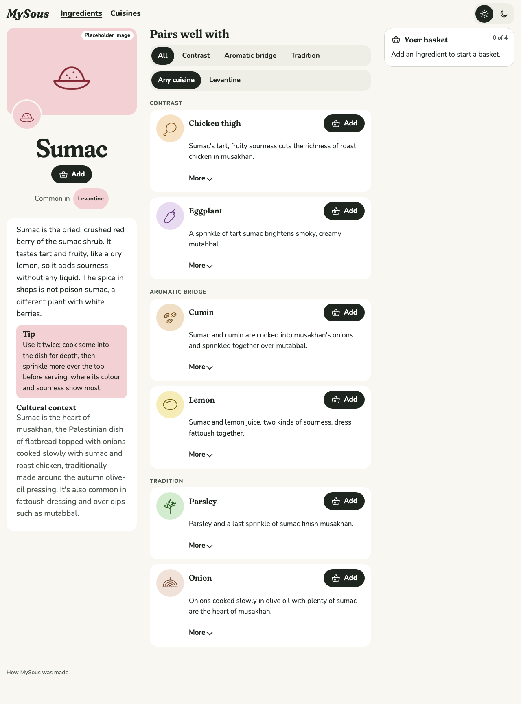 |
| Doubanjiang, phone dark | 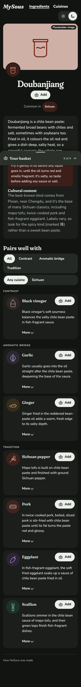 |
| Levantine, desktop light | 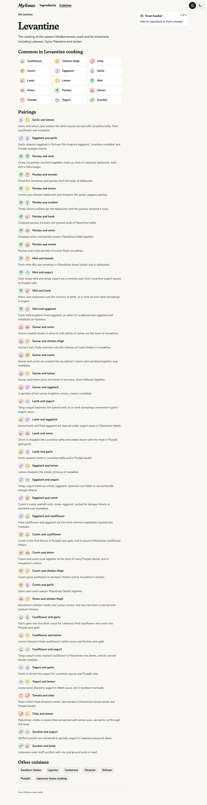 |
| What to make with lamb and yogurt, desktop light | 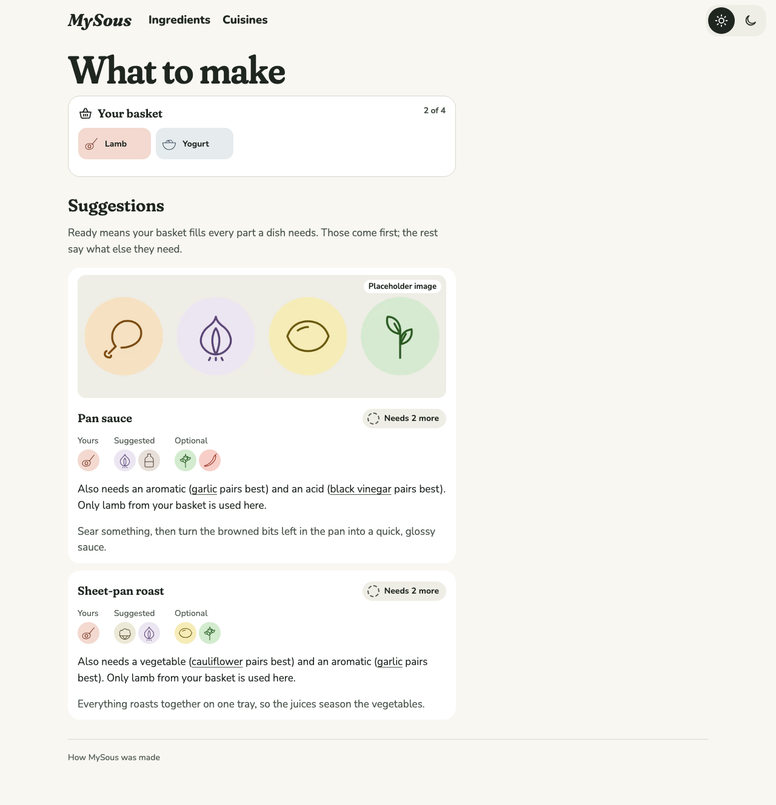 |

## Decisions

The author chose each of these from options.

- **The proposed six launch Cuisines:** Levantine, Sichuan, Oaxacan, Southern Italian, Punjabi and Japanese home cooking. Ligurian and Cantonese stay as extra Cuisines on the Pairings attested in them.
- **30 Ingredients:** the 11 from the tracer, re-researched and brought to the same depth, plus 19 new. The author asked for 30 rather than the ticket's 20, so #18 needs about 10 more to reach 40.
- **Every Pairing cites a source the reader can open.** A citation needs an http or https link to a page that was fetched and read while researching. The Cook doesn't see Pairing sources; they're for review and for the author.
- **Placeholders for every Ingredient.** No image model is available while building, so each Ingredient has a placeholder rendered from its drawing (`npm run placeholder`), labelled "Placeholder image". The PR carries a prompt for each, written to the image style guide, for the author to generate, review and swap in.

## The voice guide and its checks

`docs/voice-guide.md` covers who's speaking, the banned words, hedging, naming Cuisines, how to write an Ingredient and a Pairing, and mechanics (British spelling, the ingredient names most US home cooks use, both measurement systems). `loadKitchen` now fails the build when:

- any copy the Cook reads (essays, tips, cultural context, safety notes, Pairing Reasons, Formulas, Recipes, Cuisine descriptions, alt text) says "easy", "easily", "simply", "just" or "authentic", as a whole word in any case, naming the owner and field, such as "Ingredient salmon's safety.cooking.note says "easily"". Words that only contain one, such as "adjust", pass;
- a Pairing cites no source, or a source without a link;
- a citation's link isn't a web page.

The check caught two of the batch's own slips while it was being written. Hedging, tone and "common in…" can't be checked mechanically, so they stay in the guide for review.

## How the research was done

Three research agents read primary sources, one per group of Cuisines (Levantine and Punjabi; Sichuan, Japanese and Cantonese; Oaxacan, Italian and food safety). Each wrote its findings to `docs/research/0017-*.md`, with a quote from the source for every claim. The content cites only URLs that appear in those notes. Where a note named a dish but not its page, the page was found and fetched while writing, and added to the notes. Two guessed addresses turned out to be 404s and were replaced with the real pages. A final check confirmed that every cited link resolves. A handful of government pages refuse automated requests (USDA, CDC, Health Canada), but none is missing.

The sources lean on cooks and writers from inside each tradition (Anissa Helou, Reem Kassis, Wafa Shami, Izzah Cheema, Fuchsia Dunlop, the Leung family, Namiko Hirasawa Chen), and on official bodies: Japan's agriculture ministry (MAFF), Mexico's agriculture ministry, Regione Campania, the Larousse *Diccionario enciclopédico de la Gastronomía Mexicana* and the Pesto Genovese consortium. None comes from *The Flavour Thesaurus*, *The Flavor Bible* or compound data (ADR 0001).

## What changed in the existing content

Checking the tracer's content against sources changed some of it:

- **Two Pairing Reasons said more than any source.** "Lemon's sharpness cuts through the richness of garlic" and "Ginger's clean heat cuts the richness of chicken thigh" are now what the sources do show: garlic and lemon in Levantine tahini sauces, and ginger with chicken in Cantonese, Punjabi and Japanese cooking.
- **Gremolata lost its only Pairing.** No source pairs it with chicken thigh; every source ties it to osso buco, which isn't in MySous. It has no Pairings until #18 adds something it's attested with.
- **Corrections from the sources:** a chile's heat is made in the pale core the seeds cling to, not only the ribs. Chicken thigh starts in a cold pan. The ginger-scallion sauce is often made raw, with hot oil as one option. Cold blackens basil.
- **Claims no source supported were cut,** such as "lime is sharper and more floral than lemon" and "bone-in thighs bring the most flavour".
- **"Fresh chile" became "Chile",** since the Sichuan Pairings are about dried chiles.

The proteins brought new safety guidance: pork and lamb (FDA, the UK Food Standards Agency, Health Canada, Texas A&M AgriLife) and salmon (FDA). The Formulas' methods now give the safe temperature for each kind of protein, not only poultry. Ingredients gained four categories for the Ingredients page: spices, fish and seafood, dairy, and condiments. "Pantry" was avoided as a name, because ADR 0004 cut that concept.

## Coverage, honestly

- **The drawing-only hero is no longer on any page.** Every Ingredient now has an image, so the Playwright test of an Ingredient without one had no page left and was removed. The fallback code is unchanged. It returns once a reviewed image replaces a placeholder only for some Ingredients, or the author drops one.
- **Tests that leaned on the old content were rewritten to check the same behaviour,** not the old copy. For example, "a required Slot nothing pairs with" now uses yogurt, because with 125 Pairings almost everything finds a vegetable.
- **Coverage is uneven between Cuisines.** About 40 Pairings each are tagged Levantine and Punjabi, against 9 for Southern Italian, where several publications refused automated fetching. #18 should even this out.
- **The Japanese side leans on one writer,** Just One Cookbook, with MAFF behind the miso, rice vinegar and salmon claims.
- **Miso and yogurt fill no Slot.** Neither fits the current Slot types (a seasoning or a sauce). #19's Formulas are the place to decide.
