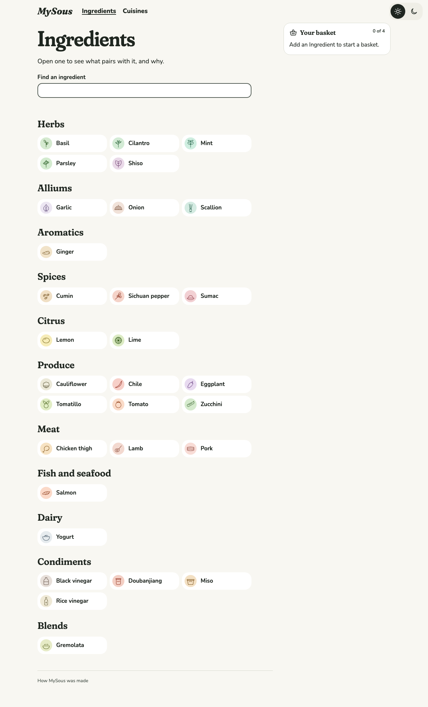
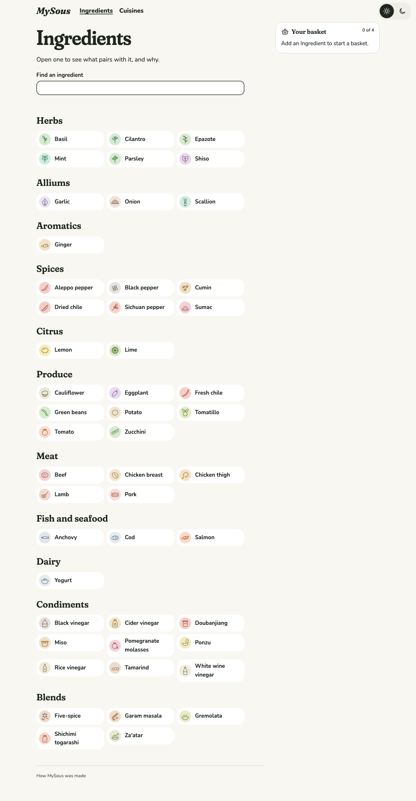
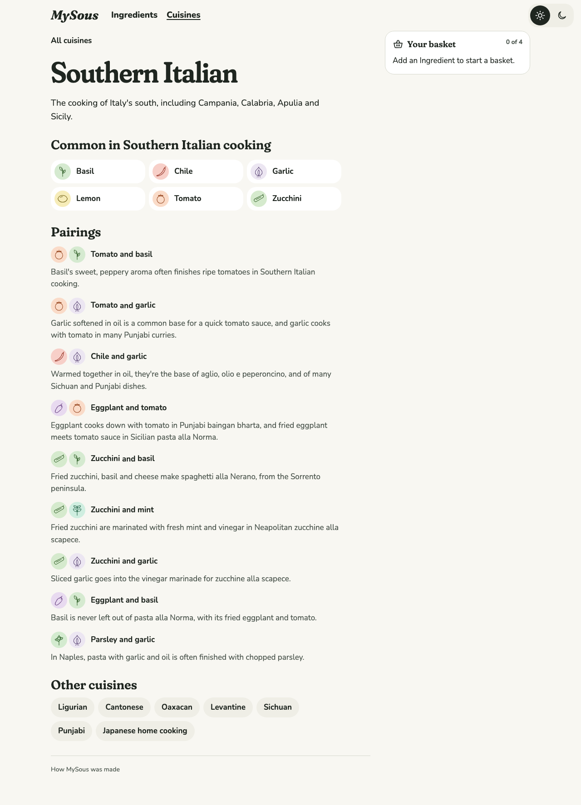
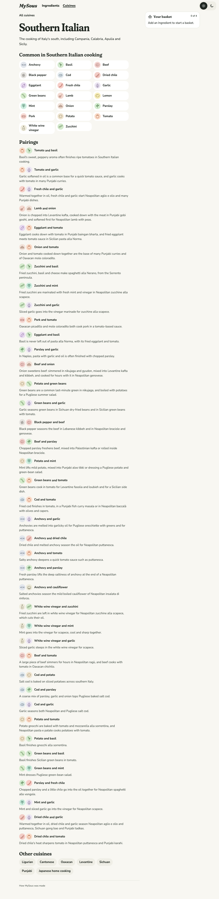
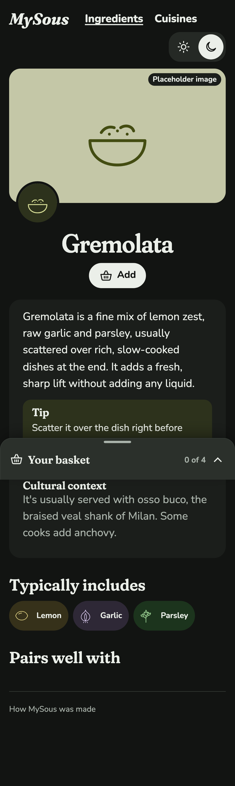
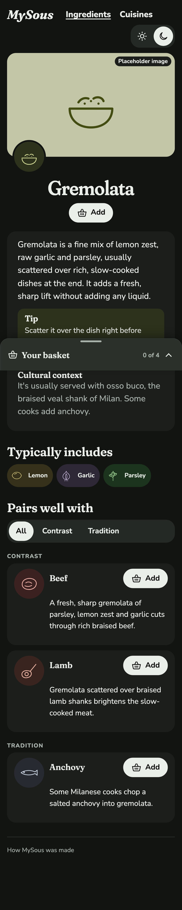
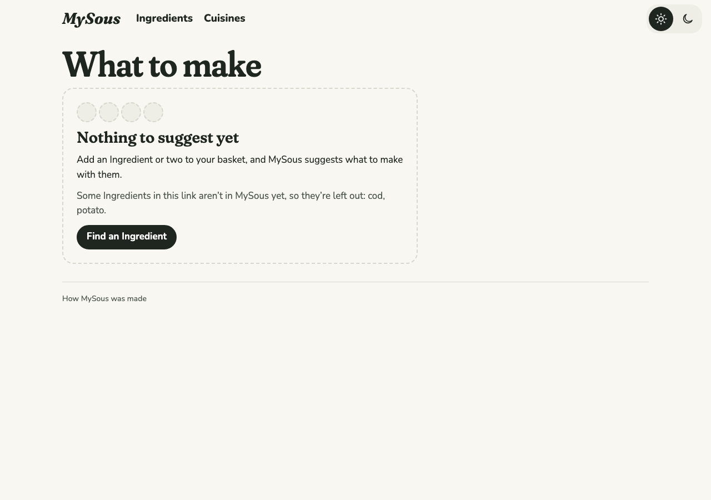
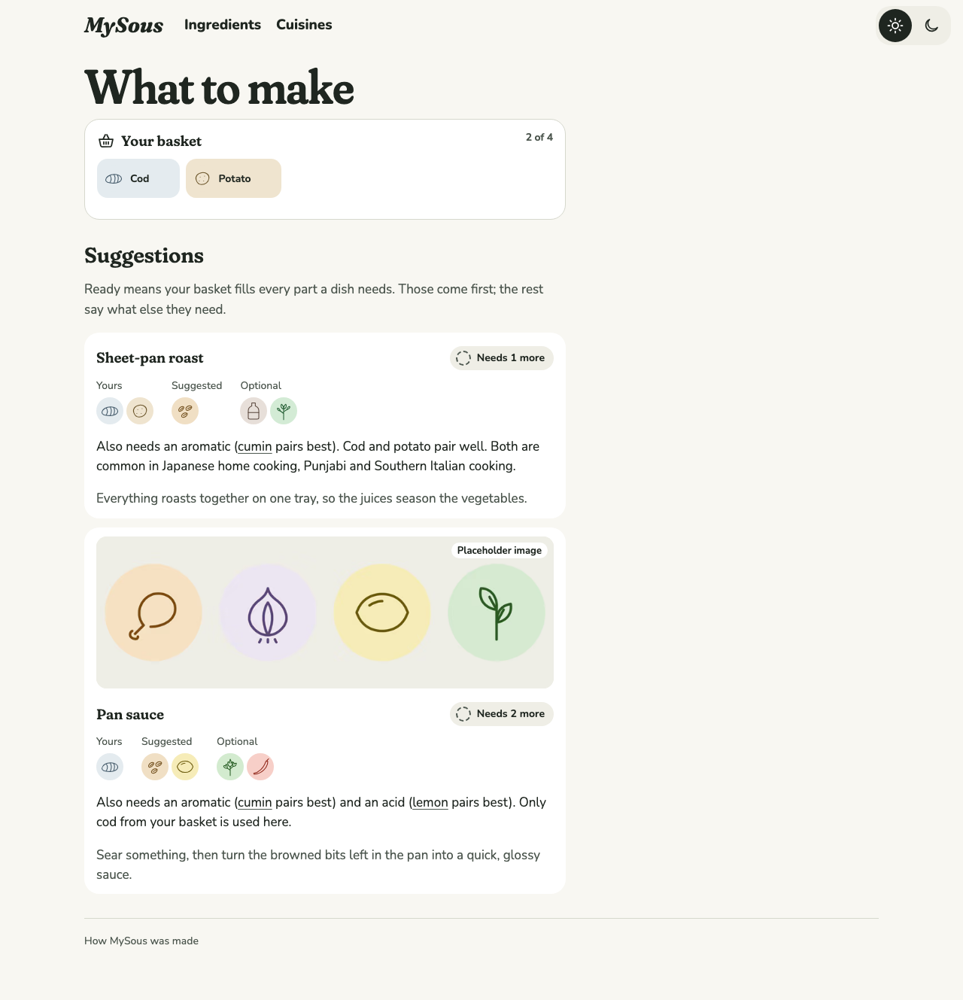
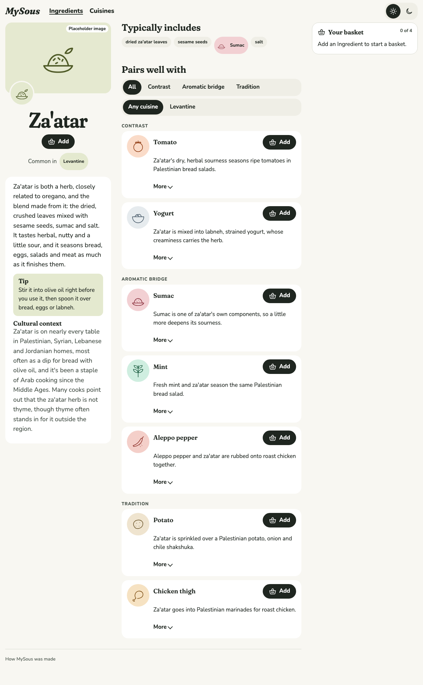
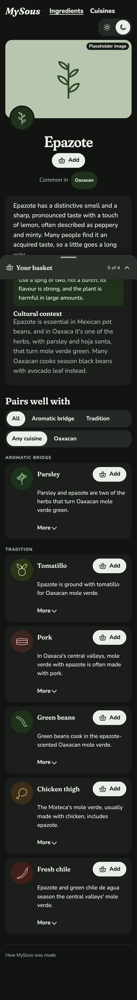

# 0019 · Pairing research, batch 2

Milestone: #18 (part of #2). The content grows from 30 Ingredients and 125 Pairings to 49 Ingredients and 256 Pairings, including Blends for four Cuisines. Every launch Cuisine now has at least three Ingredients for every Formula Slot type, or a sourced exception that says why not, and a test holds the content to that.

## Before and after

| Screen | Before | After |
| --- | --- | --- |
| Ingredients, desktop light |  |  |
| Southern Italian, desktop light |  |  |
| Gremolata, phone dark |  |  |
| What to make with cod and potato, desktop light |  |  |

New pages:

| Screen | After |
| --- | --- |
| Za'atar, desktop light |  |
| Epazote, phone dark |  |
| Oaxacan, phone light |  |

## Decisions

The author chose each of these from options.

- **About 12 new Ingredients, then more to close gaps.** The batch first added 14, chosen so each fills gaps in several Cuisines at once. Review then found that most exceptions were gaps in MySous's own catalogue rather than Cuisines that seldom use a Slot type. The author chose to close them now and to add five-spice, which brought in 5 more.
  - Blends: za'atar, garam masala and shichimi togarashi.
  - Heat: black pepper, Aleppo pepper.
  - Acid: tamarind, ponzu, white wine vinegar.
  - Protein: beef, cod.
  - Vegetables: potato, green beans.
  - Southern Italian aromatic: anchovy.
  - Oaxacan soft herb: epazote.
  - Closing gaps: pomegranate molasses (Levantine acid), cider vinegar (Oaxacan acid), chicken breast (Sichuan protein), dried chile (heat in four Cuisines), and five-spice (a Cantonese Blend).
- **"Several" means at least three.** Every launch Cuisine has at least three Ingredients for every Slot type a Formula accepts.
- **Named exceptions, with sources.** Where a Cuisine seldom uses a Slot type, `cuisines.yaml` records it under `slotExceptions`, with a reason and a cited source, and the test accepts it.
- **Three seams:**
  - Slot coverage per launch Cuisine, in the real content, which also fails on an exception that's no longer needed;
  - launch Cuisines marked in content (`launch: true`);
  - Blend components that link wherever they're an Ingredient in MySous.

## What the content holds to now

`loadKitchen` keeps each Cuisine's `launch` flag and its `slotExceptions`. It rejects an exception for a Slot type no Formula accepts, or one with no source. The real-content tests check that:

- the six launch Cuisines are Southern Italian, Oaxacan, Levantine, Sichuan, Punjabi and Japanese home cooking;
- each has three Ingredients per Slot type, or an exception, and an exception goes once it's no longer needed;
- a Blend component that names an Ingredient is written as its id, so it links.

Six exceptions remain, each a Cuisine that seldom uses a Slot type, and each with a source:

| Cuisine | Slot type | Why |
| --- | --- | --- |
| Sichuan | soft herb | Scallion greens and ground Sichuan pepper usually finish a dish; cilantro does sometimes |
| Sichuan | acid | Sourness comes from black vinegar, or from pickled vegetables served alongside |
| Japanese | soft herb | Aromatics come as yakumi, small condiments, not handfuls of herbs |
| Japanese | heat | Heat is a table condiment, such as shichimi, wasabi or mustard |
| Punjabi | soft herb | Cilantro and mint; fenugreek leaves are mostly used dried |
| Southern Italian | acid | Lemon, and vinegar, usually white wine vinegar |

Six more were closed by adding Ingredients rather than excusing them: Levantine and Oaxacan acid, Sichuan protein, and Oaxacan, Punjabi and Southern Italian heat.

## Fresh and dried chile

MySous had one Chile Ingredient covering both forms. It's now Fresh chile and Dried chile. A research pass checked every one of the 21 chile Pairings against its sources: 7 stay with fresh chile, 10 move to dried, and 4 split into both, each side citing only the sources that use that form. Aglio e olio is on both sides, since Turismo Roma prefers fresh chile and Portanapoli uses dried.

## How the research went

Three research agents read primary sources, as in batch 1, and wrote `docs/research/0018-*.md`. The content cites only URLs from those notes. A check confirmed that every content link appears there, and none returns a 404. A few sites refuse automated requests (USDA, Food Network, East Fork, China Sichuan Food), but the agents read those pages.

The research changed the plan in a few places:

- **White wine vinegar replaced red.** Red wine vinegar had one weak Southern Italian source, and Larousse says Mexican vinegars aren't made from wine. Every Neapolitan scapece source uses white wine vinegar.
- **Some tags weren't supported, so they weren't made:** chicken thigh as Sichuan, beef and green beans as Punjabi, tamarind as Levantine (it's Aleppine, mostly through Syrian Jewish cooking), and cod as Sichuan.
- **The Japanese side widened** from Just One Cookbook to Japan's agriculture ministry (MAFF) and Kikkoman, and Southern Italian went from 9 Pairings to dozens, including Regione Campania, Neapolitan writers and home cooks writing about their own regions.
- **Five-spice is tagged Cantonese only.** Its home in this graph is the Cantonese roast meats: char siu, siu yuk and crispy-skin chicken. No Sichuan source showed it in common use.
- **Gremolata has Pairings at last:** braised beef (America's Test Kitchen), lamb shanks (Anne Burrell) and anchovy, a Milanese variant. None carries a Cuisine, because gremolata's home, Milan, isn't one in MySous.

## Coverage, honestly

- Some Pairing tags rest on whole-bird dishes rather than thighs (Oaxacan moles), and the content says so.
- Cod in Southern Italy is mostly baccalà, salt cod; the cultural context says so.
- Tests that leaned on the old content were rewritten to check the same behaviour. The specimen's basket test removes whichever Ingredient comes first, rather than naming one; the content decides which.
