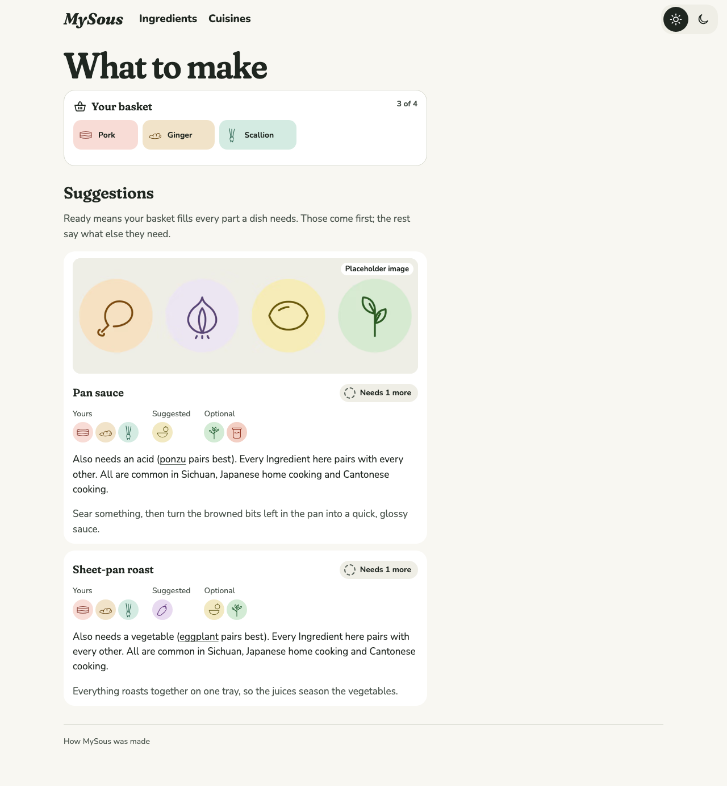
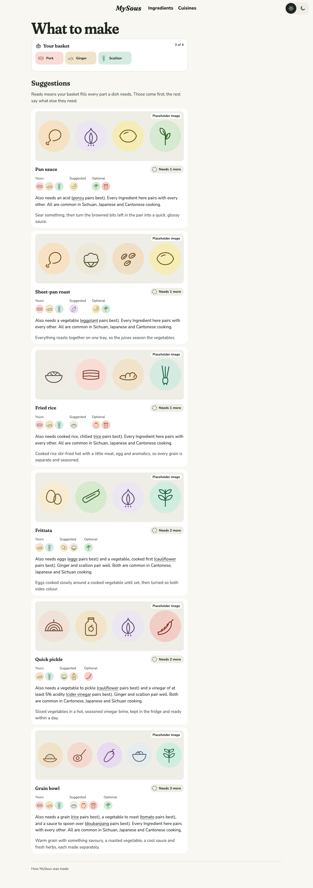
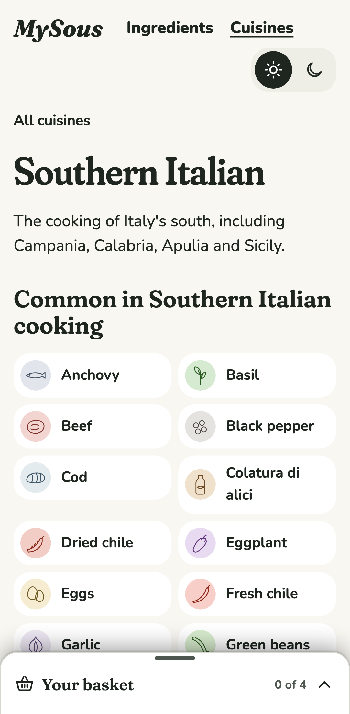
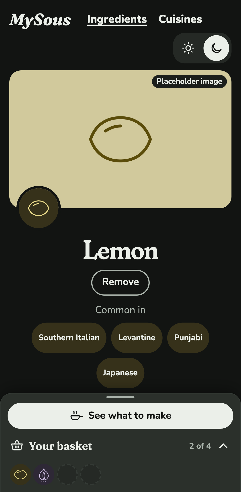
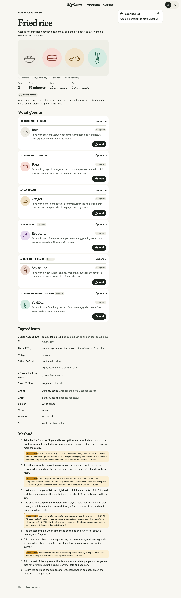
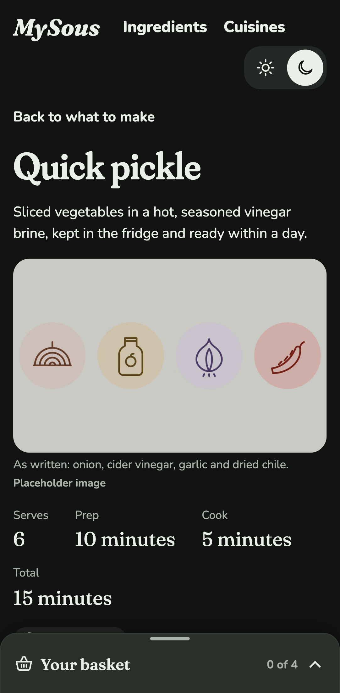
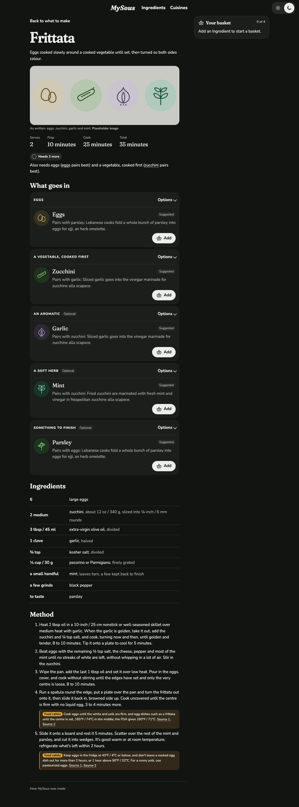
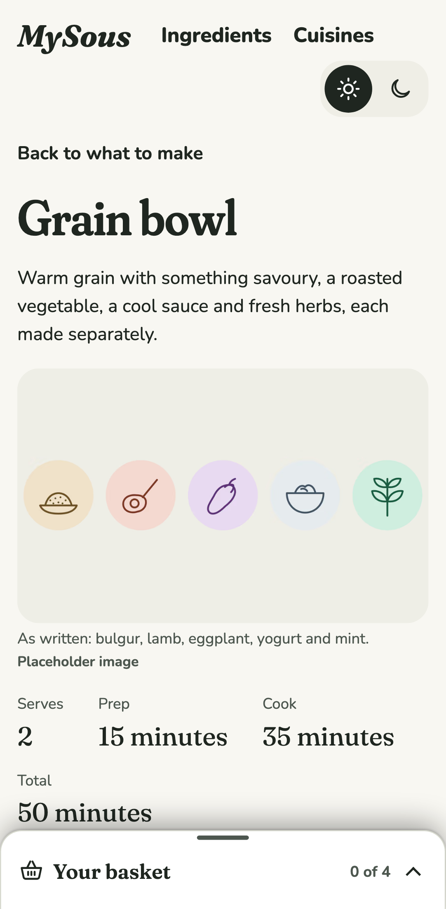

# 0020 · Six Formulas and their Recipes

Milestone: #19 (part of #2). MySous has all six launch Formulas, each with a Recipe: pan sauce, sheet-pan roast, fried rice, frittata, grain bowl and quick pickle. To make the new four work, the content gained staples, sauces and garnishes, and the phone layout changed so the basket bar never covers the page.

## Before and after

| Screen | Before | After |
| --- | --- | --- |
| What to make with pork, ginger and scallion, desktop light |  |  |
| Southern Italian, phone light |  |  |
| Lemon with a basket, phone dark |  |  |

New dish pages:

| Screen | After |
| --- | --- |
| Fried rice, desktop light |  |
| Quick pickle, phone dark |  |
| Frittata, desktop dark |  |
| Grain bowl, phone light |  |

## Decisions

The author chose each of these from options.

- **Staples are Ingredients, and a Slot can list them.** Eggs, rice and bulgur are Ingredients with their own pages, Pairings and safety guidance. A Formula's Slot can list the Ingredients it takes instead of a Slot type:
  - the frittata's eggs;
  - fried rice's rice;
  - the grain bowl's rice or bulgur;
  - the quick pickle's vinegar, cider or white wine vinegar.

  Listed Slots aren't held to the three-per-Cuisine coverage rule, since no Cuisine has three kinds of egg. Farro was dropped, because no source showed it as an everyday grain in Southern Italy.
- **A step can carry its own cited safety guidance.** The pickle's brine and jar are about no one Ingredient, so those two steps each carry a note and linked sources. Validation rejects step guidance without a linked source.
- **New Slot types: garnish and sauce.** Both meet the coverage rule in every launch Cuisine.
  - **Garnish:** 11 existing Ingredients were tagged from sources, and toasted breadcrumbs were added for Southern Italian.
  - **Sauce:** ten new Ingredients: soy sauce, tahini, green chutney, salsa verde, pasilla salsa, chintextle, salmoriglio, colatura di alici and tomato sauce, plus toasted breadcrumbs as a garnish. Tomato sauce is its own Ingredient rather than a tag on raw tomato.
- **The Recipes:**
  - sheet-pan roast: chicken thigh, cauliflower, cumin and lemon, built from flavours common in Punjabi cooking;
  - fried rice: pork, ginger and scallion, after Cantonese home cooking;
  - frittata: zucchini and mint, the mint a nod to Neapolitan scapece;
  - grain bowl: lamb, eggplant, yogurt and mint over bulgur, drawing on Palestinian eggplant fatteh;
  - quick pickle: onion in cider vinegar with dried chile, after the pickled onion of Oaxaca's piedrazo.
- **The stricter safety figure leads.** Following the voice guide:
  - pork is now 160°F / 71°C (Health Canada), with the FDA's 145°F and rest also given;
  - egg dishes are 165°F / 74°C, with the FDA's 160°F also given;
  - cooked rice is chilled within an hour, used within a day, and reheated once until steaming;
  - quick pickles use 5% vinegar, never more water than vinegar, and are kept refrigerated for up to 2 weeks.
- **"Japanese home cooking" is now "Japanese".**
- **On a phone, the basket bar has a row of its own.** As the content grew, the Southern Italian page's Ingredient tiles reached the fold, where the docked bar covered part of one, and axe failed it as a too-small target. The phone layout is now two rows: the page scrolls in the first, and the bar sits in the second, so nothing can sit under it. On wider screens the same markup lays out as before, with the tray as a side panel.

## What the content holds to now

- Formulas: six, each with a Recipe, tested.
- Ingredients: 62, every one with a placeholder image.
- Pairings: 309, every one citing a linked source from `docs/research/0019-*.md` or earlier notes. A link check found no 404s; a CDC page refuses automated requests, but the agent read it.
- Coverage: every launch Cuisine has three Ingredients for every Slot type a Formula accepts, now including garnish and sauce, or a sourced exception. The six exceptions from #18 are unchanged.

## Coverage, honestly

- **Some paths now exist only in fixtures.** Every Formula now has a Recipe and an image, and the content's 309 Pairings fill every required Slot from any one-Ingredient basket. So the Playwright tests below had no page left, and were removed:
  - a dish without a Recipe;
  - a dish or Suggestion card without an image;
  - a required Slot nothing pairs with.

  Their code is unchanged, and Vitest still covers each: `dishImage` for all three outcomes, a Recipe-less Formula, and the "No Pairing here points to…" reason. The empty-Slot path on a page is still tested, by taking out a part's only Ingredient.
- **Weak points:**
  - Salmoriglio has only two usable sources.
  - The frittata with mint rests on Barbato's recipe, which lists mint as one option, and on Neapolitan scapece, not on a named Southern Italian dish.
  - The fried rice's eggs are scrambled barely set, then reheated through with the rice, but that step isn't flagged on its own.
- **Kitchen testing is the author's.** Every timing and amount is a draft from the sources, scaled to two servings. The frittata's covered time, the sheet-pan's 25 to 30 minutes for boneless thighs and the 2 : 1 brine need checking.
