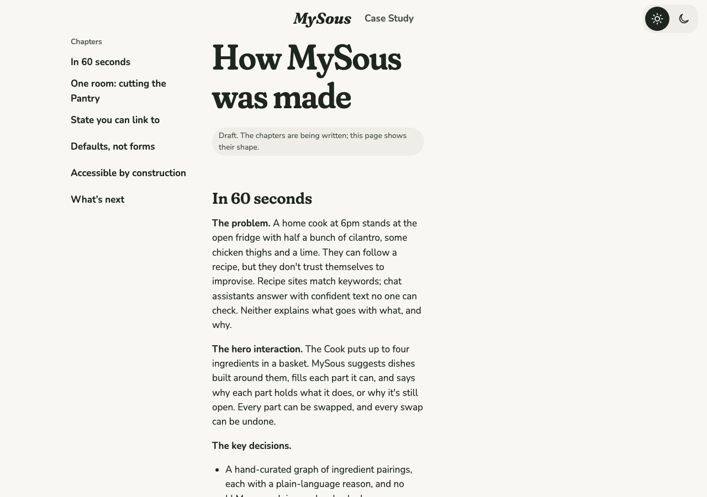
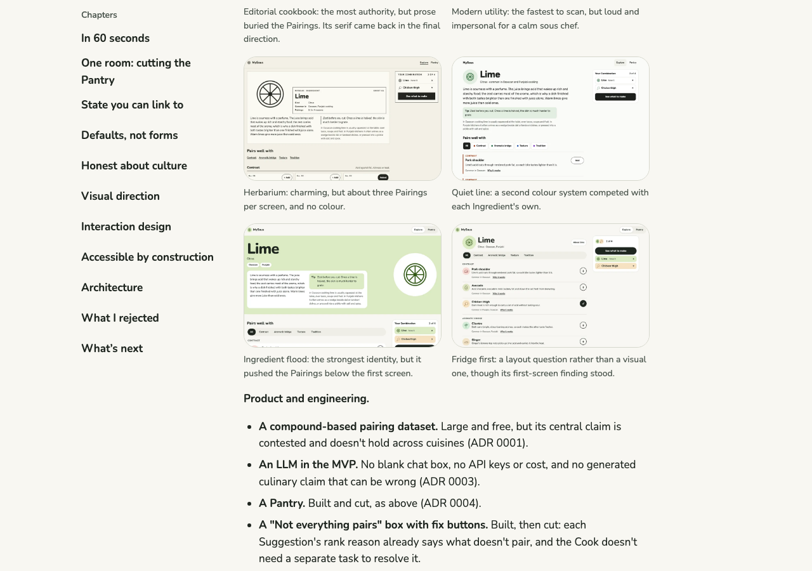
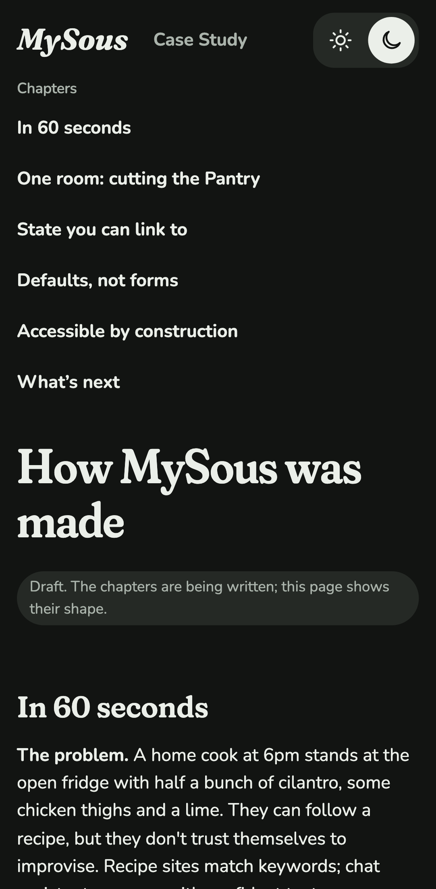
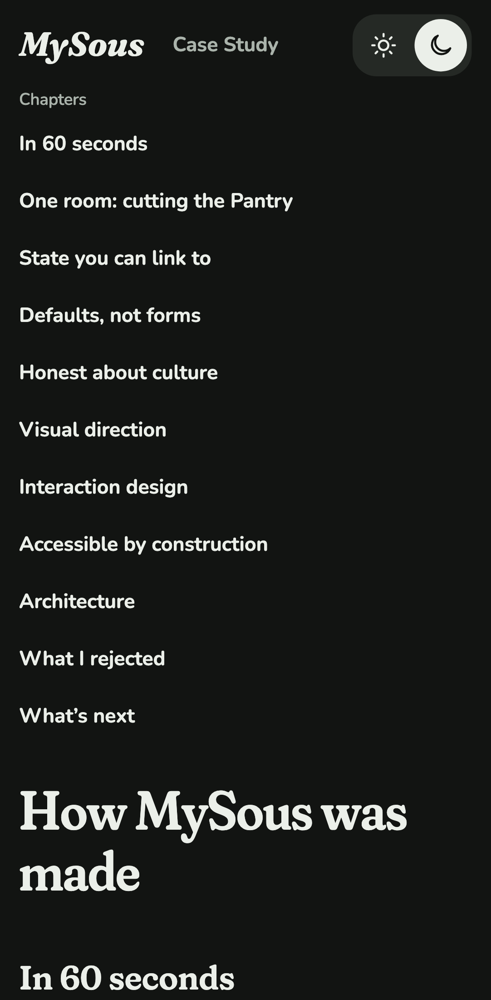
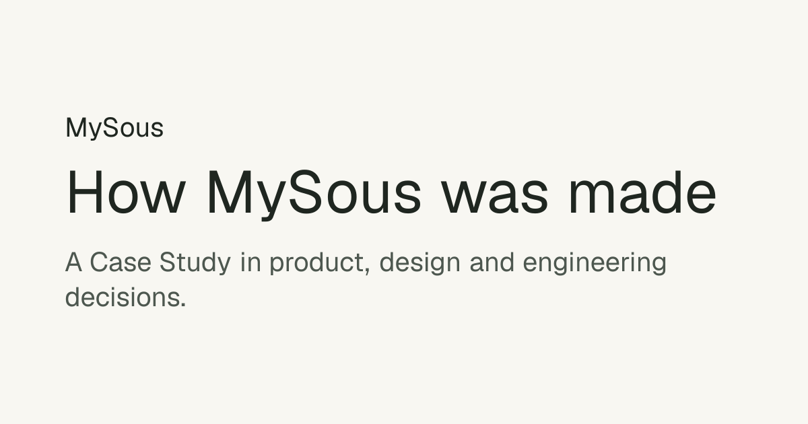
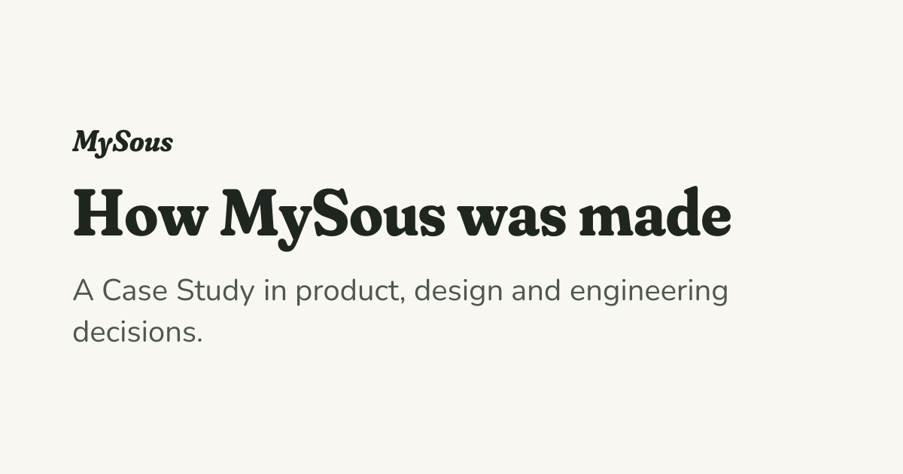
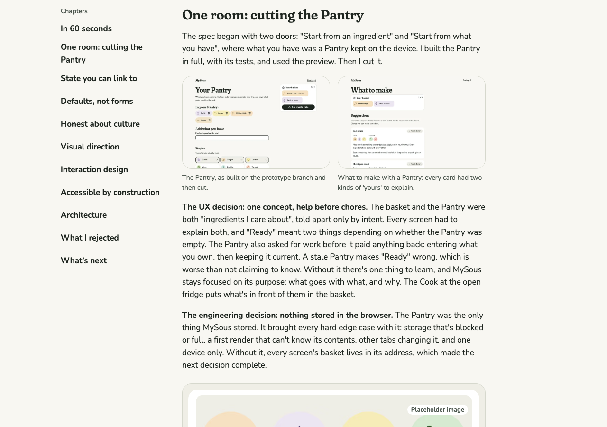
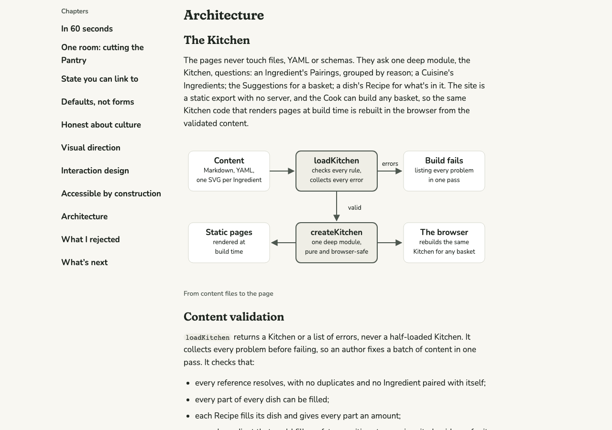
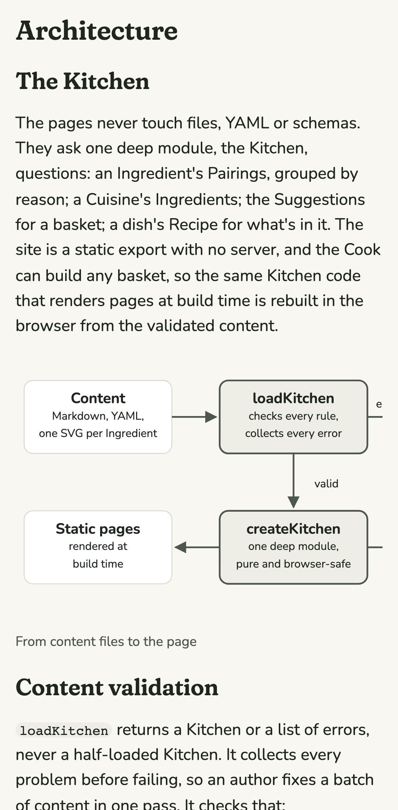
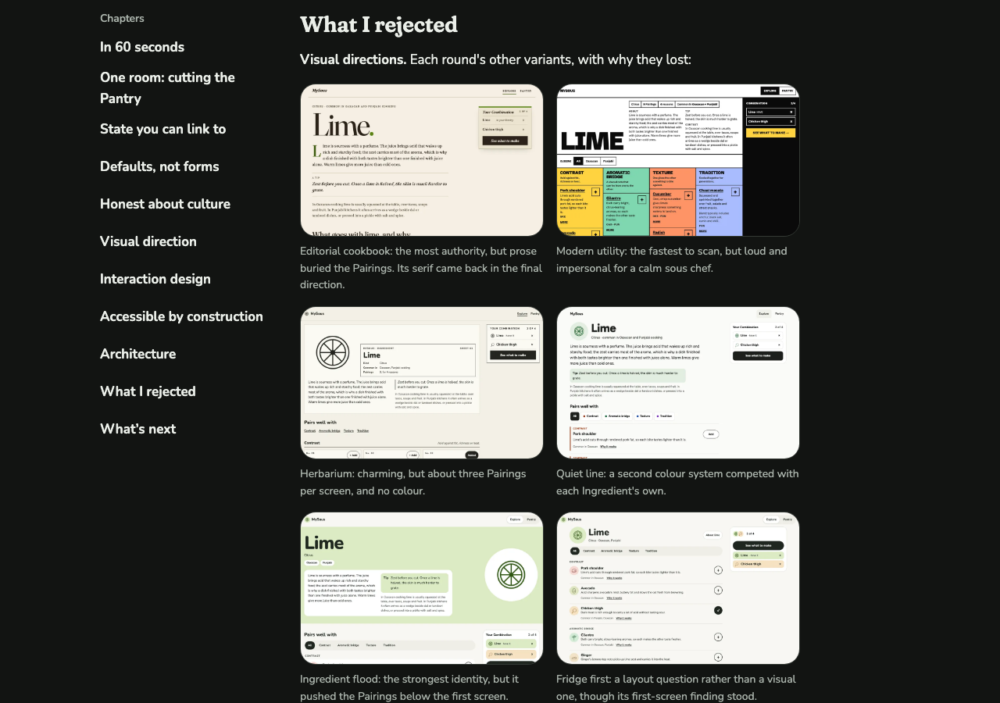

# 0021 · The Case Study's chapters

Milestone: #21 (part of #2). The Case Study at `/case-study` now has its full content in place of #20's draft. It opens with a 60-second summary, then gives the four Paired Decisions, three design chapters, the architecture with four diagrams, what was rejected, and what's next. It's written in the first person, as the author. The link preview now uses MySous's faces.

## Before and after

| Screen | Before | After |
| --- | --- | --- |
| The opening, desktop light |  |  |
| The opening, phone dark |  |  |
| The link preview |  |  |

New chapters:

| Screen | After |
| --- | --- |
| One room: cutting the Pantry, desktop light |  |
| Architecture, desktop light |  |
| Architecture, phone light |  |
| What I rejected, desktop dark |  |

## Decisions

The author chose each of these from options.

- **The chapters.**
  1. In 60 seconds.
  2. The four Paired Decisions, each a UX decision with the engineering decision behind it:
     - One room: cutting the Pantry;
     - State you can link to;
     - Defaults, not forms;
     - Honest about culture.

     "Honest about culture" took the issue's fourth place. Accessibility is a Design chapter instead, since it's a practice that runs through everything rather than one decision.
  3. Design: visual direction, interaction design, and accessible by construction.
  4. Architecture: the Kitchen, content validation, URL state and testing.
  5. What I rejected.
  6. What's next: Rescue and where an LLM might fit (ADR 0003).
- **The author's voice.** The prose is in the first person ("I built a Pantry, used it, and cut it"), drawn from the ADRs and journals 0001 to 0020.
- **Diagrams as inline SVG components** (`diagrams.tsx`):
  - from content files to the page;
  - how a dish's parts fill;
  - state you can link to;
  - what runs on every change.

  Each is an image named by its title and described in words by its `desc`. It draws in the theme's tokens, so dark mode needs nothing of its own. Each is drawn twice, wide and stacked, and its column's width picks one with a container query, so nothing scrolls sideways. The other drawing is `display: none`, so a screen reader meets only one. (At first a diagram kept a 36rem minimum and scrolled sideways on a phone; after merging, the author chose stacking.)
- **Stacked on #19.** The branch is based on #19's, since the Case Study's counts and dishes are #19's. It will be rebased onto `main` once #19 merges.

## Also in this change

- **Screenshots for what no longer exists.** The cut Pantry and the rejected visual variants can't be embedded live, so `Screenshot` shows a prototype's render. The renders are cropped from journals 0002 and 0011 to 960×600 WebP files in `public/case-study/`, 21 to 52 KB each. The dish cards stay live components in fixed states (ADR 0002).
- **The preview image's font** (left from #20). It now uses Fraunces at its softest and Nunito, as the site does. The image renderer can't read the site's woff2 files, so static TTF instances from Google Fonts are committed in `src/app/case-study/fonts/`, beside their SIL Open Font Licences.
- **Chapter links scroll smoothly** to their chapter, at the author's request. Under reduced motion they jump, as before. Only the Case Study glides: the rule applies to the document and to `.page`, whichever scrolls, and only while the Case Study is on screen.
- **Reading aids, at the author's request:**
  - The title, "How MySous was made: a Case Study", stays at the top while reading. It's set a little smaller than a display heading, since it stays on screen. It measures itself, so a chapter scrolled to lands below it.
  - The Case Study has no other header: the wordmark and the "Case Study" label are gone, and so is the chapter list's "Chapters" label. The nav keeps "Chapters" as its accessible name.
  - The window's corners: "Back to MySous" at the top left; "Back to top" at the bottom left, once the reader has scrolled half a screen; the theme switch at the top right, or the bottom right on a phone, where at the top it would sit over the title. On a narrow screen the title keeps a band at its top for the corner links.
  - The chapter being read is marked as the current location (`aria-current`). Its name turns green, and a bar grows in beside it; the bar's shape carries the meaning, so colour isn't the only signal. The green is a new palette colour, `current`, contrast-tested as text and as a mark. Under reduced motion the bar appears without growing.
  - The chapter links have less padding and more space between them on wide screens; a phone keeps 44px targets.
- **The app's link to the Case Study** moved from the footer to beside the theme switch, on two lines, and the footer is gone.
- **The app's header starts where the content does again,** with more space below it. Since #19's layout change it had shrunk to fit its contents and sat centred. A test now checks that the wordmark lines up with the content and leaves at least 24px before it. The page keeps the footer's space at its end, so the last row isn't flush against the basket bar.
- **Two shared tests got stricter or fairer, for problems the new content exposed.**
  - **Reflow.** On a phone the page scrolls inside `.page` (since #19), so the check measured the document and missed sideways scrolling inside it. It now measures both. It caught the Case Study's column widening to fit a diagram on a phone; the column is now `minmax(0, 1fr)`.
  - **Touch targets.** The check allows 0.01px, since layout can land a 44px control at 43.9998px.

## Tests

- **Vitest.** The voice guide's banned words never appear in the Case Study's prose or in the diagrams' descriptions. A quoted word, as where the Case Study names the rule, is a mention, not a use (`BANNED_WORD_MENTION` in `voice.ts`). This exemption applies to the Case Study's files only; the site-wide "authentic" check is unchanged everywhere else.
- **Playwright:**
  - the chapter navigation lists every chapter, in the order they're written;
  - every diagram is an image with a name and a description of more than 15 words, and passes axe;
  - every live dish card opens the same card in the app: the card's text in the Case Study matches the same dish on What to make for its basket (checked to fail when an embed's link drops an Ingredient);
  - every link from the prose opens What to make with the basket it names, in order.
- The Case Study was already in the axe, reflow and touch-target screens.

## Review

Both axes ran. The fixes:

- °C for the FDA's 145°F.
- "easily" added to the list of banned words.
- Domain terms capitalised as the glossary has them.
- ADR 0001's two separate reasons, copyright for pairing books and the contested claim for compound data, kept apart.
- The fill order given in all four steps, matching the diagram.
- "basket" said to be chosen from fifteen candidates, not all three on-screen words.
- VoiceOver claimed only for the passes that are done.
- Long lists of checks set as lists.
- The banned-word mention rule kept in one place.
- `Screenshot` takes a `name`.
- Clearer class names.
- One shared caption rule.

The Design and Architecture chapters aren't Paired Decisions, by the author's choice of chapters.

## VoiceOver pass

**Status: passed.** The author ran this pass on 2026-11-07, and everything behaved as expected. On an iPhone and a Mac: the chapter navigation and the chapter being read, the diagrams' descriptions, the screenshots' alt text, and the corner links.

## Waiting for the author

- **The copy.** The author edits and approves the final text. It's in the first person, but drafted from the journals. That includes the reasons each visual variant lost, which journal 0002 notes were drafted from the renders and await the author's review.
