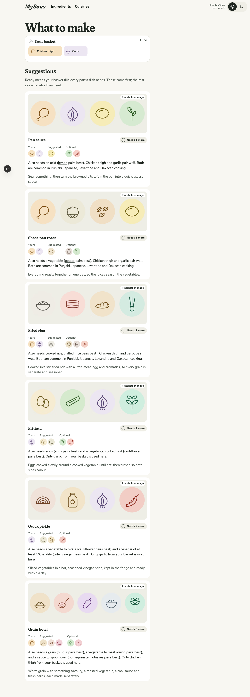
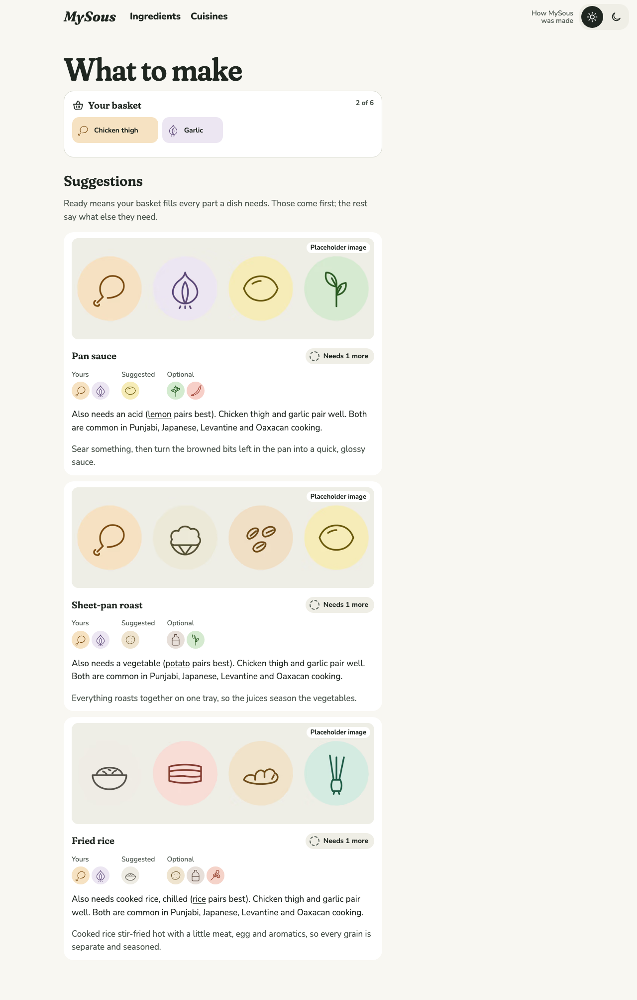
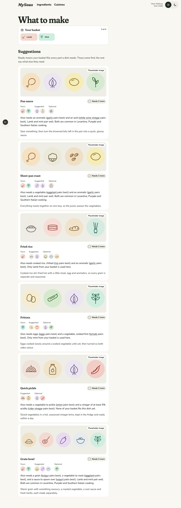
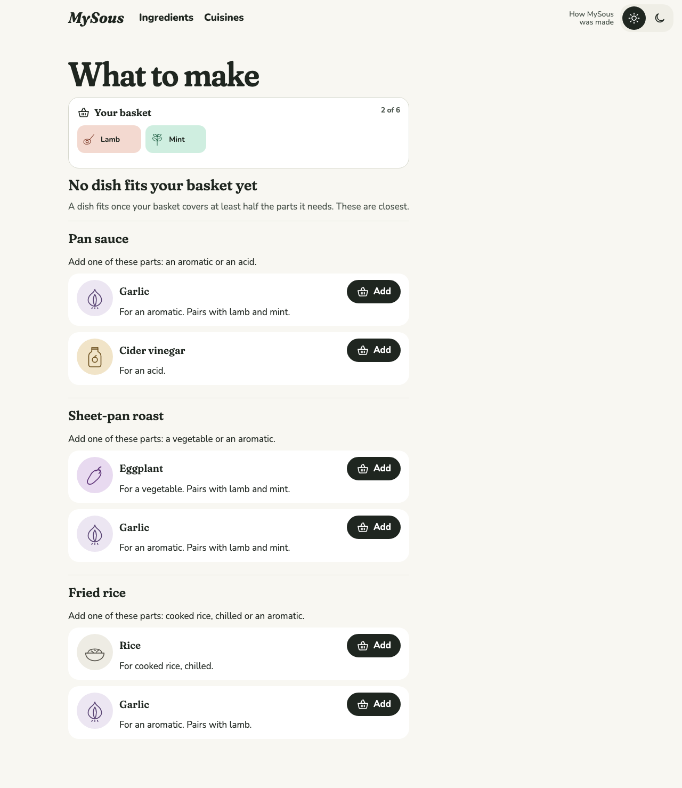
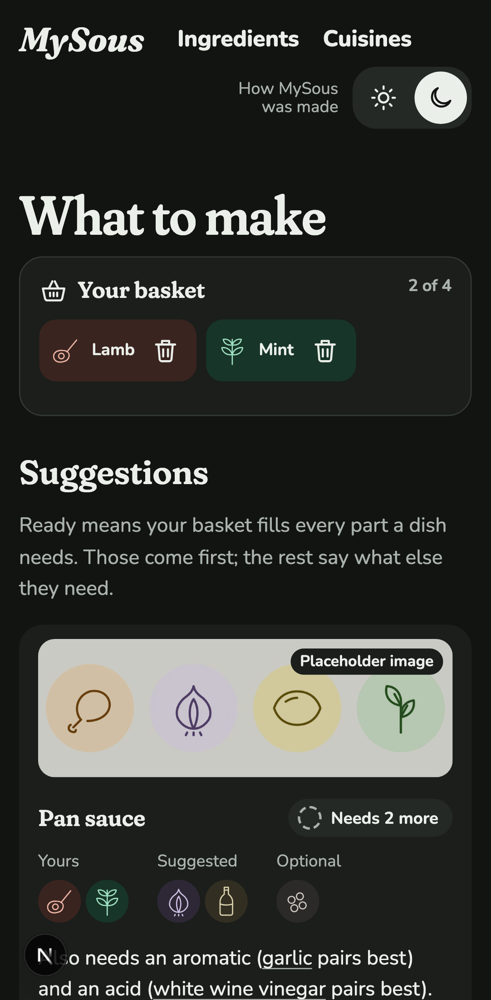
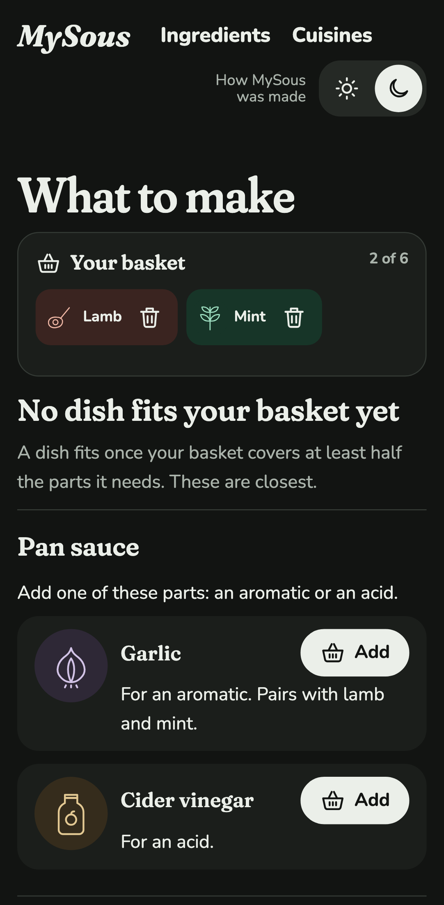
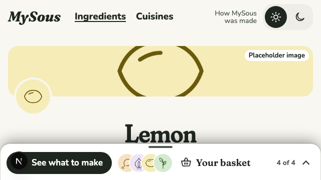
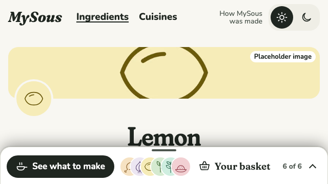

# 0022 · Baskets of six, and only the dishes they fit

Ticket: #50 (part of #2). The basket now holds six Ingredients instead of four. What to make lists only the dishes the basket fits. When none fits yet, it names the closest dishes and what to add to each.

## Before and after

| Screen | Before | After |
| --- | --- | --- |
| Chicken thigh and garlic, desktop light |  |  |
| Lamb and mint, which fit no dish, desktop light |  |  |
| Lamb and mint, phone dark |  |  |
| The tray bar at 640×360, a full basket (four before, six after) |  |  |

## Decisions

The author chose each of these from options.

- **What fits.** A dish fits when Ingredients from the basket are in at least half of its required parts. Staple parts, such as the frittata's eggs, count; optional parts don't. A part filled by a Pairing suggestion doesn't count, because it isn't the Cook's. The author first chose "a majority of the ingredients needed". Asked whether a majority means more than half or at least half, they chose at least half. With more than half, a single Ingredient would never fit any dish.
  - Required parts per dish, and how many the basket must cover: pan sauce 3 (2), sheet-pan roast 3 (2), fried rice 3 (2), frittata 2 (1), grain bowl 4 (2), quick pickle 2 (1).
- **When nothing fits.** The author first chose to say which Ingredient to remove. Under the at-least-half rule, removing an Ingredient never makes a dish fit, so they chose to say what to add instead. The screen names the closest dishes (fewest parts short, at most three). Each gives the parts it needs and, for each part, the best-pairing Ingredient not in the basket, with an Add button. This replaces the spec's "still shows the closest dishes" form of no dead ends.

Defaults, not asked:

- Ranking among the dishes that fit is unchanged.
- A dish page opens for any basket, whether it fits or not, so links from Ingredient pages and the Case Study keep working.
- A part's "Pairs with" names only Ingredients in the basket, not ones the dish took by Pairing.
- A full basket that fits nothing says to remove an Ingredient before adding one.
- No ADR: the limit and the rule are cheap to change back.

## Also in this change

- **The Kitchen.**
  - `suggest` returns only the Formulas a Combination fits.
  - `suggestion(formulaId, combination)` fills any one Formula, for a dish page or a Case Study embed.
  - `closest(combination)` gives the near misses with what to add.
  - Every Suggestion carries `toFit`, the number of parts it's short.
- **The tray bar.** In its one-row layout (640px and wider), it no longer draws empty circles for free places, since the count already says "4 of 6". Its drawings overlap a little more, so six leave the title whole at 640×360. The phone layout still shows the circles, on their own row.
- **The Case Study.**
  - It says "up to six".
  - The hero sentence says MySous suggests the dishes a basket fits.
  - The not-paired example now says it opens "the dishes it fits".
  - The culture chapter's live card uses lamb, mint and pomegranate molasses. Its rank reason still names a regional Cuisine ("All are common in Levantine cooking."). Lamb and mint alone no longer fit a pan sauce, so the app wouldn't show a card to match the embed.
- **Copy.**
  - The empty-dish rank reason is now "Nothing from your basket is in this dish yet.", so "fits" keeps the one meaning the Glossary gives it.
  - The home page says six.
- **Docs.** The Glossary says six and defines **Fit**. The spec (#2) is updated: Combination rules, a Fit rule, the Suggestion shape, no dead ends, stories 23 and 44, and the journeys.

## Tests

- **Vitest, through `loadKitchen`:**
  - a Combination keeps six and reports the seventh;
  - which dishes a basket fits, on both sides of half, with staple parts counted and optional and Pairing-filled parts not;
  - any one dish filled for a basket that doesn't fit it, with how far it is from fitting;
  - the closest dishes, fewest parts short first and at most three, each with the best-pairing Ingredient to add per part, its "Pairs with" limited to the basket.
- **Playwright:**
  - What to make lists only the dishes a basket fits;
  - when none fits, it names the closest dishes and what to add, and adding garlic brings the pan sauce in;
  - a full basket that fits nothing says to remove one first;
  - a dish page opens for a basket that doesn't fit it;
  - the tray, its messages and the full-basket message say six;
  - at 640×360 the bar's title stays whole with a full basket.
- Tests that reached one particular dish through `suggest` now use `suggestion`.
- Totals: Vitest 210 passed. Playwright 524 passed, on phone and desktop.

## Review

Both axes ran. The fixes:

- **The Glossary.** The new Fit entry had split Suggestion from its Avoid line. Fixed.
- **What to add moved into the Kitchen** (`closest` returns each near miss's `toAdd`). Before, the screen worked it out. This also fixed two bugs:
  - "Pairs with" named Ingredients the dish took by Pairing ("white wine vinegar", with only lamb and mint in the basket);
  - a part could be named with nothing to add for it.
- A full basket that fits nothing now says what to do first.
- **"Fits" has one meaning.** The empty-dish rank reason is reworded, and so is a test name that used "fits" for a part.
- Smaller fixes:
  - the number words cover up to six;
  - `CLOSEST_LIMIT` isn't exported;
  - one test names its dish;
  - the CSS order is fixed.

Kept as they are:

- the tray bar's hidden circles and the Case Study basket (both needed by six and by fitting, as above);
- `toFit` on a dish the Cook has changed, which counts only the basket and is documented as doing so.

## VoiceOver pass

**Status: to do.** The new part is What to make when nothing fits: the heading, the closest dishes, and each Add button's name ("Add Garlic to your basket"). Check that adding one announces the change and moves on to the dishes that now fit.

## Waiting for the author

- **The copy** of the nothing-fits state and the Case Study's changed sentences.

## Later

- The author asked to drop the nothing-fits heading and the "at least half" explanation. The closest dishes stay, and so does the full-basket notice.
