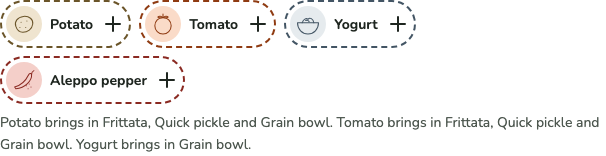
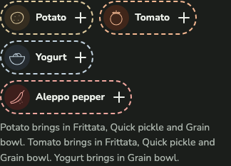

# 0023 · What pairs well, in the basket

Ticket: #51 (part of #2, built on #50). On What to make, the basket card now suggests up to four Ingredients that pair with what's in it. Each is one tap to add, and the list of dishes follows.

## After

| Screen | After |
| --- | --- |
| Chicken thigh and garlic, desktop light |  |
| Chicken thigh and garlic, phone dark |  |

## Decisions

The author chose each of these from options.

- **Which Ingredients:** the best-pairing ones, whether or not they bring in a new dish. Ranked by how many of the basket's Ingredients each pairs with, then how many dishes it would bring in, then by name. Ingredients already in the basket are left out.
- **How they look:** up to four compact chips in a row under the basket's Ingredients. Each chip shows the drawing, the name and a plus sign. A line under the row says which dishes each would bring in.
  - After a first look, the author asked for no wash and a dashed edge in the colour of each Ingredient's circle, and no visible "Pairs well" label. The row keeps "Pairs well" as its name for screen readers. Under the pointer a chip takes its wash and its plus turns a quarter.
- **Tracking:** a separate ticket, built on the #50 branch, since it relies on the fit rule.

Defaults, not asked:

- The row is hidden when the basket is full or nothing pairs with it, and shown whether or not any dish fits.
- After a tap, focus moves to the basket's heading, since the chip tapped leaves the row. The change is announced as any add is ("Yogurt added to your basket, 3 of 6.").

## Also in this change

- **The Kitchen.** `couldAdd(combination)` gives each `Addition`: the Ingredient, the basket's Ingredients it pairs with, and the Formulas it would bring in.
- **The basket's own list is named "In your basket"**, so a screen reader tells it apart from the suggestions. Tests read the basket through that name.
- `Chip` takes `dashed`.
- The spec (#2) has story 44a and a Pairs well rule.

## Tests

- **Vitest, through `loadKitchen`:**
  - what could be added is ranked by Pairings with the basket, then dishes brought in, then name;
  - each carries what it pairs with and brings in;
  - none when nothing pairs;
  - at most four;
  - none for a full basket.
- **Playwright:**
  - the chips on What to make, in order, with the line under them;
  - one tap adds yogurt, announces it, moves focus to the basket, and brings in the grain bowl;
  - the chips show when no dish fits;
  - no chips with a full basket.
- The touch-target and axe screens already open What to make with a basket that has chips.
- Totals: Vitest 212 passed. Playwright 530 passed, on phone and desktop.

## Review

Both axes ran, and neither found a defect. The fixes:

- The type became `Addition`, and the variable `ideas` was renamed, since "idea" is on the Glossary's Avoid list.
- The dashed edge moved into `Chip`.
- Tests were added for nothing pairing and for the nothing-fits screen.

Kept as they are:

- `TrayView`'s `children` slot beside `action`; both are used.
- Dish names keep their capitals mid-sentence, as the voice guide has names.
- `couldAdd` isn't memoised: it takes 13–36ms on real baskets.

## VoiceOver pass

**Status: to do.** Check each chip's name ("Add Potato to your basket"), the announcement after a tap, and that focus lands on the basket's heading.

## Waiting for the author

- **The copy:** "Add more Ingredients to see more dishes."

## Later

- **Add buttons.** Every Add to the basket (on an Ingredient's page, the closest dishes, and a dish's parts) is now a basket and a plus. Its words stay in its name, and a tooltip shows them on hover or keyboard focus: "Add Garlic to your basket". The plus turns a quarter on hover, like the chips', from a shared `PlusIcon`. `AddToBasketButton` keeps one button between Add and Remove, so focus stays on it; `Tooltip` takes no label for Remove, which has its own words.
- A Playwright test covers the tooltip on hover, Escape and focus. It was written after the button.
- The author replaced the "brings in" lines under the chips with one: "Add more Ingredients to see more dishes." The Kitchen still ranks the chips by the dishes each brings in.
- The Pairs well chips have the same tooltip as Add: "Add Yogurt to your basket".
