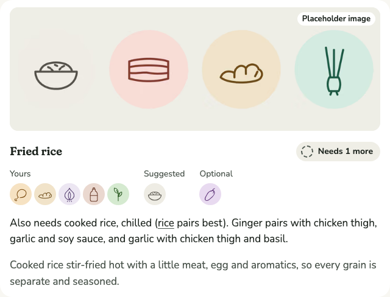

# 0024 · Saying which Ingredients pair, in plain prose

Ticket: #52 (part of #2). A dish's rank reason used to list every Pairing in the basket one by one: "Chicken thigh and garlic pair well, and so do garlic and lemon, and so do…". With six Ingredients that could run to fourteen clauses. It now names each Pairing once, grouped around the Ingredients that pair with the most.

## After

| Screen | After |
| --- | --- |
| Fried rice, for chicken thigh, basil, ginger, garlic and soy sauce, desktop light |  |

## How it reads

- Around the Ingredient with the most Pairings, then the next: "Ginger pairs with chicken thigh, garlic and soy sauce, and garlic with chicken thigh and basil."
- Ingredients that pair with the same ones are named together: "Potato and parsley pair with onion and garlic."
- Pairs that share nothing: "Chicken and garlic pair well, as do lemon and parsley."
- Unchanged: "Every Ingredient here pairs with every other.", "Everything here pairs with garlic.", what doesn't pair with the rest, and the shared Cuisine.

Defaults, not asked: ties between Ingredients go to the one earlier in the dish, and partners are named in the dish's order.

## Tests

- **Vitest, through `loadKitchen`:** the grouped form, Ingredients with the same partners, and two and three separate pairs. Each was seen failing first.
- Checked by hand on real baskets of five and six.
- Totals: Vitest 216 passed. Playwright 530 passed, on phone and desktop.

## Review

Not run: the change is one function in the Kitchen and its tests.

## Waiting for the author

- **The copy:** the grouped sentence and "as do".
