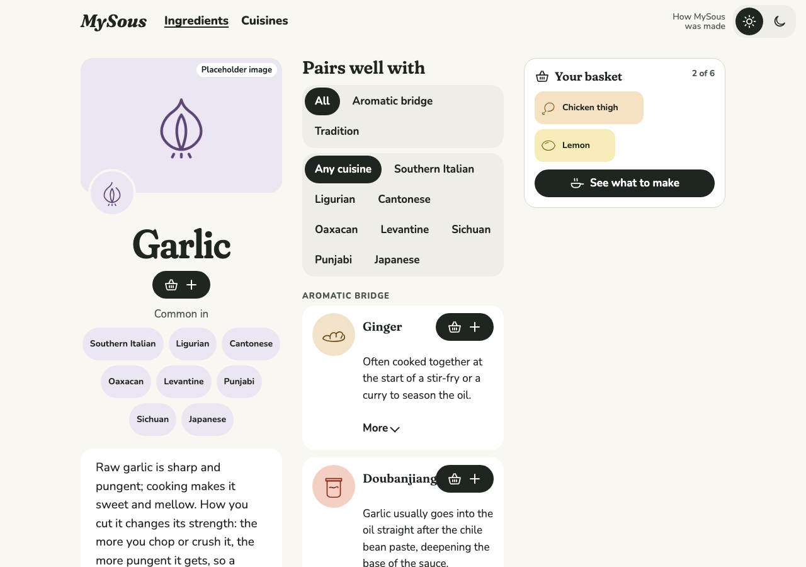
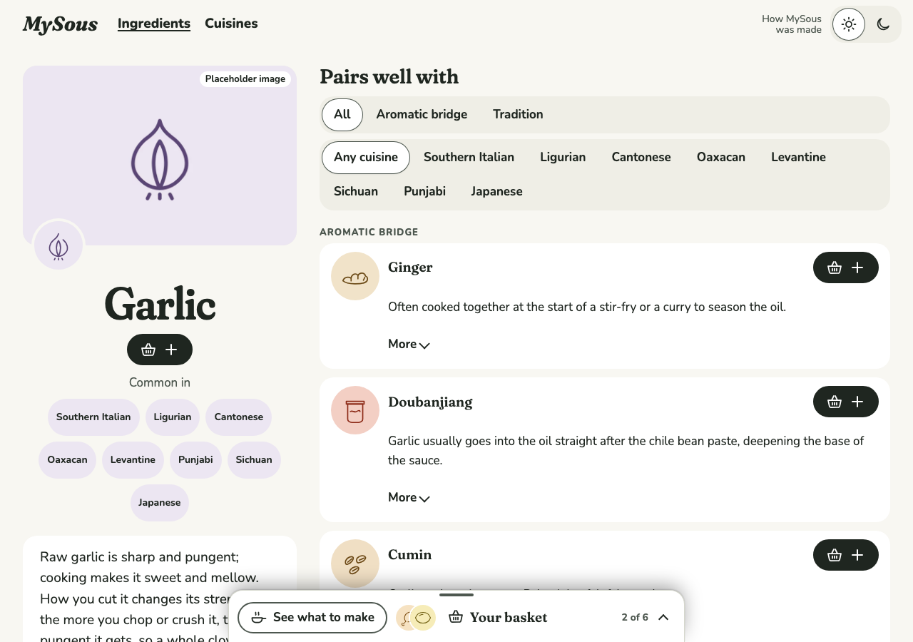
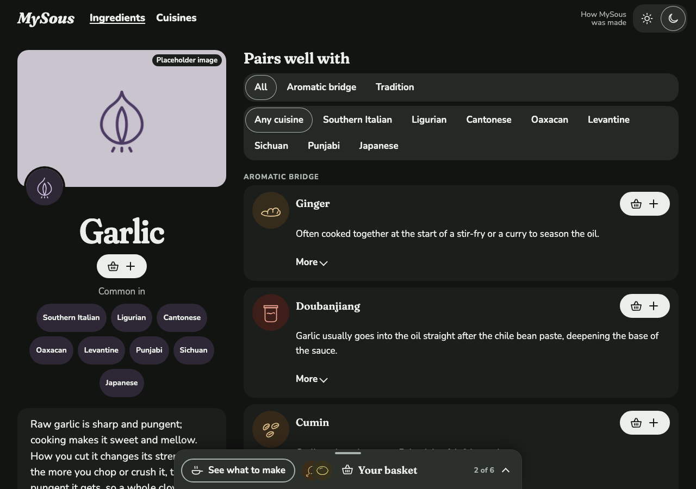
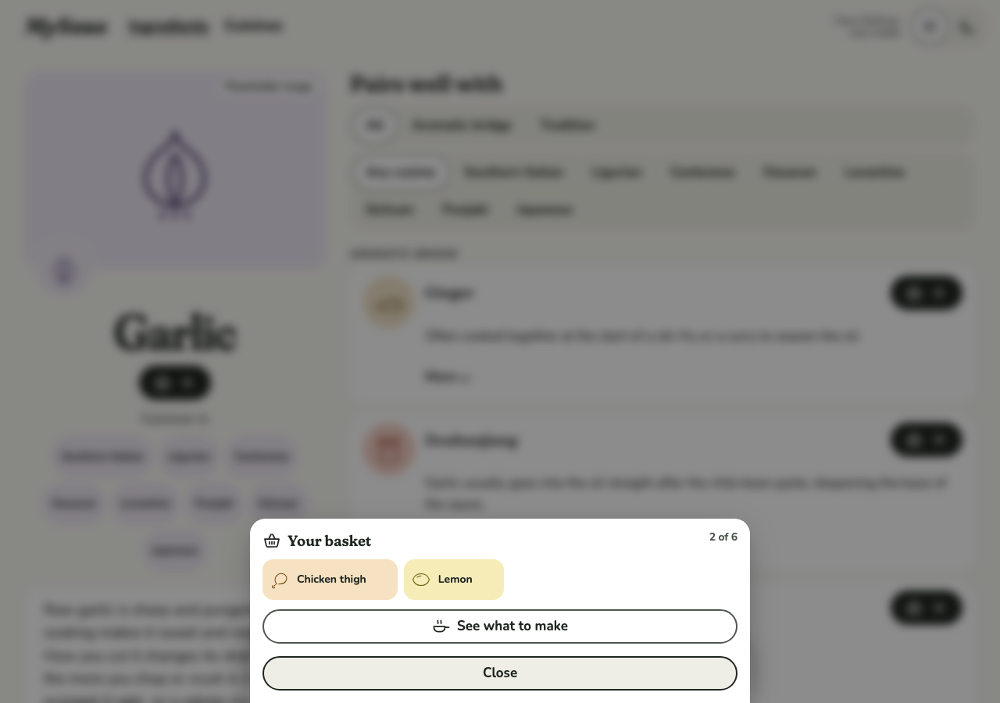

# 0025 · A calmer Ingredient page

Ticket: #54 (part of #2). The Ingredient page had too many solid black controls competing: See what to make, the selected Pairs well filters, the theme switch, and every Add. Its three columns left each one narrow. Now only Add is solid, the basket is a bar docked at the foot of the screen, and the Ingredient and its Pairings share the width.

## Before and after

| Screen | Before | After |
| --- | --- | --- |
| Garlic, with chicken thigh and lemon in the basket, desktop light |  |  |
| The same, desktop dark | |  |
| The basket opened from the bar, desktop light | |  |

## Decisions

The author chose each of these from options.

- **See what to make** is the outlined button.
- **A selected segment** is a raised pill on the floating colour (white in light), with a soft shadow and a fine ring in muted ink. This applies to the Pairs well filters and to the theme switch, which shares the control.
- **The basket is the docked bar at every width**, opening the full basket as a sheet, on every page that has it. There's no side column any more.
- **Add stays solid**, as the one main action.

Defaults, not asked:

- On a wide screen the bar and the sheet are the width of a line of text (40rem), centred over the window's foot. The window scrolls as before, and the page ends with room for the bar.
- The Ingredient and its Pairings sit side by side from 56rem, where the side panel used to start, rather than 72rem. The Ingredient's column is 24rem, up from 20rem. At 1280px the Pairings are about 780px wide, up from 320px.
- The parent spec's story 21 now describes the docked bar at every width.

## Also in this change

- The tray renders once, as the sheet. The side panel, its heading and the focus move on widening are gone.
- Tests that read the basket from the side panel now open the sheet.

## Tests

- **Playwright:**
  - on desktop, on an Ingredient, Cuisines, a dish and home, the bar sits at the window's foot, opens the sheet, and no side panel is left;
  - See what to make has no fill;
  - a selected Pairing filter is white with ink words;
  - at 1280px the Ingredient and its Pairings sit side by side, each wider than before;
  - the open sheet's axe check now runs on desktop as well as phone.
- Each new test was seen failing first.
- Totals: Vitest 216 passed. Playwright 539 passed, on phone and desktop.

## Review

Both axes ran, and the code meets the ticket. The fixes:

- Stale comments and test names that still spoke of the side panel or three columns.
- The tray is inline in the sheet, with its heading id named once.
- The selected segment's ring fades in with its fill, and its comment says muted ink.
- The pill test sets the light theme, and the bar test explains its threshold.
- The ticket's "the page's width" is corrected to the 40rem the author saw.

Kept as they are:

- In dark, the selected pill (#2b302b on #252925) is set apart mostly by its ring.
- `tray-width` now sizes only the design system's specimen.
- Earlier journal entries still describe the side panel, as it was then.

## VoiceOver pass

**Status: to do.** On desktop, check the bar's name ("Your basket 2 of 6: Chicken thigh, Lemon"), that opening it moves to the sheet's heading, and that Escape returns to the bar. Check also the filters' selected state.

## Waiting for the author

- The 40rem bar on wide screens, and the 56rem breakpoint for two columns.
