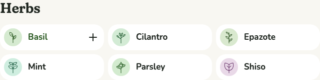
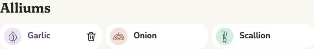

# 0026 · Add from the Ingredients list

Ticket: #55 (part of #2). On the Ingredients list, each Ingredient's pill has a button at its end that adds it to the basket in one click, without opening its page.

## After

| Screen | After |
| --- | --- |
| Basil under the pointer, with garlic in the basket, desktop light |  |
| Garlic, in the basket, under the pointer |  |

## Decisions

The author chose each of these from options.

- **A plus at the pill's end**, shown with a mouse only under the pointer or on keyboard focus. On touch, where nothing hovers, it always shows. This is the basket's own pattern for its bins.
- **For an Ingredient in the basket the plus becomes a bin**, which takes it out. It's the same button, so focus stays on it.

Defaults, not asked:

- Both are icons alone, so each has its words in a tooltip ("Add Basil to your basket", "Remove Garlic from your basket"). Add's text Remove button shows none, since its word is on it.
- The plus turns a quarter on hover, as everywhere, and the bin is red under the pointer, as in the basket.
- A full basket says why nothing was added, as any Add does.
- The list's lede gains a sentence: "Or add it to your basket from here." The button is hidden until hover, so the lede says it's there.
- The parent spec's story 20 lists the Ingredients list as a place to add from.

## Also in this change

- `useBasketToggle(ingredientId)` holds the add-or-remove logic for Add on an Ingredient's page and for this button. `basketWords(name, added)` holds their words.
- The bin icon moved out of `TrayView` into its own component.

## Tests

- **Playwright:**
  - with a mouse the button is hidden until hover or keyboard focus, and on touch it shows;
  - one click adds, says so, the bar's count goes up, and focus stays on the button, now Remove;
  - the bin takes an Ingredient out;
  - a full basket says why nothing was added.
- The first three were seen failing first. The full-basket test passed at once, since Add already said why.
- Totals: Vitest 216 passed. Playwright 549 passed, on phone and desktop.

## Review

Both axes ran, and nothing was wrong. The fixes:

- The lede was split, one idea per sentence.
- The add-or-remove logic and its words, copied from Add, are shared.
- The full-basket test and story 20.

Kept as they are:

- The show-on-hover CSS echoes the basket's bins, rather than sharing a class across a module and the global sheet.
- After a mouse click, the button hides once the pointer leaves, as the basket's bins do.

## VoiceOver pass

**Status: to do.** Check that each pill reads as a link then a button ("Add Basil to your basket"), the announcement after a press, and that focus stays on the button as it becomes Remove.

## Waiting for the author

- The lede's new sentence.
