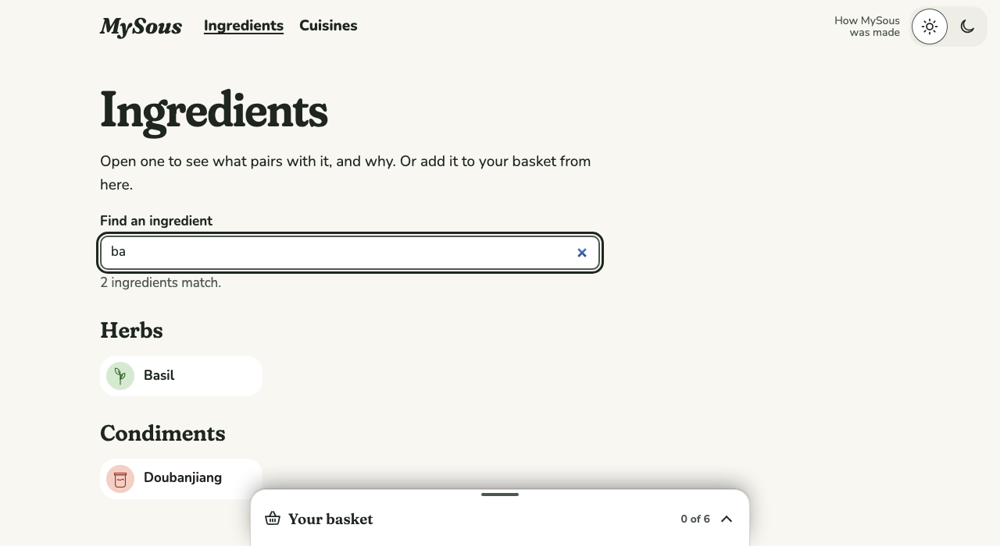

# 0027 · The Ingredients page's search filters its list

Ticket: #57 (part of #2). On the Ingredients page, typing in the search box now narrows the list of every Ingredient below it, instead of opening a dropdown of matches above the same list.

## After

| Screen | After |
| --- | --- |
| "ba" typed on the Ingredients page, desktop light |  |

## Decisions

The author chose each of these from options.

- **The Ingredients page**, not Home, which has no list under its search.
- **No dropdown there:** the list is the result. Enter opens the Ingredient when exactly one matches.

Defaults, not asked:

- Matching is the Kitchen's own search, so both searches find the same Ingredients.
- Kinds with no match are hidden, and the page says how many match ("2 ingredients match.").
- With no match, it says the name isn't in MySous yet, and to try another spelling or clear the search. Clearing, or Escape, shows every Ingredient again.
- Enter with no match or several does nothing; the count already says why.
- What's typed isn't kept in the address, so it's gone after opening an Ingredient and coming back.
- Home's search keeps its dropdown.

## Also in this change

- `FilterField`, a search field that narrows the page below it, styled as the Combobox's field.
- The list renders on the client, under the same field disabled until the browser takes over, so the page's first paint still has every Ingredient.
- Both searches share their label and no-match wording.

## Tests

- **Playwright:**
  - typing narrows the list and hides empty kinds, with a count and no dropdown;
  - no match says so, with a next step, and clearing shows every Ingredient;
  - Enter with one match opens it, keeping the basket.
- Each was seen failing first. Home's dropdown is covered by the search tests already there.
- Totals: Vitest 216 passed. Playwright 555 passed, on phone and desktop.

## Review

Both axes ran. The fixes:

- The count is a polite live region, not a second status, so the page keeps one status for the basket.
- The no-match state has a next step (#2: no dead ends).
- The label and no-match wording are shared with Home's search.
- The list's filter prop is named `matching`.

Kept as they are:

- `FilterField` borrows the Combobox's stylesheet, so both fields look alike.

## VoiceOver pass

**Status: to do.** Check the field's name, the count as it changes, the no-match message and hint, and Enter opening a single match.

## Waiting for the author

- The no-match hint: "Try another spelling, or clear the search to see every ingredient."
