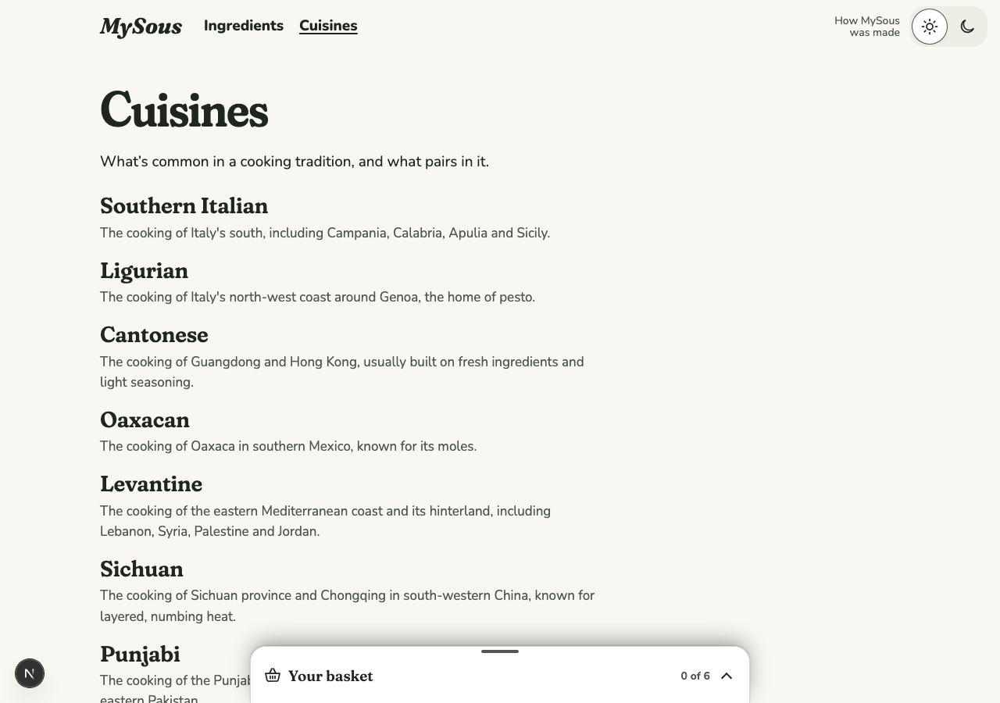
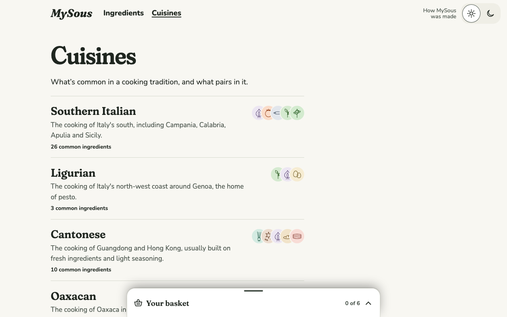
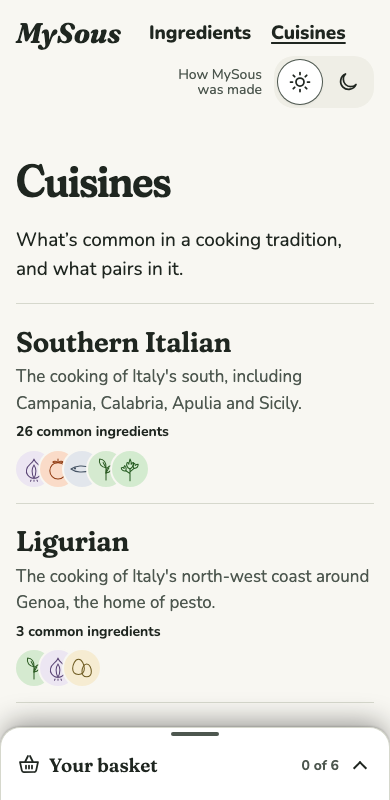
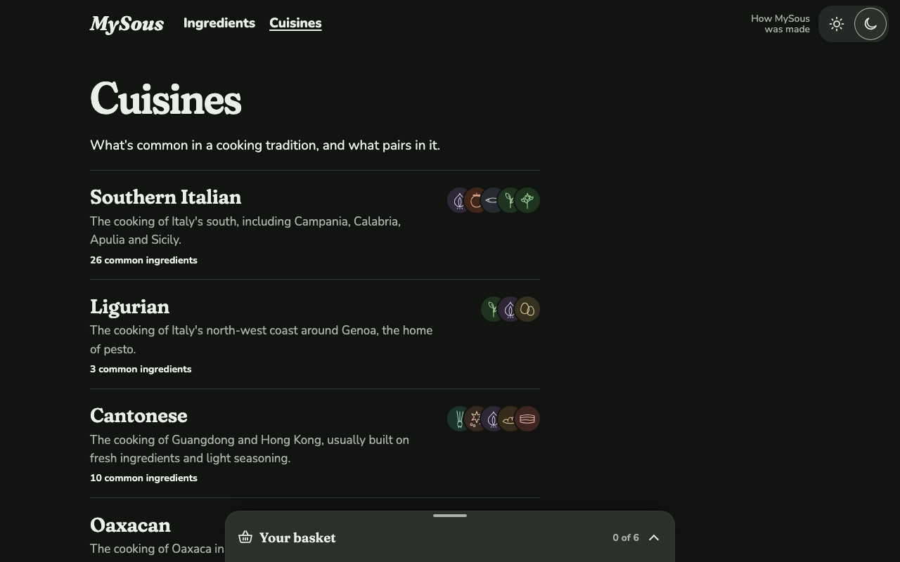

# 0028 · Each Cuisine, told apart by what it leans on

Ticket: #59 (part of #2). The Cuisines page was a plain list of names and descriptions. Each row now shows the drawings of the five Ingredients the Cuisine leans on, and how many Ingredients are common in it, in rows divided by a hairline.

## Before and after

| Screen | Before | After |
| --- | --- | --- |
| Cuisines, desktop light |  |  |
| Cuisines, phone light | |  |
| Cuisines, desktop dark | |  |

## Decisions

The author chose each of these from options.

- **Drawings, not flags.** The author first asked for a country flag per Cuisine. Flags clash with naming Cuisines by region: Levantine spans four countries, one of them contested, and Punjab two. Sichuan and Cantonese would both show China's flag, and Southern Italian and Ligurian Italy's. Each Cuisine shows instead the drawings of the Ingredients common in it that are in the most of its Pairings, then by name.
- **Divided rows**, not cards, with the drawings at each row's end, as the author asked after a first look.

Defaults, not asked:

- At most five drawings, overlapping as a cluster. Ligurian has three.
- The cluster is one image, named by its Ingredients ("Sichuan pepper, Black vinegar, Doubanjiang, Chicken breast and Dried chile"), since no name sits beside these drawings. Elsewhere a drawing is decorative because its name is nearby.
- The count says "19 common ingredients", keeping the "common" hedge.
- Below 30rem the drawings sit under the row's words, so a phone at 320px keeps the text readable.

## Also in this change

- **The Kitchen.** A Cuisine's view carries `mostPaired`: its common Ingredients, those in the most of its Pairings first, then by name.

## Tests

- **Vitest, through `loadKitchen`:** a Cuisine's Ingredients, most paired in it first, then by name, with an Ingredient in none of its Pairings last.
- **Playwright:**
  - Sichuan's row shows five drawings, named in that order, says "19 common ingredients", and its name opens the Cuisine;
  - Ligurian shows its three;
  - at 320px the drawings sit under the words.
- The Kitchen test and the first two browser tests were seen failing first. The narrow-screen test came with its fix.
- Totals: Vitest 217 passed. Playwright 563 passed, on phone and desktop.

## Review

Both axes ran. The fixes:

- The drawings' column is sized from the number the page shows, not a second hard-coded five.
- The count keeps the "common" hedge.
- The rows stack on a narrow screen.
- The count's margin, which another rule cancelled, now applies.
- A comment says why the cluster is named.

Kept as they are:

- **The ranking counts only Ingredients common in the Cuisine.** For Cantonese, chicken thigh is in three Cantonese Pairings but isn't marked common in Cantonese cooking, so it isn't drawn. That's a question for the content, not the ranking.
- Home's glimpse of five and this page's are separate choices, each with its own constant.

## VoiceOver pass

**Status: passed.** The author ran this pass on 2026-11-09, and everything sounded correct. It covered each row's heading and link, the cluster read as one image with its Ingredients' names, and the count.

## The author's answers

Settled on 2026-11-09:

- **The count's wording**, "19 common ingredients", is approved.
- **Chicken thigh stays out of Cantonese.** The author asked to leave it out unless a source is ready to cite. The only Cantonese source in its Pairings, The Woks of Life's Cantonese poached chicken, uses a whole chicken and names the thigh only as where to test doneness. So it isn't marked common in Cantonese cooking, and the page is unchanged.
